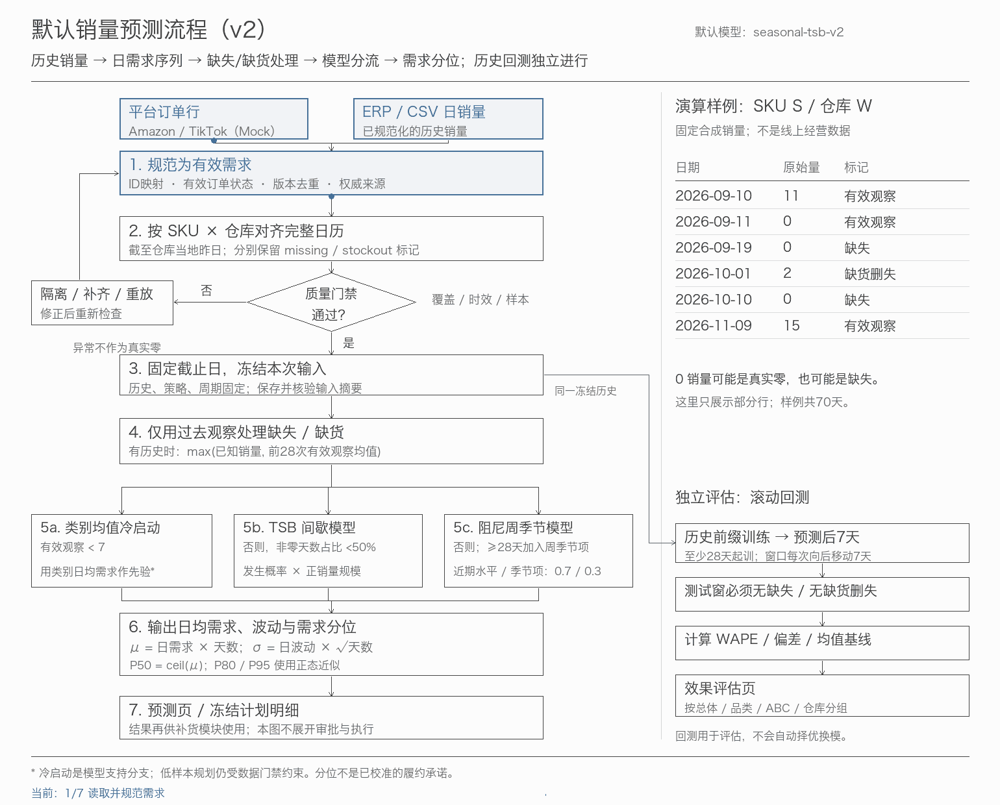
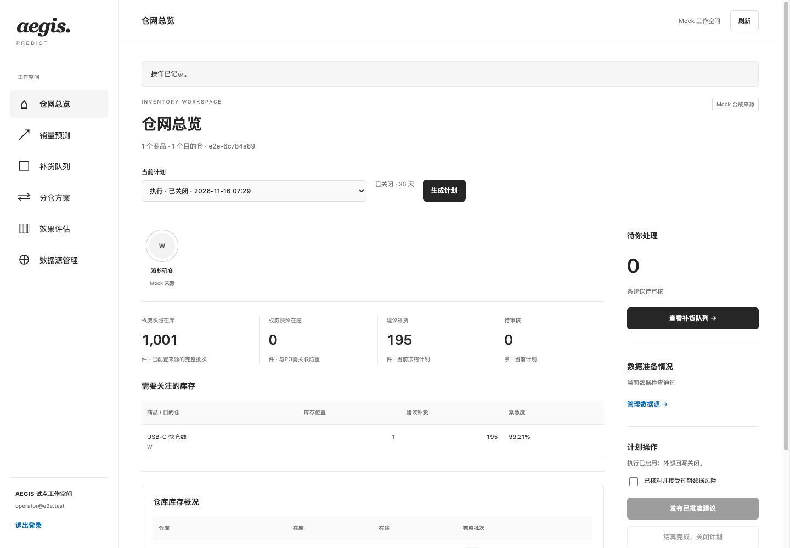
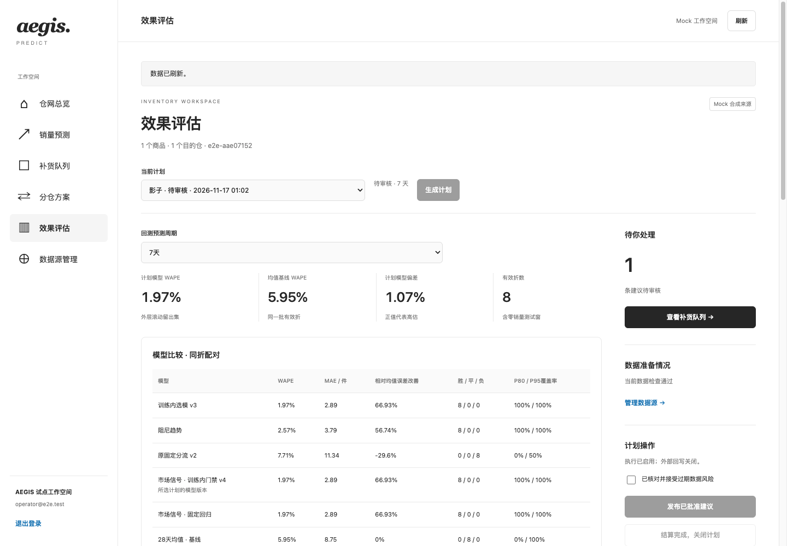
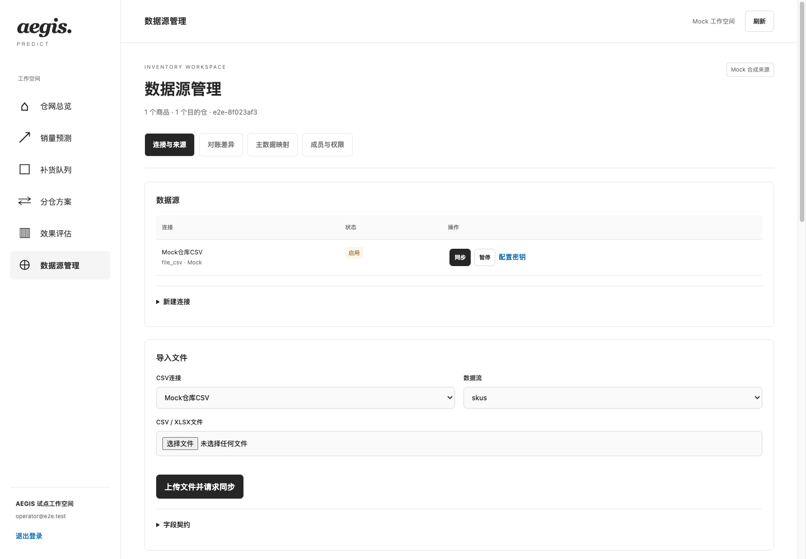
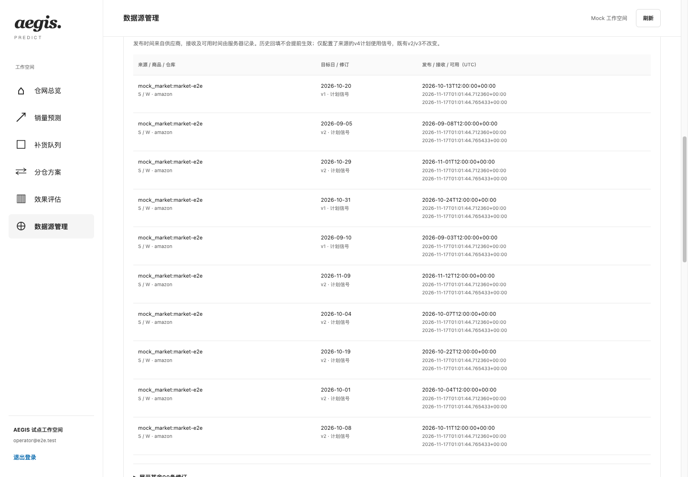
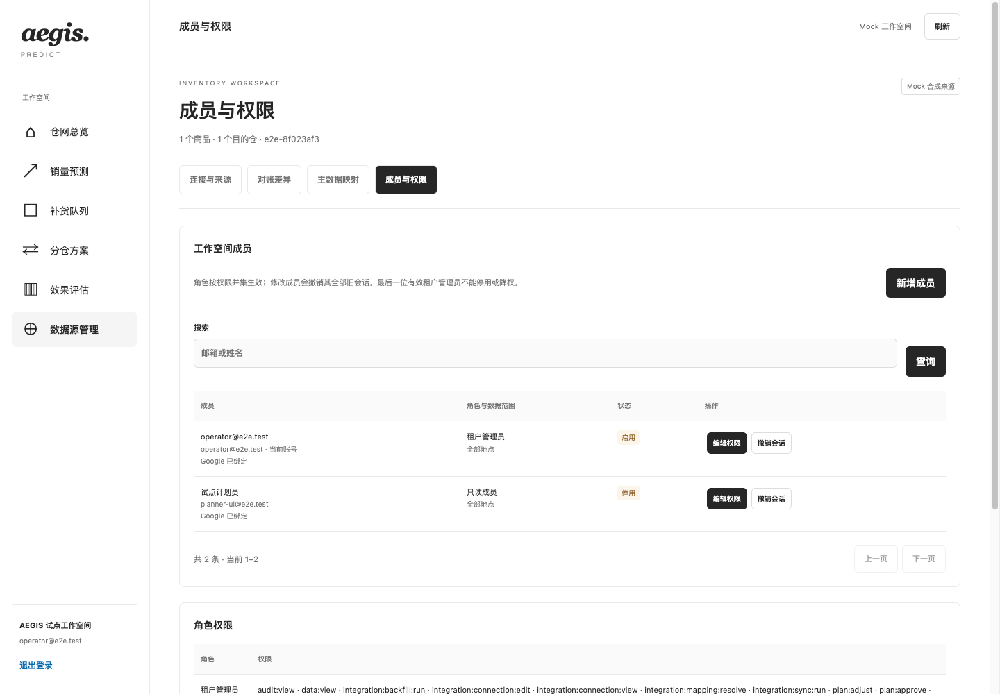
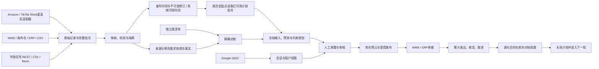

# AEGIS-PREDICT

**面向跨境电商的销量预测、海外仓补货与库存协同系统。**

AEGIS-PREDICT 按 **商品 × 仓库 × 渠道** 组织需求与库存，支持销量预测、缺货识别、补货计算、共享库存池分配、建议审核和执行对账。重点是让计划员看清“哪里缺、补多少、从哪里补，以及执行后库存是否真正更新”。



[查看预测流程静态图](docs/assets/aegis-workflow.svg) · [样例数据、计算规则与生成方法](docs/assets/README.md) · [v3候选模型与基线评估](docs/19-forecast-model-evaluation.md) · [市场信号与修订回测](docs/20-market-signal-integration.md)

主入口为 **多租户生产工作台**（`aegis serve` 的 `/`），五个业务页面及数据源、对账差异、主数据映射、成员权限管理共用 Google 登录、租户会话、生产 API 与后台 Worker。默认保留 Amazon/TikTok Mock；执行与外部回写开关默认关闭。

独立的 `overseas_inventory` 仿真工具继续用于场景演示与算法比较。生产工作台不调用 `/student/*`，不使用仿真工具的密码或审批记录。真实 Google 登录仍需部署配置；平台 Mock 通过不代表真实商家授权或逐市场验收完成。

## 已实现的整体能力

| 领域 | 当前实现 |
| --- | --- |
| 业务工作台 | 仓网总览、冻结销量预测、补货审批、分仓执行、滚动回测与管理区（数据源、差异处置、映射、成员权限）；统一 Cookie 会话、CSRF、权限控制和状态门禁 |
| 用户与租户 | PostgreSQL 行级安全、复合租户外键、角色权限、地点范围限制、会话撤销、审计记录；Google 授权码流程、PKCE、浏览器绑定、一次性 state、nonce 与 ID Token 签名/受众/发行者/时效验证 |
| 平台与系统接入 | Amazon SP-API、TikTok Shop 读取适配器；官方结构的 Mock 响应通过同一解析器；通用 REST、CSV/XLSX 导入及市场信号 Mock；市场目录包含23个 Amazon 站点与20个 TikTok Shop 市场配置 |
| 原始数据与质量 | 原始记录去重、完整批次、分页失败不推进最终游标、隔离与重放、主数据映射、数量与状态校验；未支付和取消订单不计入有效需求 |
| 管理与处置 | 对账差异安全字段预览、负责人/状态/说明、复核闭环；映射检索、有效主数据选择及Worker重放；成员新增、Google绑定、角色/范围修改、停用及会话撤销，保护最后管理员 |
| 来源与对账 | 按租户、仓、领域和渠道批准权威来源；避免平台与 ERP 聚合销量重复累计；独立源清单按记录键、版本、内容精确比对，记录缺失、多出和内容差异，不以总条数相等代替对账 |
| 需求预测 | 生产默认保留v2；v3训练内选模与均值回退；v4按发布/接收/可用时间接入计划信号，提供13模型配对比较、修订冻结复算及覆盖不足回退 |
| 补货与分配 | 补货点、目标库存、库存缺口、紧急度、装箱约束；共享库存池分配、运输方式、仓容和资金等约束下的优化；人工调整、审核及冻结输入复算 |
| 库存与在途 | 权威完整快照、库存与 PO 在途关联防重、发布事务中并发预占；已发运库存继续扣减，直到源快照明确反映并通过对账 |
| 执行闭环 | 累计发运/收货/取消、版本幂等、数量守恒、跨租户防护；通用 WMS/ERP 只读执行回拉；单据创建确认与实物完成分开记录；双端库存结算后关闭计划并开始下一轮 |
| 工程交付 | 数据库迁移、隔离数据库回归、容器构建/运行检查脚本、非 root 运行、只读根文件系统、运行依赖 wheel 摘要及源码 manifest |

### 当前执行边界

- 平台默认是 **Mock**，Google 用户认证使用真实 OIDC 实现，凭据与 HTTPS 回调域名留作部署配置。
- `AEGIS_PLAN_EXECUTION_ENABLED=false`、`AEGIS_WRITEBACK_ENABLED=false` 是默认值。显式开启后，发布还需通过来源、完整性、对账与库存校验；Mock 和真实来源不能混合执行。
- 外部创建请求结果不明时，系统持续查单；“暂未查到”不会自动触发重复创建。
- 单租户保留一个活动计划。已实现顺序执行闭环；并行滚动计划、跨版本替代及释放策略仍需继续开发。
- 独立对账清单与执行快照关联依赖源系统提供可信导出/回读契约。人工上传证据也会留痕，不等同于供应商签名或实地盘点证明。

## 界面与阅读路径

采用白底、细分隔线、固定导航和克制的状态色。首页按“仓库概况 → 核心指标 → 风险清单 → 原因与证据 → 补货操作”组织；手机端使用底部导航与纵向审批条目。以下截图均为现有业务页面，使用合成数据，不包含登录页面。

### 1. 仓网总览

四项核心指标、仓库快捷入口、风险前五项和右侧待办，帮助计划员先定位需要处理的库存。



### 2. 销量预测

选择计划明细和7/14/30天周期，从冻结输入计算需求分位，显示历史需求、缺失与缺货删失说明及模型证据。


### 3. 补货队列

展示商品、目的仓、建议量、分配量及最终数量，支持调整、批准和驳回，所有说明写入审计。手机端将审批表转换为纵向条目。


### 4. 分仓方案

查看分配数量、运输方式、预占及实际累计发运/收货/取消；独立源对账通过后结算两端库存，完成后关闭计划。


### 5. 效果评估

使用所选计划的冻结输入，按7/14/30天周期比较模型的WAPE、MAE、相对均值改善与分位覆盖率；v4额外展示13模型和市场信号接入前后配对结果，并展示分组结果和规划目标成本。尚无真实经营对照时不展示虚构的利润或履约率提升。



[手机总览](design-previews/2026-11-16-production-workspace/390-overview.png) · [手机预测](design-previews/2026-11-16-production-workspace/390-forecast.png) · [手机审批](design-previews/2026-11-16-production-workspace/390-replenishment.png) · [设计说明与浏览器检查](design-previews/2026-11-16-production-workspace/DESIGN.md)

### 6. 数据源管理

创建 Amazon/TikTok Mock、市场信号Mock、CSV/XLSX 或通用 REST 连接；平台Mock显式授权，上传并同步文件，批准来源、检查批次、独立清单对账及隔离记录重放。



市场信号单独显示修订历史，发布时间与系统接收/可用时间分开记录。



### 7. 管理区

通过数据源页面上方页签进入新增管理功能。手机端继续保留六项主导航，管理页使用独立页签；列表支持查询和分页。

**对账差异**：查看缺失、多出、内容或版本变化，记录处理依据，关联独立复核后关闭。关闭处置不会修改对账证据或绕过执行门禁。


**主数据映射**：按来源和外部标识定位未映射记录，检索有效商品/仓库代码，确认后交由Worker重放。


**成员与权限**：新增成员、绑定Google身份、分配角色和地点范围，停用或撤销会话。角色变更撤销旧会话，最后可用管理员受并发保护。



[手机差异列表](design-previews/2026-11-16-governance/390-reconciliation.png) · [手机映射](design-previews/2026-11-16-governance/390-mappings.png) · [手机成员](design-previews/2026-11-16-governance/390-users.png)

## 架构与数据流



生产工作台经同源 API 读取当前租户数据，来源规则、批次、对账、冻结计划、预占、执行与审计持久化在 PostgreSQL。仿真工具继续维护独立场景模型。

## 本地运行

### 环境

Python 3.12 为当前验证环境；项目要求 Python ≥3.11。多租户服务需要 PostgreSQL 16；容器验证需要 Docker。版本约束位于 `requirements/constraints.txt`。

```bash
python -m venv .venv
source .venv/bin/activate
pip install --constraint requirements/constraints.txt -e '.[dev]'
```

可选机器学习依赖仅用于相关演示功能：

```bash
pip install -e '.[ml]'
```

### 运行可视化仿真

```bash
globalpool-web --host 127.0.0.1 --port 8000
```

访问 `http://127.0.0.1:8000`。演示默认密码为 `globalpool`，可通过 `GLOBALPOOL_ADMIN_PASSWORD` 覆盖。合成网络位于 `data/sample_network.json`。该入口在 `AEGIS_ENV=prod` 时被禁用。

也可生成离线报告：

```bash
globalpool-demo --data data/sample_network.json --output output --horizon-days 30
```

### 部署多租户服务

```bash
cp .env.example .env
# 填入数据库密码、Fernet密钥及按需配置的Google客户端信息
docker compose up -d --build
```

默认 API 只绑定本机 `127.0.0.1:8000`。公开部署需配置 HTTPS 反向代理、实际域名和 `AEGIS_ALLOWED_HOSTS`。Google 配置暂空时，服务入口会显示待配置状态。

| 配置 | 用途 |
| --- | --- |
| `POSTGRES_PASSWORD` / `AEGIS_APP_ROLE_PASSWORD` | 迁移 owner 与非 owner 应用角色；使用 URL-safe 密码 |
| `AEGIS_SECRET_KEYS` | Fernet 加密密钥；首个用于写入，后续用于轮换读取 |
| `AEGIS_AUTH_MODE=google` | 默认 Google 登录；`hybrid`/`password` 仅在显式选择后启用密码入口 |
| `AEGIS_GOOGLE_CLIENT_ID` / `AEGIS_GOOGLE_CLIENT_SECRET` | Google Web 应用凭据 |
| `AEGIS_GOOGLE_REDIRECT_URI` | 精确配置为 `https://你的域名/api/v1/auth/google/callback` |
| `AEGIS_GOOGLE_ALLOWED_DOMAINS=[]` | 可选 Google Workspace `hd` 限制，服务端验证 |
| `AEGIS_INTEGRATION_MODE=mock` | 默认平台仿真；真实数据切换为 `live` 并重新批准来源 |
| `AEGIS_REQUIRE_RECONCILIATION=true` | 执行发布需要最新权威批次对账通过 |
| `AEGIS_PLAN_EXECUTION_ENABLED=false` | 控制执行计划与发布 |
| `AEGIS_WRITEBACK_ENABLED=false` | 独立控制外部单据创建 |

首次创建租户和绑定 Google 身份通过运维 CLI 完成。系统按 **Google `sub`** 绑定已有成员，不按相同邮箱自动合并账户。

```bash
# 在具有owner和应用数据库配置的环境执行；密码交互输入或通过部署密钥注入
aegis db create-role
aegis db upgrade
aegis db grant
aegis tenant-create --slug acme --name Acme --email admin@example.com

aegis identity-bind --tenant TENANT_UUID --email admin@example.com --google-sub VERIFIED_GOOGLE_SUB
```

已部署 Compose 时，可通过 `docker compose run --rm --no-deps scheduler aegis ...` 执行上述租户与身份管理命令。Google `sub` 必须由可信身份核验取得；自助邀请与入驻流程仍在路线图中。

## 平台 Mock 与真实接入

| 系统 | 默认可验证内容 | 转为真实接入需要 |
| --- | --- | --- |
| Amazon | `mock_amazon`：官方结构订单、分页、未支付/取消排除、FBA库存解析、账户与站点隔离、独立清单对账 | 已审核 SP-API 应用、商家授权、对应站点权限、真实录制样例及回填/对账 |
| TikTok Shop | `mock_tiktok`：授权店铺结构、订单状态、数量与渠道投影、独立清单对账 | 已审核应用、目标市场权限、商家授权、刷新/吊销与真实状态联调 |
| 自有WMS / 海外仓 / ERP | 通用 REST、字段映射、CSV/XLSX、在途关联、标准累计执行回读契约 | 实际端点、签名、幂等键、库存口径、单据对应关系与配额协议 |
| Google | 真实 OIDC 实现与本地签名令牌测试；配置未预置 | Google Cloud Web客户端、HTTPS回调、成员subject绑定与实际登录验收 |

Mock 连接通过 `/api/v1/connections/{id}/mock-authorize` 显式授权，传输层使用内存 MockTransport，未知路径直接失败。源清单接口 `/api/v1/data/batches/{id}/mock-source-manifest` 从独立夹具重新生成期望数据，不从已落地记录复制“期望结果”。

真实 REST 执行回读需返回单据/行级累计量。接口、结算顺序及证据字段见[生产闭环与接入手册](docs/16-production-closure-and-auth.md)。

## 验证

```bash
# 仅使用可丢弃测试库；库名必须以_test结尾
AEGIS_TEST_ADMIN_DSN='postgresql+psycopg://OWNER@HOST:5432/aegis_test' pytest -q

python -m compileall -q src
aegis backtest --max-wape 0.35 --max-bias 0.2 --output /tmp/backtest.json

docker build --platform linux/arm64 -t aegis-predict:verify .
python scripts/verify_container.py --image aegis-predict:verify \
  --platform linux/arm64 --output /tmp/container-verification.json
```

未设置 PostgreSQL 测试 DSN 时，相关测试会跳过；不能将跳过的结果视为租户隔离或执行闭环通过。容器检查脚本创建独立数据库、网络和非 root/只读 API，结束后清理测试资源。依赖 wheel 摘要可在镜像内 `/app/artifacts/runtime-wheel-sha256.txt` 查看。

v0.10.0 全仓库回归为 **159项通过、0失败、0跳过**。新增市场信号不可变修订、发布时间/系统可得时间过滤、REST/CSV/Mock全管道、v4冻结复算及市场Mock与真实执行隔离。已验证训练前缀与内层选模的未来值扰动边界、v2数值兼容、新旧冻结版本复算及评估周期切换。需求与库存事实的完整历史可得时间尚未重建；这些测试不能替代真实point-in-time数据验收。

仓库合成样例的全部滚动窗口：7天v3 WAPE **5.511%**，28天均值 **6.791%**；14天为 **6.378% / 7.269%**；30天为 **8.008% / 7.935%**，相对均值轻微退化，因此v3不默认替换生产v2。分位仍未校准，不能当作履约保证。完整11模型、最近窗口/全窗口、固定压力场景、推广方式及Linux运行证据见[模型比较与泄漏审查](docs/19-forecast-model-evaluation.md)。

外部市场数据已通过 `market_signals` 的REST/CSV/XLSX及 `mock_market` 接入追加式修订表。v4在每个内外层起点先筛选已发布、已接收且已可用的计划信号，再选择修订；事后实际指标不填入未来。固定合成矩阵全窗口7/14/30天相对v3误差改善约29.5%/22.4%/11.0%，噪声组仍有退化；无可信信号的仓库样例精确回退。真实数据商与商家效果尚未验收，v4需按策略显式启用。详见[市场接入、对比结果与限制](docs/20-market-signal-integration.md)。

[当前模型比较页](design-previews/2026-11-16-forecast-comparison/1440-evaluation.png) · [v0.8管理页面记录](docs/18-governance-workspace.md) · [v0.7执行闭环记录](docs/17-production-workspace-integration.md)

## 未来需要接入与补齐的能力

| 优先级 | 工作包 | 交付目标 |
| --- | --- | --- |
| P0 | 真实账户与系统联调 | Google真实登录验收；Amazon/TikTok真实商家授权生命周期；WMS/ERP签名、字段与配额契约；逐市场脱敏样例 |
| P0 | 长周期对账与运营验收 | 连续源端对账、异常差异处置、真实计划员UAT、恢复演练、容量与长稳测试 |
| P1 | 更完整的业务事实 | 退款/退货独立事实、订单行集合删除/替换、来源版本冲突与双时间模型、发运与收货明细 |
| P1 | 滚动供应计划 | 并行计划、版本替代、跨计划资源重排、时间分桶供应、更多提前期与采购经济约束 |
| P1 | SaaS运营 | 自助邀请/入驻、计费与配额、租户公平调度、企业SSO、细粒度数据范围与可观测性 |
| P2 | 制造与复杂供应链 | BOM/MRP、供应商产能、批次/序列号/效期、多级库存网络与财务对账 |
| P2 | 模型与业务效果 | 活动/价格/流量真实信号、模型校准、可复核因素贡献、公平仿真及真实收益评估 |

## 代码与文档

```text
src/aegis/                       多租户服务、API与Worker
  api/                           五个业务页面、四类管理视图与API
  auth/                          Google OIDC与身份绑定
  integration/                   连接器、批次、规范化、源对账、回写
  inventory/                     预占、累计执行、回读与结算
  planning/                      来源组装、预测、约束规划与生命周期
  models/                        租户、业务事实与证据模型
  migrations/                    数据库迁移
src/overseas_inventory/           独立仿真、演示算法与业务页面
scripts/verify_container.py      Linux容器运行验收
tests/production/               数据库、API、安全与故障回归
design-previews/                当前业务截图与设计说明
```

- [企业级能力评估与落地方案](docs/13-enterprise-readiness-and-delivery-plan.md)
- [首轮P0数据与库存契约](docs/14-p0-implementation-and-pilot-contract.md)
- [生产闭环、Google认证与接入手册](docs/16-production-closure-and-auth.md)
- [市场信号接入、发布时间、修订历史与回测](docs/20-market-signal-integration.md)
- [销量预测、均值基线比较与泄漏审查](docs/19-forecast-model-evaluation.md)
- [差异处置、映射、成员权限与验证](docs/18-governance-workspace.md)
- [生产工作台、接口与端到端验证](docs/17-production-workspace-integration.md)
- [前端注意力与布局说明](design-previews/2026-11-16-production-workspace/DESIGN.md)

官方契约参考：[Google OpenID Connect](https://developers.google.com/identity/openid-connect/openid-connect)、[Amazon SP-API授权流程](https://developer-docs.amazon/sp-api/docs/website-authorization-workflow)、[TikTok Shop开发者文档](https://partner.tiktokshop.com/docv2)。这些链接用于实现与联调依据，具体权限和市场能力仍以实际应用审核结果为准。
