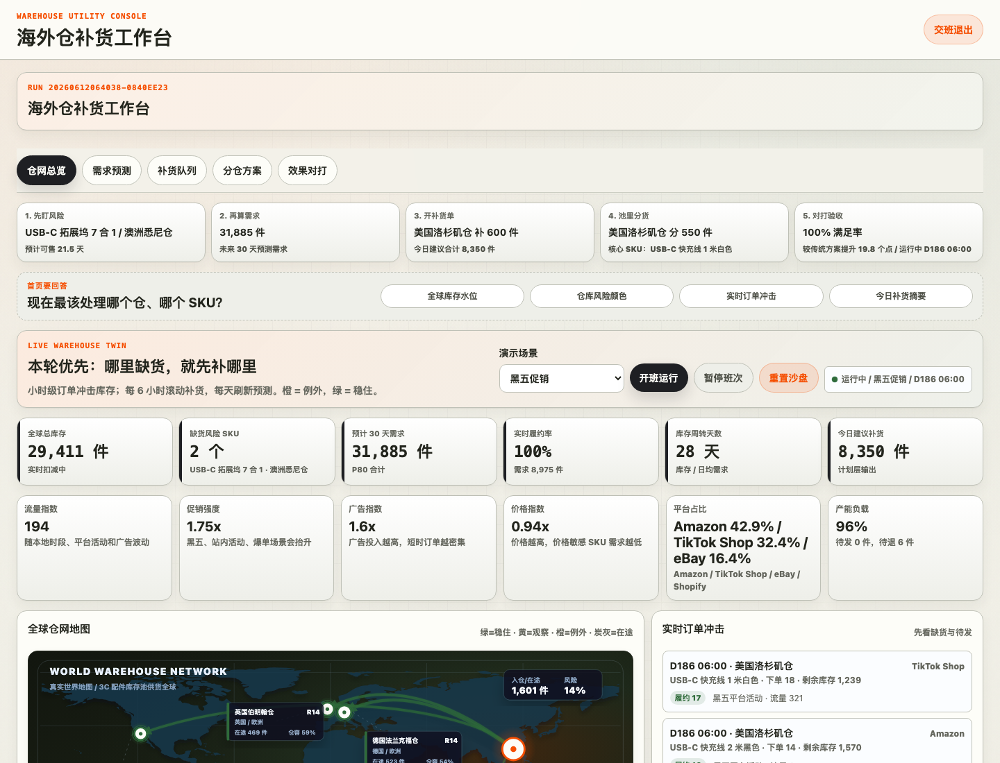
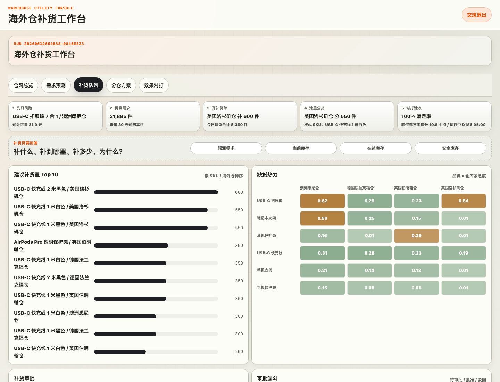
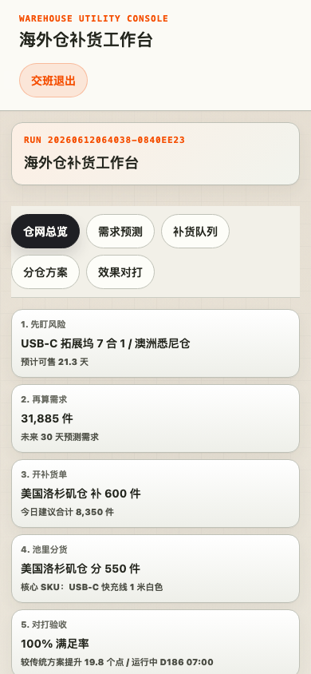

# AEGIS-PREDICT

**基于 AI 需求预测的跨境电商海外仓智能补货与分仓系统。**

> 库存池供货全球，让每一件库存都去最需要它的海外仓。

[](https://www.python.org/)
[](https://fastapi.tiangolo.com/)
[](https://docs.scipy.org/doc/scipy/reference/generated/scipy.optimize.milp.html)
[](#测试)

---

跨境电商海外仓补货，最怕的不是「完全没货」，而是货放错了地方：美国仓快断货，德国仓同款还压着一堆；黑五一来，人工 Excel 根本跟不上。

AEGIS-PREDICT 把海外仓库存从「各仓自有」升级为「全球共享库存池」，按 **SKU × 海外仓** 维度预测需求、计算补货点与目标缺口，再从统一库存池动态分仓到全球仓网，并用 90 天策略对打 + 小时级实时沙盘把决策跑给你看。

当前版本是可本地运行的比赛 / 课程原型。页面上的订单流是数字孪生仿真，不是真实店铺回传。



## 目录

- [它解决什么](#它解决什么)
- [核心能力](#核心能力)
- [界面预览](#界面预览)
- [快速开始](#快速开始)
- [Docker](#docker)
- [命令行 Demo](#命令行-demo)
- [系统怎么转](#系统怎么转)
- [输入数据](#输入数据)
- [配置项](#配置项)
- [项目结构](#项目结构)
- [测试](#测试)
- [文档索引](#文档索引)
- [路线图](#路线图)
- [当前边界](#当前边界)
- [许可证](#许可证)

## 它解决什么

| 常见情况 | 系统怎么接 |
| --- | --- |
| 总库存够，但某个仓先爆单 | 按 SKU × 仓预测需求，先抓高风险缺口 |
| 补货靠经验，解释不清 | 输出补货点、目标库存、紧急度、原因 |
| 货该海运还是空运说不清 | 分仓时带运输方式与仓容 / 资金约束 |
| 方案写出来没人信 | 传统单仓备货 vs 智能库存池 90 天对比 |
| 答辩只能看静态表 | 实时沙盘：订单、缺货、待发、在途、退货 |

## 核心能力

- **需求预测** — 把 180 天销量切成滚动监督样本，提取滞后销量、滚动均值、波动率、趋势、星期周期，以及广告、促销、季节、平台活动、价格指数等市场信号特征，训练树模型集成输出 P50 / P80 / P95 分位需求、波动率与置信度。
- **智能补货** — 综合现货、在途、已分配计算库存位置，按服务等级配置安全库存，输出补货点、目标库存、按箱规取整的建议量、紧急度与是否需审批。
- **全球库存池分仓** — 汇总各仓缺口，优先保障高缺货风险、高服务等级、高毛利、尾程更强的仓；用 `scipy.optimize.milp` 整数规划在库存池可分配量、运输方式运力、仓容、入仓能力与采购预算约束下求解，求解失败自动退回启发式分配。
- **策略对打** — 90 天滚动仿真：同一条需求路径下，比较「传统各仓独立备货」与「智能库存池」的 Fill Rate、缺货率、配送时效、平均库存与总利润。
- **实时经营沙盘** — 1 tick = 1 模拟小时（页面约 1.8 秒推进一步），模拟订单进入 / 取消、缺货、待发积压、退货回库、在途到仓；每 6 小时刷新补货决策，每天刷新预测摘要；内置 5 个场景压力测试。
- **可解释决策** — 每条建议都带触发原因、优先级评分、约束提示与审批状态，支持审批回写与执行记录。

## 界面预览

登录后是 5 个工作页：**仓网总览 · 需求预测 · 补货队列 · 分仓方案 · 效果对打**。



手机宽度也能把班次控制和关键数字看清：



## 快速开始

环境要求：Python 3.10+，macOS / Linux / Windows 均可。

```bash
git clone https://github.com/kaori-seasons/Aegis-Predict.git
cd Aegis-Predict

python -m venv .venv
source .venv/bin/activate        # Windows: .venv\Scripts\activate

pip install -e .
# 推荐：装上机器学习包，预测更稳（LightGBM / XGBoost / scikit-learn）
pip install -e ".[ml]"
```

启动网页服务：

```bash
globalpool-web --host 127.0.0.1 --port 8000
# 或者不安装控制台入口：
PYTHONPATH=src python -m overseas_inventory.competition_web --host 127.0.0.1 --port 8000
```

浏览器打开 <http://127.0.0.1:8000>，默认密码：

```text
globalpool
```

登录后点「开班运行」。场景可切：常规滚动 / 黑五促销 / 美国仓爆单 / 欧洲调拨 / 澳洲物流延迟。

自定义密码：

```bash
GLOBALPOOL_ADMIN_PASSWORD=your-password globalpool-web --host 127.0.0.1 --port 8000
```

> 没装 ML 依赖也能跑：预测模块会自动退回内置纯 Python 随机森林兜底，功能完整、结果可复现。

## Docker

```bash
docker compose up --build
```

同样访问 <http://127.0.0.1:8000>，默认密码 `globalpool`。Compose 会把本地 `runs/` 挂载到容器 `/app/runs`，保留运行记录、审批与执行回写。

或手动构建运行：

```bash
docker build -t globalpool-ai .
docker run --rm -p 8000:8000 \
  -e GLOBALPOOL_ADMIN_PASSWORD=your-password \
  -v "$PWD/runs:/app/runs" \
  globalpool-ai
```

Docker 镜像默认安装 `.[ml]` 依赖。

## 命令行 Demo

不想开网页时，直接出一份补货计划：

```bash
globalpool-demo
# 或：PYTHONPATH=src python -m overseas_inventory.demo
```

可选参数：`--data`（输入网络，默认 `data/sample_network.json`）、`--output`（输出目录，默认 `output/`）、`--horizon-days`（预测周期，默认 30）。

输出：

| 文件 | 内容 |
| --- | --- |
| `output/replenishment_plan.json` | 结构化补货 / 分仓 / 仿真结果，便于二次处理 |
| `output/replenishment_plan.md` | 人类可读的决策报告 |
| `output/dashboard.html` | 静态驾驶舱，浏览器直接打开 |

## 系统怎么转

```text
历史销量 + 市场信号
        ↓
   需求预测（7 / 14 / 30 天，P50/P80/P95）
        ↓
 补货点 / 安全库存 / 建议量 / 紧急度
        ↓
 全球库存池分仓（SciPy MILP，失败则启发式）
        ↓
 90 天策略对打 + 小时级实时沙盘
```

内置样例：

- 15 个 3C 配件 SKU（线材 / 支架 / 保护壳 / 拓展坞 / 笔记本支架）
- 4 个海外仓：`US-LAX` / `DE-FRA` / `UK-BHX` / `AU-SYD`，从深圳全球库存池补货
- 180 天需求历史 + 市场信号，海运 / 空运双通道
- 仓容、入仓处理能力、采购预算与最小起订量约束

样例数据：[`data/sample_network.json`](data/sample_network.json)

### 预测

优先 LightGBM / XGBoost / RandomForest；缺失的模型自动跳过并记录在 `feature_notes`，全部不可用时退回内置随机森林。输出 `daily_rate`、`horizon_units`、`p50/p80/p95_units`、`volatility`、`confidence`。

### 补货

```text
库存位置 = 现货 + 在途 - 已分配
安全库存 = 服务等级系数 × 需求波动率 × √提前期
补货点   = 预测日均 × 提前期 + 安全库存
目标库存 = P80 周期需求 + 安全库存
建议量   = max(0, 目标库存 - 库存位置)，按箱规向上取整
紧急度   = 缺货压力 × 0.82 + (1 - 置信度) × 0.18
```

高金额或高紧急度建议自动进入审批队列。

### 分仓

把多仓当成一个池子。优先级 = 紧急度 0.48 + 需求规模 0.22 + 尾程能力 0.16 + 利润贡献 0.14（premium 服务等级加权），并卡住池存量、仓容、单日入仓能力与采购资金预算。缺口不做隐式吞掉，明确进入下一轮采购 / 跨仓调拨队列。

### 实时沙盘

1 tick = 1 模拟小时，页面约每 1.8 秒推进一步。会模拟：

- 订单进入、取消、缺货、待发
- 仓库处理能力打满后的积压
- 退货回库、价格弹性与平台流量结构（Amazon / TikTok Shop / eBay / Shopify）
- 在途补货倒计时到仓
- 每 6 小时刷新补货决策，每天刷新预测摘要

## 输入数据

样例数据可直接复用；换成自己的数据时，参考 `data/sample_network.json` 的结构。

**最小必需字段**：`service_level_z`、`skus`、`warehouses`、`lanes`、`global_supply_pool`、`inventory`、`demand_history`

**增强字段**（启用市场信号、多式联运与约束优化）：`market_signals`、`transport_options`、`warehouse_constraints`、`procurement_constraints`

UCI Online Retail 原表体积较大，不直接进 git。如需复现数据转换流程，见 [data/public_sources/README.md](data/public_sources/README.md) 与 [data/ready_uploads/SOURCES.md](data/ready_uploads/SOURCES.md)。

## 配置项

| 环境变量 | 默认值 | 说明 |
| --- | --- | --- |
| `GLOBALPOOL_ADMIN_PASSWORD` | `globalpool` | 控制台登录密码 |
| `GLOBALPOOL_SECRET_KEY` | `globalpool-development-secret` | 会话签名密钥（生产部署务必修改） |
| `GLOBALPOOL_RUNS_DIR` | `runs/` | 运行结果、审批与执行记录目录 |
| `GLOBALPOOL_ML_MAX_ROWS` | `900` | 单模型最大训练样本行数 |

每次运行会在 `runs/{job_id}/` 落盘：`input_network.json`、`metadata.json`、`replenishment_plan.json`、`replenishment_plan.md`、`dashboard.html`、`operations_state.json`。

## 项目结构

```text
.
├── src/overseas_inventory/     # 核心代码（包名 overseas_inventory，产品名 GlobalPool AI）
│   ├── models.py               # 数据契约：SKU / 仓网 / 库存池 / 约束
│   ├── forecasting.py          # 需求预测（ML 集成 + 纯 Python 兜底）
│   ├── replenishment.py        # 补货点 / 目标库存 / 紧急度
│   ├── allocation.py           # 全球库存池分仓
│   ├── optimizer.py            # SciPy MILP 整数规划
│   ├── simulation.py           # 90 天策略对打
│   ├── webapp.py               # 实时仿真引擎与运行状态
│   ├── competition_web.py      # FastAPI 入口
│   ├── demo.py / dashboard.py  # 命令行计划与静态驾驶舱
│   └── web_frontend/           # 网页前端（原生 HTML / CSS / JS）
├── data/                       # 样例数据与公开数据说明
├── docs/                       # 设计文档与截图
├── competition/                # 路演稿 / 项目书 / PPT
├── scripts/                    # 样例构建与文档导出脚本
├── tests/                      # 单元测试
├── Dockerfile
└── docker-compose.yml
```

## 测试

```bash
python -m unittest discover -s tests
# 或
pytest
```

覆盖预测、补货取整与约束、库存池分仓、仿真对比与 Web API 关键路径。

## 文档索引

| 文档 | 内容 |
| --- | --- |
| [docs/01-project-charter.md](docs/01-project-charter.md) | 立项与边界 |
| [docs/02-requirements.md](docs/02-requirements.md) | 功能 / 非功能需求 |
| [docs/03-system-design.md](docs/03-system-design.md) | 系统设计 |
| [docs/04-algorithm-spec.md](docs/04-algorithm-spec.md) | 算法说明 |
| [docs/05-roadmap.md](docs/05-roadmap.md) | 实施路线 |
| [docs/06-simulation-evaluation.md](docs/06-simulation-evaluation.md) | 仿真评估 |
| [docs/07-dashboard-spec.md](docs/07-dashboard-spec.md) | 驾驶舱规格 |
| [docs/09-deployment.md](docs/09-deployment.md) | 部署 |
| [docs/images/](docs/images/) | 界面截图 |
| [competition/00-one-page-proposal.md](competition/00-one-page-proposal.md) | 一页方案 |
| [competition/03-demo-guide.md](competition/03-demo-guide.md) | 现场演示流程 |
| [competition/04-slide-outline.md](competition/04-slide-outline.md) | PPT 大纲 |

## 路线图

1. **已完成** — 方案、原型、算法闭环、比赛网页端与实时沙盘
2. **接入真实业务数据** — 替换 `data/sample_network.json`，接入订单、库存、在途、促销日历与物流成本
3. **模型增强** — 促销 / 节假日特征、预测误差监控、分品类模型、更完整的仓容与资金约束
4. **协同与驾驶舱** — 计划员调整回写、审批流、采购 / 调拨 / 发运计划下发

详见 [docs/05-roadmap.md](docs/05-roadmap.md)。

## 当前边界

说清楚，避免误用：

1. 实时订单是仿真数据，不是 Amazon / TikTok / Shopify 真连接。
2. 场景聚焦 3C 配件，不是全品类 ERP / WMS / OMS。
3. 适合课程、比赛、方案验证；上生产还要接真实订单、库存、物流、广告和财务。
4. 未做多租户权限和数据库持久化；run 结果默认落本地 `runs/`。

## 许可证

原型代码按仓库现状使用，暂未选择正式开源协议。如需正式开源许可证，将在后续 release 中补充。

---

如果只记一句：

> 普通系统是库存台账；这个系统更像海外仓补货参谋。
