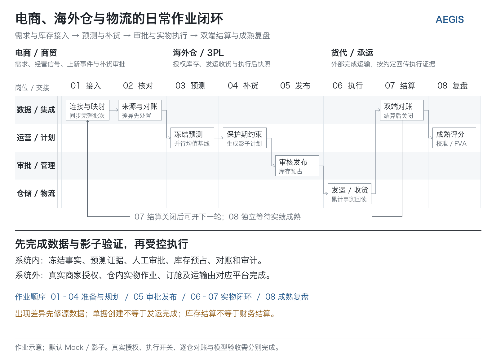
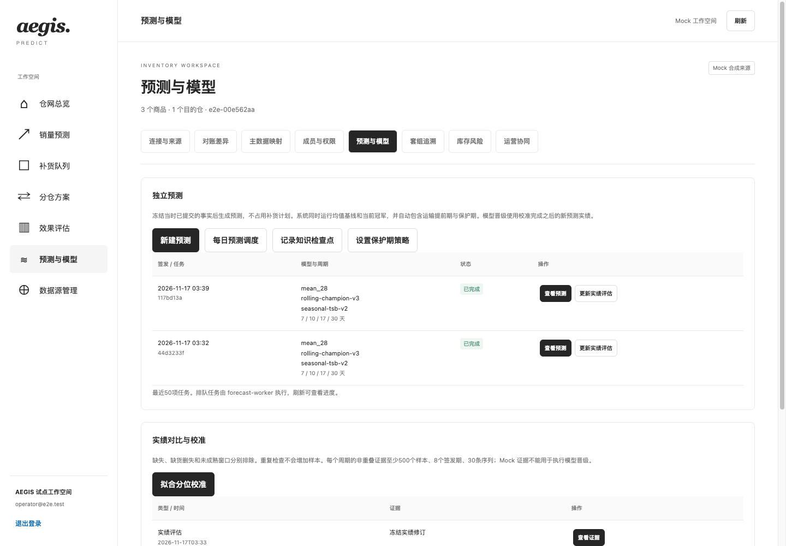
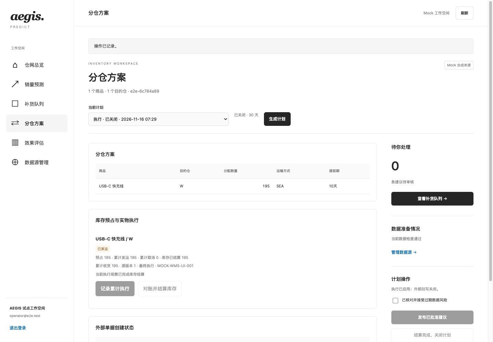
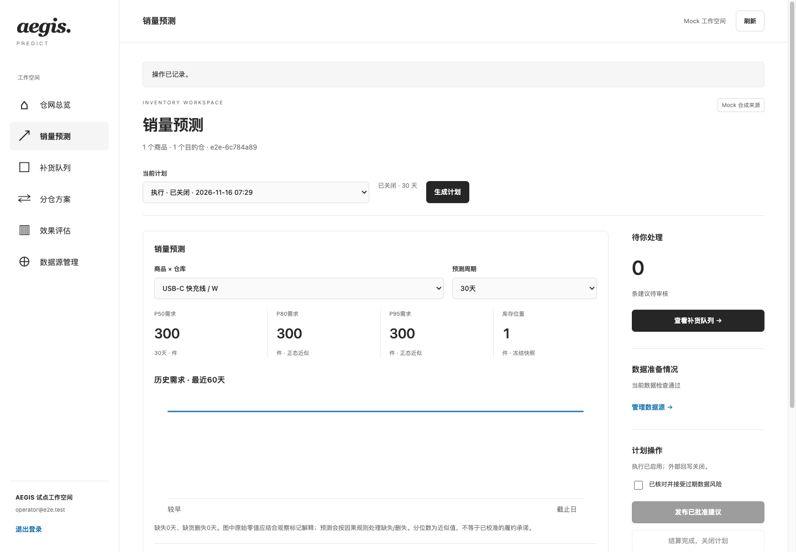
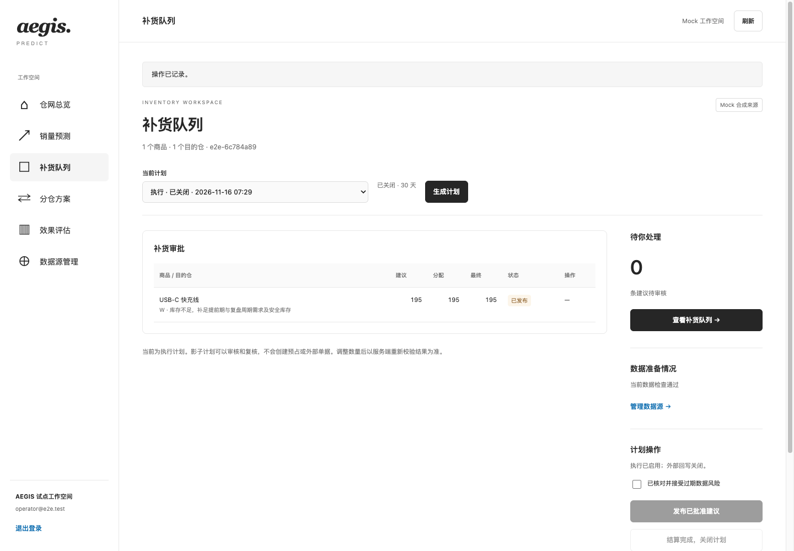
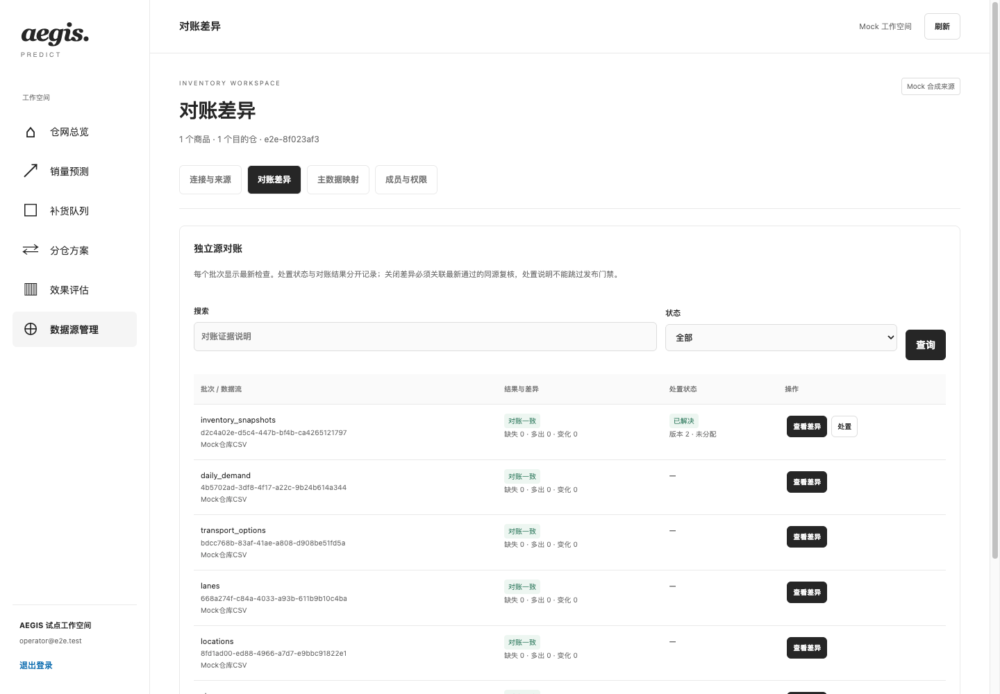
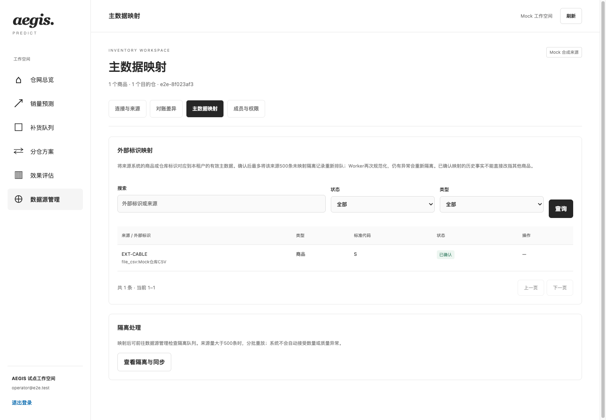

# AEGIS-PREDICT



**跨境电商的销量预测、智能补货与仓储物流协同工作台。** 按「商品 × 仓库 × 渠道」核对需求与库存，把 **接入 → 对账 → 预测 → 补货 → 审批 → 发运收货 → 库存结算 → 成熟复盘** 连成可追溯的作业链。图中八步逐段展示负责人、页面、交接物、放行条件和异常去向；动图为作业示意，实际接入与执行条件见下文。

[静态全图 SVG](docs/assets/industry-sop.svg) · [静态全图 PNG](docs/assets/industry-sop.png) · [八步分镜](docs/assets/industry-sop-contact.png) · [行业 SOP 操作手册](docs/24-industry-sop-and-readme-guide.md) · [图源与复生成](docs/assets/README.md)

当前主入口是 `aegis serve` 的 `/` 多租户工作台。默认 Google 登录，凭据及 HTTPS 回调需部署配置；Amazon/TikTok 保留 **Mock**，执行与外部回写默认关闭。工程闭环与隔离环境验证已完成，真实商家授权、逐市场/仓库对账、经营效果及生产容量仍需租户试点验收。

## 按岗位开始阅读

| 你要完成什么 | 建议阅读顺序 | 完成后应拿到什么 |
| --- | --- | --- |
| 电商运营 / 补货计划 | [适用行业](#industries) → [八步 SOP](#sop) → [页面交接](#workspace) → [预测与模型](#models) | 可解释的预测、冻结计划及待审核建议 |
| 仓储 / 3PL / 物流协同 | [适用行业](#industries) → [SOP 05–07](#sop) → [执行与结算手册](docs/16-production-closure-and-auth.md#4-预占执行与结算) | 单据引用、累计执行、双端快照与结算证据 |
| 数据 / 系统集成 | [试运行与部署](#deployment) → [数据接入](#integration) → [行业手册](docs/24-industry-sop-and-readme-guide.md) | 明确的租户、映射、字段、来源和独立对账契约 |
| 审批 / 项目负责人 | [SOP](#sop) → [验证记录](#verification) → [当前边界与路线图](#roadmap) | 可审核的放行条件、验收证据和未完成项 |

<a id="industries"></a>
## 适用行业与系统分工

| 行业 / 业务场景 | 如何使用本系统 | 外部系统继续承担什么 |
| --- | --- | --- |
| Amazon / TikTok 跨境电商、品牌多店 | 按账户/市场接入订单和库存；核对有效需求；使用经营滞后与上新事件辅助候选预测；按海外仓生成补货并审批 | 店铺经营、平台履约与真实应用授权；真实经营分析/广告报表的专项联调 |
| 商贸分销 / 多仓零售 | 通过 ERP/WMS REST 或 CSV/XLSX 接入销量、库存和采购；批准权威来源；按区域仓预测、分配和复核 | ERP采购结算、销售/退货完整账务；没有平台数据时不需要虚构平台来源 |
| 自有仓 / 第三方海外仓 / 3PL | 在客户授权的租户中提供权威库存和执行凭据；回读发运/收货；提供执行后快照，配合双端对账结算 | 库位、波次、拣选、复核、打包等 WMS 作业。仓储客户数据不跨租户合并训练或分配 |
| 货代 / 干线与尾程承运协同 | 提供已约定的运输方式、提前期及到货信息；通过客户 WMS/ERP 或人工证据交接累计执行；延误进入风险处置 | 订舱、运价采购、路线调度、车辆和包裹轨迹等 TMS/承运作业；本项目未实现专用承运商连接器 |

本系统是需求与补货决策、库存执行证据的协同层。**库存结算不等于财务结算；外部单据创建成功不等于实物已经发运。** 制造排程、多级 MRP、运输调度和财务总账属于后续接入或扩展范围。

<a id="sop"></a>
## 八步端到端 SOP

先建立租户与成员、导入主数据和来源契约，再按下表试运行。建议由计划员提交、审批员复核；模型晋级、BOM 发布和运营假设另有异人审批要求。岗位名称是业务分工，系统授权以实际角色权限为准。

<!-- BEGIN INDUSTRY_SOP -->
| 步骤 / 触发 | 负责人 / 页面 | 操作与交接 | 放行与异常处理 |
| --- | --- | --- | --- |
| **01 接入数据并确认主数据映射**<br>首次接入 / 每个同步批次 | 集成管理员<br>「数据源管理、主数据映射」 | 创建连接；导入或同步；确认 SKU/仓库映射，重放隔离记录。<br>**交接：**连接、映射、原始记录与完整批次；保留来源和源版本。 | **放行：**批次完整、标识可解析；当地日、单位、渠道和库存口径明确。<br>**异常：**未知商品、缺字段或分页失败 → 修正来源并重放，不推进执行。 |
| **02 批准权威来源并完成独立对账**<br>每个权威批次 / 每次来源变更 | 数据负责人 / 集成管理员<br>「数据源管理、对账差异」 | 批准来源；逐记录比较独立清单；认领、处理并复核差异。<br>**交接：**matched 对账证据、权威来源规则与带依据的差异处置。 | **放行：**需求不重复累计；库存/PO 在途不重算；差异不能仅凭关闭工单放行。<br>**异常：**缺失、多出或版本冲突 → 返回01修正并同步，再用新清单复核。 |
| **03 签发独立预测并检查证据**<br>每日 / 数据就绪后 | 计划员；模型晋级由另一审批成员确认<br>「预测与模型、经营信号与新品」 | 冻结输入与时点；运行均值及候选；检查缺失、滞后、冷启动和回退原因。<br>**交接：**预测 ID、每日轨迹、周期分位、输入/代码摘要和模型证据。 | **放行：**只用签发时已知数据；候选需成熟实绩、校准及独立前向晋级验证。<br>**异常：**历史不足或新品供体不足 → 回退并保留原因；不自动放行真实执行。 |
| **04 核对保护期并生成补货方案**<br>每次补货决策 | 计划员 / 运营人员<br>「预测与模型、运营协同、补货队列」 | 选保护期策略；运营假设先审批成场景；生成影子计划并核对方案。<br>**交接：**冻结计划、逐仓建议、运输选择、到货前缺口与约束诊断。 | **放行：**按每条运输路线的 L / L+R 计算；共享库存、装箱、仓容等不被绕过。<br>**异常：**无解、ETA 未知或数据过期 → 处理风险与来源，重新生成并复核。 |
| **05 逐行审核并受控发布执行计划**<br>执行条件验收后 / 每次发布 | 计划员建执行计划；审批员审核发布<br>「补货队列、分仓方案」 | 先结束影子计划，再建执行计划；逐行审核后发布并原子预占库存。<br>**交接：**已发布计划、预占记录；按配置创建单据或人工协同交接。 | **放行：**影子计划不转成实物执行；来源/对账、库存及模型门禁重新校验。<br>**异常：**预占冲突或门禁未过 → 停留待处理；创建结果不明只查单，不重复创建。 |
| **06 外部发运收货并回传累计事实**<br>每次实物变动 | 自有仓 / 海外仓 / 3PL；货代或承运人协同<br>「分仓方案、库存风险；外部 WMS / ERP / 承运系统」 | 外部系统完成作业；回读或登记累计发运、收货、取消与最终状态。<br>**交接：**有版本的执行观察与异常处置；可追溯到原单据和计划。 | **放行：**创建成功不等于实物完成；累计量守恒，版本和数量不得倒退。<br>**异常：**运输延误、回读失败或数量冲突 → 保留库存扣减，调查并补真实证据。 |
| **07 双端库存结算并关闭计划**<br>执行后新快照 / 最终执行完成后 | 库存负责人 / 集成管理员 / 审批员<br>「数据源管理、分仓方案」 | 对账源/目的仓新快照；确认单据累计量已反映，再结算并关闭。<br>**交接：**双端库存结算证据、关闭计划；具备条件后可开始下一轮。 | **放行：**旧快照不能解除扣减；最终执行和必要双端结算通过后才能关闭。<br>**异常：**一端未到数或凭据不匹配 → 保持未结算并补齐，不手工删除预占。 |
| **08 等待实绩成熟并复核模型与运营效果**<br>预测目标窗口成熟后；不阻塞下一轮计划 | 计划员 / 经营负责人；另一成员批准模型晋级<br>「预测与模型、效果评估、运营协同」 | 同窗口比较均值与候选；分开校准和前向验证，复核运营 FVA。<br>**交接：**成熟评估、偏差与覆盖记录；满足门槛才进入晋级审批。 | **放行：**未成熟/缺失/删失窗口不报收益；存量成绩不能证明新品冷启动有效。<br>**异常：**样本不足或相对基线退化 → 保持候选/回退；不自动换模或承诺收益。 |
<!-- END INDUSTRY_SOP -->

**两条独立闭环：**07 完成最终执行与库存结算后关闭活动计划，可重新从01开始；08在预测窗口成熟后独立评分，不阻塞下一轮补货。当前单租户只允许一个活动计划；影子计划复核完成后，应结束它，再另建执行计划，不能把影子结果直接当作实物发布。

异常的处理顺序是「修正源事实 / 配置 → 同步或重放 → 新对账 / 新预测 / 新计划 → 再审批」。关闭差异工单、人工认可旧快照或反复点击评分，都不能替代服务端证据门禁。逐行业操作、最小交接字段和首次试点验收清单见[行业 SOP 手册](docs/24-industry-sop-and-readme-guide.md)。

<a id="workspace"></a>
## 页面与业务交接

主工作台的五个业务页面与管理页共用租户 Cookie 会话、CSRF、生产 API、数据库和后台 Worker。以下均为已实现页面的合成数据截图，不包含登录页；历史截图不代表所有 v0.12 控件均出现在同一画面中。

| 作业阶段 | 页面 | 重点核对 |
| --- | --- | --- |
| 01–02 | 数据源管理、主数据映射、对账差异、成员与权限 | 批次、来源、口径、映射、独立对账和权限 |
| 03 | 预测与模型、经营信号与新品、销量预测 | 签发时点、基线、模型选择、缺失/删失、冷启动和回退 |
| 04–05 | 运营协同、补货队列、分仓方案 | 冻结预测/场景、保护期、运输、约束、数量调整和审核 |
| 06–07 | 分仓方案、库存风险、数据源管理 | 预占、单据、累计执行、独立快照、双端结算和关闭 |
| 08 | 预测与模型、效果评估、运营协同 | 成熟标签、均值配对、校准、模型晋级和运营 FVA |

**先定位仓与商品，再查看预测与建议。**


**独立预测有自己的任务与证据，不依赖先建补货计划。**



**审核建议后，在分仓方案跟进预占、实物执行与结算。**



<details>
<summary>展开其他业务与管理页面截图</summary>











[套组版本与追溯](design-previews/2026-11-17-decision-operations/1440-bundles.png) · [库存风险处置](design-previews/2026-11-17-decision-operations/1440-risks.png) · [运营协同](design-previews/2026-11-17-decision-operations/1440-collaboration.png) · [手机总览](design-previews/2026-11-16-production-workspace/390-overview.png) · [手机审批](design-previews/2026-11-16-production-workspace/390-replenishment.png) · [布局说明](design-previews/2026-11-16-production-workspace/DESIGN.md)

</details>

<a id="deployment"></a>
## 试运行与部署

### 1. 准备运行环境与配置

当前验证环境为 Python 3.12；项目要求 Python ≥3.11，生产数据库使用 PostgreSQL 16。使用 Compose 可同时启动 API、同步/预测/规划 Worker 与 scheduler。依赖约束在 `requirements/constraints.txt`。

```bash
python -m venv .venv
source .venv/bin/activate
pip install --constraint requirements/constraints.txt -e '.[dev]'

cp .env.example .env
# 配置数据库密码、Fernet密钥、Google客户端、实际回调与允许的主机
# 保留 Mock，并保持执行和外部回写关闭，先完成影子验收
docker compose up -d --build
```

Compose 的 API 只绑定 `127.0.0.1:8000`。本机可检查 `/health/live`、`/health/ready`；生产登录入口应经配置好的 **HTTPS 反向代理**。未配置 Google 客户端时，登录页显示待配置，平台 Mock 不会自动提供 Google 账户认证。

| 配置 | 必须明确的含义 |
| --- | --- |
| `POSTGRES_PASSWORD` / `AEGIS_APP_ROLE_PASSWORD` | 使用不同的 URL-safe 密码；API 使用非 owner 应用角色，迁移/管理使用 owner |
| `AEGIS_SECRET_KEYS` | Fernet 加密密钥，首个用于新写入；由环境或密钥管理注入 |
| `AEGIS_AUTH_MODE=google` | 默认真实 OIDC；Google `sub` 绑定已有租户成员，不按相同邮箱自动合并 |
| `AEGIS_GOOGLE_CLIENT_ID` / `AEGIS_GOOGLE_CLIENT_SECRET` | Google Web应用凭据，不能放入仓库 |
| `AEGIS_GOOGLE_REDIRECT_URI` | 精确的 `https://实际域名/api/v1/auth/google/callback` |
| `AEGIS_ALLOWED_HOSTS` / `AEGIS_GOOGLE_ALLOWED_DOMAINS` | 实际主机白名单 / 可选 Workspace域限制 |
| `AEGIS_INTEGRATION_MODE=mock` | 默认 Amazon/TikTok 合成数据；真实接入切为 `live` 后需重新核实来源 |
| `AEGIS_REQUIRE_RECONCILIATION=true` | 执行前要求权威批次独立对账通过 |
| `AEGIS_PLAN_EXECUTION_ENABLED=false` | 执行计划与发布默认关闭 |
| `AEGIS_WRITEBACK_ENABLED=false` | 外部创建单据独立关闭；开启执行不等于开启回写 |

### 2. 创建租户、绑定身份、安排岗位

Compose 的 `migrate` 服务已执行创建应用角色、升级和授权；首次租户及身份绑定仍需运维完成。Google `sub` 必须通过可信身份核验取得，不从邮箱猜测。

```bash
docker compose run --rm --no-deps scheduler aegis tenant-create \
  --slug acme --name Acme --email admin@example.com

docker compose run --rm --no-deps scheduler aegis identity-bind \
  --tenant TENANT_UUID --email admin@example.com --google-sub VERIFIED_GOOGLE_SUB
```

默认无开放注册或自助入驻。管理员在「成员与权限」中建立试点岗位：`INTEGRATION_ADMIN` 管连接和源事实，`PLANNER` 建预测/计划，`APPROVER` 审批发布，`VIEWER` 只读。人工提交执行与库存结算需要发布权限，仓库负责提供凭据并由获授权成员登记。当前业务接口要求全地点范围，不能把受限地点账号当成已实现的细粒度仓库工作台。

### 3. 按 SOP 做影子验收，再评估执行

1. 进入 `/`；按01–02导入主数据、需求、完整库存、PO/在途及运输配置，批准来源并独立对账。
2. 按03–04发行预测、检查均值基线与回退原因，生成影子补货计划，核对数量与约束。
3. 对新保护期算法，先积累成熟实绩、校准及独立前向验证，再由另一成员批准匹配的模型发布；新品候选的真实执行仍单独阻止。
4. 真实账户/仓库联调、持续对账、业务 UAT、恢复及容量验收完成后，才评估执行开关；需要自动创建外部单据时另行验收回写。
5. 结束影子活动计划后另建执行计划，重做审核与发布；按06–07记录实物执行、双端结算和关闭。

不使用 Compose 时，需配置 owner/app 数据库连接并运行 `aegis db create-role`、`aegis db upgrade`、`aegis db grant`，随后分别运行 API 和四类 Worker。升级现有库须先备份并演练迁移；当前迁移为 `0008_commerce_signals`，不要用 downgrade 删除已有审计和执行事实。

无需真实 Google/商家凭据的浏览器验收，可按[隔离测试脚本说明](docs/17-production-workspace-integration.md#真实浏览器流程)运行 `scripts/workspace_e2e_server.py --scenario operations`；仅限本机、显式可丢弃的 `*_test` 数据库。该 Google 测试供应商与测试路由不进入生产 `aegis serve`。

独立仿真入口 `globalpool-web` / `globalpool-demo` 仍用于算法演示，与生产工作台的身份、租户和审批分开；不应拿仿真审批代替上述 SOP。

<a id="integration"></a>
## 数据接入与可追溯交接

| 数据 | 当前通道 | 交接时必须核对 |
| --- | --- | --- |
| Amazon / TikTok | 真实读取适配器及同解析器 Mock；市场目录包含23个 Amazon站点、20个 TikTok市场配置 | 目录存在不等于该市场已真实授权验收；账户、市场、订单状态与库存口径 |
| 自有 WMS / 海外仓 / ERP | CSV/XLSX、可配置 REST、独立清单和标准累计执行回读 | SKU/仓映射、完整批次、字段/签名/配额、PO在途关联、幂等键和单据引用 |
| 实际经营与新品 | `commerce_performance`、`sku_launches` 导入/REST、`mock_commerce`、事件登记 | 同渠道/当地完整日、币种/指标契约、三时间、覆盖状态与上新实体分组 |
| 计划市场信号 | `market_signals` REST/文件/Mock | 计划信号与实际指标分开，发布时间、接收时间和可用时间分开 |
| 免费公开上下文 | Frankfurter参考汇率、Wikimedia话题热度、GOV.UK英国假日及 `mock_public_market` | 固定接口、首次接收、修订、署名和显式SKU/仓映射；不把历史下载倒填为过去已知 |

对账清单必须从源系统独立导出，按记录键、版本、内容和批次范围核对；条数相同不等于一致。执行后的清单还需包含 `execution_refs`，说明单据累计量已反映于源/目的仓快照。接口和字段例子见[执行与结算契约](docs/16-production-closure-and-auth.md)、[经营/公开数据契约](docs/23-commerce-coldstart-and-public-signals.md)。

<a id="models"></a>
## 预测、补货与治理能力

| 能力 | 当前实现与使用条件 |
| --- | --- |
| 默认预测 v2 | 保留既有 `seasonal-tsb-v2`；历史计划按原代码/冻结输入复算，不静默替换 |
| v3 / v4 / v5 候选 | v3训练内选模；v4使用已知计划信号；v5使用经营/公开滞后及新品同龄群组先验。均与 mean28 配对，数据不足或门禁未过时保留回退原因 |
| 真实时点与评估 | 数据库事实历史、已提交可见性检查点、独立预测队列/每日调度、成熟标签和修订；校准与校准后的前向测试分开，模型晋级异人批准 |
| 补货与分配 | 冻结每日轨迹，按运输路线 L / L+R 及可证实到货日计算；约束共享库存、装箱、供应商、仓容、运输和资金；发布时原子预占 |
| 套组与运营协同 | 单层版本化 BOM、销售件/基础件口径、双向追溯；运营假设与采购意向分开审批，冻结场景，成熟后比较 FVA |
| 风险与执行 | 风险认领、调查、限时静默、证据关闭；累计发运/收货/取消、回读/人工证据、双端库存结算；创建结果不明持续查单 |
| SaaS与审计 | PostgreSQL RLS、复合租户外键、角色权限、会话撤销、CSRF、不可变证据；不默认跨租户训练或共享库存 |

候选模型不因回测最好就自动晋级。v0.12受控合成矩阵中，有效滞后信号的7天 MAE 相对均值改善32.82%，28天回退结果退化12.10%；这些是研究样例，不代表真实店铺收益。未经校准的分位不作为履约承诺；存量成绩不证明新品冷启动有效。

<details>
<summary>查看模型内部预测流程与数值样例</summary>


该图解释默认 v2 内部预测与回测，不覆盖本页新增的跨岗位 SOP，也不代表 v3/v4/v5 的全部分支。[静态图](docs/assets/aegis-workflow.svg) · [生产函数计算的固定样例与说明](docs/assets/README.md) · [v3基线比较](docs/19-forecast-model-evaluation.md) · [v4市场信号](docs/20-market-signal-integration.md) · [v5滞后与新品](docs/23-commerce-coldstart-and-public-signals.md)

</details>

<a id="verification"></a>
## 验证记录与复现

以下工程记录对应 **2026-11-20 / v0.12** 的[代码交付 c2c609a](https://github.com/kaori-seasons/Aegis-Predict/commit/c2c609af0c910e3d97cdb90a1bab196a69922adb)。本次 README/SOP 整改只作图文校验；应用全量验收沿用该交付的归档记录。测试和浏览器作业使用隔离合成环境；真实公开 API 冒烟为只读请求。动图展示作业步骤，真实商家验收需另留租户级证据。

| 验证 | 结果 / 证据 |
| --- | --- |
| 本次SOP图文 | 八步同源步骤表、55秒GIF、静态图/分镜、文字边界和本地链接校验：[记录](docs/verification/industry-sop-docs.json) |
| PostgreSQL 16全量测试 | **198 passed**，1条既有依赖弃用提示；迁移往返、元数据漂移、RLS、修订、三时钟及执行门禁：[记录](docs/verification/commerce-tests.json) |
| 浏览器端到端 | Google Mock登录 → 连接/同步 → 契约保存/回显 → 上新/映射 → v5独立预测与冻结证据；60个未成熟窗口排除：[本期记录](docs/verification/commerce-browser.json) |
| 实物执行与结算 | 已验证合成执行计划的审核发布、累计发运收货、独立清单、双端库存结算及关闭：[完整步骤与边界](docs/17-production-workspace-integration.md#真实浏览器流程) |
| 免费公开接口 | Frankfurter / Wikimedia / GOV.UK 真实只读解析通过：[冒烟记录](docs/verification/commerce-public-api-smoke.json) |
| 无泄漏与基线对比 | 各时钟迟到、未来值扰动、上新实体排除、消融和双轨配对：[完整矩阵](docs/artifacts/commerce-benchmark.json) / [解释](docs/23-commerce-coldstart-and-public-signals.md#7-无泄漏验证与配对结果) |
| Linux镜像 | ARM64与AMD64构建/运行通过：迁移、非root、只读根、API健康、wheel摘要及实际拟合；隔离数据库为PostgreSQL17：[ARM64](docs/verification/commerce-linux-arm64.json) / [AMD64](docs/verification/commerce-linux-amd64.json) |

```bash
# 必须使用可丢弃、以_test结尾的独立测试库
AEGIS_TEST_ADMIN_DSN='postgresql+psycopg://OWNER@HOST:5432/aegis_test' pytest -q

aegis backtest --max-wape 0.35 --max-bias 0.2 --output /tmp/backtest.json
python scripts/benchmark_commerce.py --output /tmp/commerce-benchmark.json

docker build --platform linux/arm64 -t aegis-predict:verify .
python scripts/verify_container.py --image aegis-predict:verify \
  --platform linux/arm64 --output /tmp/container-verification.json
```

AMD64 在本机以仿真方式验证，不代表吞吐指标。wheel摘要记录本次构建字节，尚不等于跨时间可重复的依赖供应链锁定。部署前仍需真实账户、持续对账、恢复、容量和计划员 UAT。

<a id="roadmap"></a>
## 当前边界与后续接入

| 优先级 | 待接入 / 待验证能力 | 完成条件 |
| --- | --- | --- |
| P0 | Google真实登录、Amazon/TikTok真实商家授权与逐市场生命周期 | 审核权限、HTTPS回调、实际登录、刷新/撤销与脱敏源样例 |
| P0 | 自有WMS、第三方仓、ERP真实契约与长周期对账 | 实际签名/配额/字段/库存口径、独立导出、实物UAT、恢复与容量验证 |
| P1 | 平台经营分析/广告报表、经营FVA、新品前向验收 | 分渠道时间契约、长期时点历史、独立新品样本与成熟效果；当前新品执行仍阻止 |
| P1 | 退款/退货、源集合删除/替换、细分执行事实 | 独立事实与明确版本/幂等/结算规则，不以倒退累计数表示退货 |
| P1 | 并行滚动计划与SaaS运营 | 跨计划资源替代/释放、租户公平调度、自助邀请/入驻、计费配额和更细数据范围 |
| P2 | 复杂制造与物流 | 多级BOM/MRP、产能、批次效期、多级库存、专用TMS/承运商/轨迹与财务对账；不在当前已实现范围内 |

<a id="docs"></a>
## 代码与文档索引

```text
src/aegis/                多租户API、认证、连接器、库存、预测规划和Worker
src/overseas_inventory/   独立仿真与算法演示
scripts/                 回测、受控验收及图形生成工具
tests/production/        数据库、API、安全、执行与故障回归
docs/assets/             SOP/预测动图、静态图、数据源与生成元数据
docs/verification/       已归档的工程验证证据
design-previews/         现有页面的合成数据截图
```

| 阅读目标 | 文档 |
| --- | --- |
| 按行业和岗位实际操作 | [电商、海外仓与物流 SOP 手册](docs/24-industry-sop-and-readme-guide.md) |
| 当前经营数据/新品/公开接口 | [v0.12交付与配置](docs/23-commerce-coldstart-and-public-signals.md) |
| 独立预测、保护期、校准与治理 | [P0/P1操作与试点指南](docs/22-point-in-time-forecastops-and-decision-workspace.md) |
| 授权、预占、累计执行与结算 | [生产闭环与接入手册](docs/16-production-closure-and-auth.md) |
| 对账、映射、成员和工作台 | [管理工作台](docs/18-governance-workspace.md) / [业务页面与端到端](docs/17-production-workspace-integration.md) |
| 模型原理与比较 | [v3](docs/19-forecast-model-evaluation.md) / [v4](docs/20-market-signal-integration.md) / [v5](docs/23-commerce-coldstart-and-public-signals.md) |
| 评估与后续开发依据 | [参考项目评估与落地方案](docs/21-reference-project-assessment-and-delivery-plan.md) / [企业级能力评估](docs/13-enterprise-readiness-and-delivery-plan.md) |
