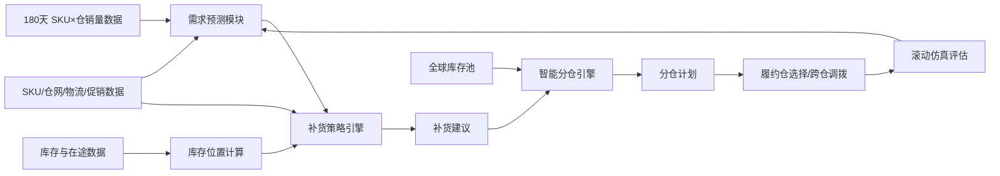
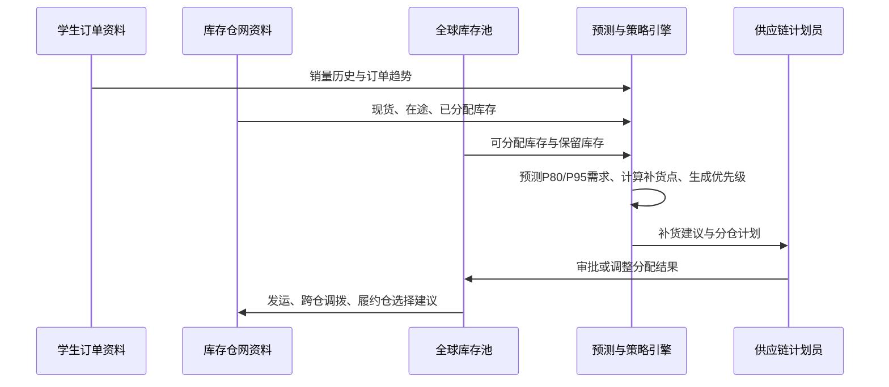

# 系统设计

## 总体思路

系统以“库存池供货全球”为核心，但不把项目做成完整 OMS/WMS/ERP 后台。比赛版聚焦 3C 配件跨境卖家：15 个具体 SKU、深圳中心仓、美国/德国/英国/澳洲四个海外仓、180 天模拟销量。海外仓不再只根据本仓库存独立补货，而是向逻辑库存池提出需求，系统根据预测分布、库存成本、服务水平和履约时效统一排序、统一分配、统一评估。

## 业务流程

1. 数据采集：比赛版上传 3C 配件 SKU、180 天销量、库存、在途、仓库、运输链路和促销信号。
2. 需求预测：按 SKU-海外仓维度生成未来周期需求。
3. 库存评估：计算各仓库存位置，并判断是否低于补货点。
4. 补货建议：生成目标库存和建议补货量。
5. 库存池分配：从全球库存池按优先级分配库存。
6. 履约决策：订单发生后，系统优先本地仓发货；本地缺货时判断是否跨仓履约。
7. 仿真评估：与传统各国仓独立备货 baseline 比较缺货率、Fill Rate、时效、库存和利润。

## 核心模块

| 模块 | 输入 | 输出 | 当前原型 |
| --- | --- | --- | --- |
| 数据层 | 15 个 3C 配件 SKU、4 个海外仓、运输、库存、180 天销量 | 统一网络数据 | `models.py` |
| 预测层 | 需求历史 | 日均预测、P50/P80/P95、波动率、置信度 | `forecasting.py` |
| 补货层 | 预测、提前期、服务等级、库存位置 | 补货点、目标库存、建议补货量 | `replenishment.py` |
| 分配层 | 补货建议、库存池、仓网能力 | 库存池分配计划 | `allocation.py` |
| 仿真层 | 真实需求情景、传统方案、智能方案 | Fill Rate、缺货率、时效、库存、利润对比 | `simulation.py` |
| 展示层 | 补货、分仓、仿真结果 | Markdown、JSON、HTML 驾驶舱 | `demo.py` / `dashboard.py` |

## 数据中心最小表设计

| 数据表 | 关键字段 | 用途 |
| --- | --- | --- |
| SKU 表 | SKU、品类、体积、重量、采购价、毛利率、生命周期 | 判断补货优先级 |
| 订单销量表 | 日期、国家、平台、SKU、销量、销售额 | 训练预测模型 |
| 库存快照表 | 仓库、SKU、现有库存、可用库存、锁定库存 | 判断缺货风险 |
| 在途库存表 | SKU、起运地、目的仓、预计到达日、运输方式 | 计算库存位置 |
| 仓库表 | 仓库国家、仓容、处理能力、租金、服务范围 | 分仓约束 |
| 物流成本表 | 起点、终点、运输方式、单件成本、时效 | 优化目标 |
| 促销日历表 | 黑五、圣诞、Prime Day、本地节假日、平台活动 | 提升预测质量 |
| 汇率/关税/异常表 | 汇率、税率、港口延迟、清关风险 | 风险情景模拟 |

## 数据流

## “库存池供货全球”的设计要点

- 统一供给：库存先进入全球池，再按全球需求分配，避免单区域提前锁死库存。
- 动态优先级：库存不足时优先保障高缺货风险、高服务等级、高利润贡献的仓点。
- 滚动计划：每天或每周重新预测，分配结果随销售、在途和到仓变化更新。
- 保留机制：库存池设置保留量，防止全部库存被单轮计划消耗。
- 缺口透明：当库存池无法满足需求时，系统明确输出未满足缺口，触发采购或跨仓调拨。

## 部署形态建议

| 层级 | 建议实现 |
| --- | --- |
| 数据接入 | 只接入决策需要的数据表，避免比赛原型变成后台大杂烩 |
| 特征与预测 | Python 服务或批处理任务，按日生成预测 |
| 策略服务 | 独立补货与分仓服务，向网页端输出计划结果 |
| 演示前端 | 比赛网页端 5 页，展示库存池、预测、补货、分仓和仿真 |
| 数据存储 | PostgreSQL 存主数据和计划结果，对象存储保存批量输入输出 |
| 监控 | 预测误差、缺货率、Fill Rate、库存周转、计划采纳率 |

## 权限与审批

- 系统自动生成建议，但不默认自动下发大额补货。
- 高金额、高缺货风险或低置信度建议需要人工审批。
- 审批记录应保存调整前后数量和调整原因。
- 后续版本可按 SKU 价值、仓库等级和用户角色配置审批阈值。
