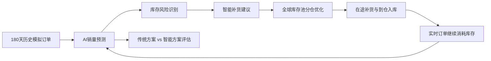

# 可视化页面信息架构

项目入口不是普通后台管理页，而是比赛演示用的供应链驾驶舱。打开系统后，主线必须在 30 秒内讲清楚：

1. 哪里快缺货。
2. 为什么会缺货。
3. 系统建议怎么补。
4. 全球库存池怎么分仓。
5. 智能方案比传统方案好多少。

## 页面总览

| 页面 | 演示目的 | 核心问题 | 主要可视化 |
| --- | --- | --- | --- |
| 首页：全球库存池看板 | 展示整体运营态势 | 哪里缺货、哪个仓风险最高 | 指标卡、世界仓网地图、风险 SKU 排行、实时订单流、补货摘要 |
| 预测页：AI 销量预测 | 展示模型结果和可解释性 | 未来 7/14/30 天会卖多少，为什么上涨 | 历史销量 + 预测曲线、P50/P80/P95、影响因素解释 |
| 补货页：智能补货建议 | 展示可执行决策 | 补什么、补多少、补到哪里、为什么 | 补货表、计算公式、缺货热力、优先级 |
| 分仓页：库存分配方案 | 体现库存池供货全球 | 一批货如何分配到多个海外仓 | 深圳到海外仓流向图、智能分配矩阵、传统 vs 智能对比 |
| 仿真评估页：方案对比 | 证明系统有效 | 智能方案是否真的降低缺货和成本 | 指标对比、仿真运行状态、在途补货、事件时间线 |

## 首页布局

```text
┌────────────────────────────────────────────┐
│ 跨境电商全球库存池智能补货与分仓系统          │
├────────┬────────┬────────┬────────┬────────┤
│ 总库存  │ 风险SKU │ 30天需求 │ 满足率  │ 今日补货 │
├───────────────────────┬────────────────────┤
│                       │ 实时订单流           │
│      全球仓库地图       │ 美国用户下单...      │
│                       │ 德国仓库存预警...    │
├───────────────────────┴────────────────────┤
│ 高风险SKU列表                                │
├────────────────────────────────────────────┤
│ 今日补货建议摘要                             │
└────────────────────────────────────────────┘
```

## 演示闭环



## 页面切换顺序

比赛演示建议按这个顺序讲：

1. 首页：先展示全球库存池状态和风险 SKU。
2. 预测页：解释 AI 为什么预测某 SKU 会涨。
3. 补货页：展示补货公式，不让系统像黑箱。
4. 分仓页：展示库存池如何从深圳分到海外仓。
5. 仿真评估页：用缺货率、满足率、成本、时效证明改善。

