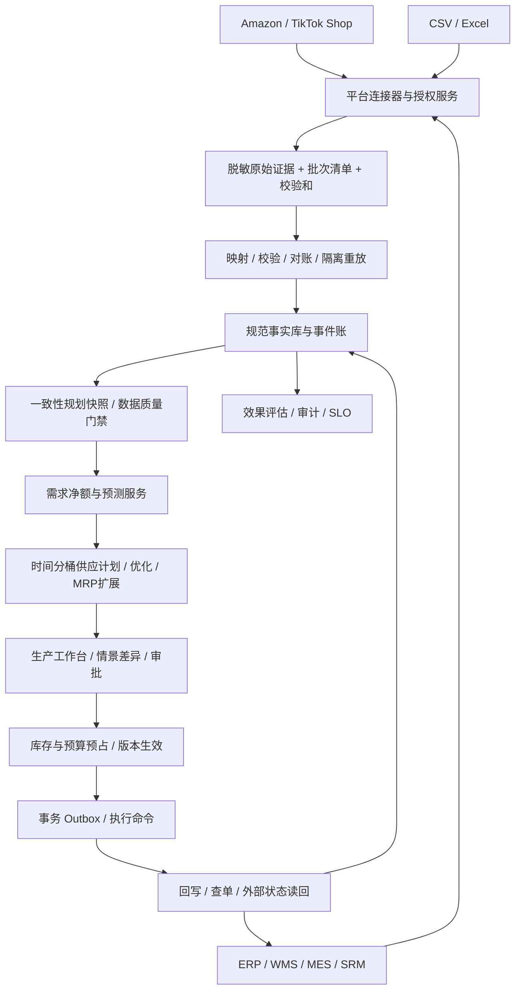

# Aegis-Predict 企业级生产就绪度评估与开发落地方案

- 评估日期：2026-11-16（Asia/Shanghai）
- 业务方向：Amazon、TikTok Shop，多租户 SaaS；后续评估制造业供应计划扩展
- 评估基线：Git 基准提交 `5a028c5` 加当前工作区；包含尚未提交、尚未发布的 `src/aegis` 工程化代码
- 交付性质：代码与文档审查、局部真实数据库验证、目标架构和分阶段实施方案；不是生产认证或真实客户效果报告
- 阅读对象：业务负责人、供应链负责人、产品、研发、算法、测试、实施和运维

> 实施状态说明：第0–16节保留评估时基线；2026-11-16首轮实施后的首轮证据与风险状态见第17节；0.6.0闭环更新见第18节及 [P0接入手册](14-p0-implementation-and-pilot-contract.md)。

## 0. 结论与决策建议

**当前系统应定位为“具备部分工程化闭环的供应链规划 Alpha”，尚不能作为大型制造企业的生产计划主系统，也没有足够证据作为多租户 SaaS 自动补货执行系统上线。**

现有价值是真实的：它已具备跨境成品预测、单库存池分仓、可解释补货和演示仿真；当前工作区进一步加入了 PostgreSQL 数据模型、租户隔离、原始数据处理、冻结输入、计划审批、成本优化和回写恢复等代码。部分不变量已通过真实 PostgreSQL 测试。

但“有相应类、接口和测试”与“企业能持续依赖它做决策”之间仍有距离。主要缺口包括：

1. **库存与执行事实不够精确。** 采购单、头程、调拨、在途和已承诺量缺少单据级关联，尚无跨计划库存预占账本。当前限制同租户一个活动计划的办法可以保守防重，但不能支持企业日常连续滚动计划。
2. **计划没有按时间展开。** 当前成本模型主要分配本轮货量，尚未计算每天何时缺料、何时到货、何时释放采购或生产订单。
3. **制造业语义基本缺失。** 组合 SKU 拆解不是制造 BOM/MRP；仓库处理量不是工厂产能；供应商可用量不是交期承诺；库存分配不是 APS 排程。
4. **平台接入处于代码与模拟契约验证阶段。** Amazon/TikTok 未完成真实授权、各站点全量对账和长期稳定性验证。TikTok 实物库存、Amazon 入仓执行等不能视为已经接通。
5. **效果证据尚弱。** 样例回测和仿真能帮助研发，但不能证明真实店铺 ROI、服务等级或制造订单交付表现。
6. **SaaS 的运营与治理尚不完整。** 缺少租户配额、公平调度、自助授权、完善的数据范围权限、企业 SSO、恢复演练、生产前端和运营支持流程。

推荐执行两条有先后依赖的产品路线：

- **路线 A：成品补货 SaaS。** 先服务 Amazon/TikTok 卖家的成品预测、库存风险、补货建议和人工执行协同。限定客户、站点、仓型和数据规模，先只读影子，再受控发布。
- **路线 B：制造业供应计划扩展。** 在 A 的库存账、时间分桶和执行闭环可靠之后，增加需求消耗、BOM/MRP、供应商协同、关键资源能力计划和供需追溯。详细车间排程优先与已有 MES/APS 集成。

不建议同时承诺“跨境平台补货 SaaS”和“替代大型制造业 APS/IBP 全套平台”。二者共用数据与规划底座，但业务模型、实施周期和验收责任明显不同。

## 1. 评估方法、范围与证据边界

### 1.1 评估材料

本次以以下材料交叉核对，代码行为优先于文档描述：

- `README.md`、`docs/01` 至 `docs/12`：立项、需求、系统设计、算法、仿真、展示、部署与原生产化方案。
- `src/overseas_inventory/`：原预测、补货、分仓、仿真、Web 服务和静态前端。
- `src/aegis/core/`、`models/`、`migrations/`、`integration/`、`planning/`、`api/`、`workers/`：当前工作区工程化实现。
- `tests/` 与 `tests/production/`、`data/sample_network.json`、Compose 和 CI 配置。
- SAP、Oracle、Kinaxis 官方公开能力资料，以及 Amazon/TikTok 官方接口资料，作为能力参照，不作为任何厂商特定客户项目的验收证明。

`docs/12-production-plan.md` 中对外部 `agentic-aps` 仓库全分支、全历史的描述，本次没有独立复核；不把这些描述作为本报告的事实基础。

### 1.2 证据分层

| 证据级别 | 含义 | 能证明什么 | 不能证明什么 |
| --- | --- | --- | --- |
| E0 | 文档或设计描述 | 目标、约束、思路 | 已实现、可运行 |
| E1 | 代码存在 | 具备实现入口 | 正确、稳定、适用真实业务 |
| E2 | 自动测试或本地集成验证 | 已测边界内的不变量 | 平台真实行为、生产规模、长期可靠性 |
| E3 | 真实数据影子验证 | 在指定客户和周期内可用 | 其他行业、任意规模或自动执行安全 |
| E4 | 受控生产和故障恢复记录 | 选定场景下的运营能力 | 不受范围限制的“企业级全能” |

当前证据主要停留在 E1/E2，尚缺 E3/E4。不能用代码行数、API 数量或模型名称替代生产验收。

### 1.3 本次实际验证结果

| 检查 | 观察结果 | 解释 |
| --- | --- | --- |
| Python 编译检查 | `src/aegis` 通过 | 不等于类型检查和安全审计 |
| Alembic 升级 | 隔离 PostgreSQL 16 测试库升级到 `0002_production_invariants` 成功 | 尚未证明带生产存量数据的无停机升级和回退 |
| 全仓库测试 | **58 通过，1 失败，共 59 项** | 当前全仓库 CI 不能称为全绿 |
| 新增生产方向测试 | 41 项通过，包含领域、连接器模拟、数据库、API 和回写故障注入 | 不是对所有并发、规模与真实平台条件的覆盖 |
| 已有失败项 | `CompetitionWebTests.test_frontend_index_and_health` | 测试要求首页包含 `GlobalPool AI`，当前页面标题为 `AEGIS-PREDICT`，该测试和页面在本轮均未改动；需确认品牌契约后修复 |
| 租户隔离 | 已验证越租户读取不可见、越租户写入和外键引用被拒绝 | 仍需覆盖角色继承、导出、缓存、附件、任务和运维入口 |
| 写回故障注入 | 模拟外部已创建、响应丢失，恢复时查询已有单据；测试场景仅一次创建 | 不意味着所有外部系统天然支持恰好一次创建 |
| 容器与生产环境 | 已有 Docker/Compose/CI 配置 | 本次没有完成镜像构建、云部署、故障切换或恢复演练 |
| 平台联调 | MockTransport 等模拟契约测试 | 没有真实商家授权和平台沙箱/生产联调证据 |

样例滚动回测采用 7 天预测窗口、至少 28 天训练、非重叠测试窗口；60 条 SKU×仓序列，共 1,260 个序列窗口：

| 指标 | 当前统计基线模型 | 28 天均值基线 |
| --- | ---: | ---: |
| WAPE | 6.4817% | 6.7912% |
| Bias | -2.7987% | -2.2056% |

WAPE 改善约 **0.3095 个百分点**，但负偏差更大；不能概括为所有指标都变好。1,260 个窗口包含跨仓、跨时间相关性，不能直接视为 1,260 个独立统计样本。以上数据来自模拟样例，不代表 Amazon/TikTok 真实需求预测表现。

复核命令：

```bash
# 指向专用、可丢弃、库名以 _test 结尾的数据库。
AEGIS_TEST_ADMIN_DSN='<test-owner-dsn>' .venv/bin/pytest -q
PYTHONPATH=src .venv/bin/python -m aegis.cli backtest \
  --max-wape 0.35 --max-bias 0.2 --output /tmp/aegis-backtest.json
```

当前 CI 的 `0.35/0.2` 是宽松的工程回归护栏，不能作为客户效果验收线。后续应按业务分层、预测周期和已批准基线分别设阈值。

## 2. 与大型企业生产能力的差距

### 2.1 参照系应按能力拆解

SAP IBP 的官方能力范围覆盖需求、库存、分层供应、粗能力计划、情景协作及经营计划；其中多级库存和多层 BOM/地点规划，明显超出单库存池分仓。[SAP IBP 官方功能说明](https://www.sap.com/products/scm/integrated-business-planning/features.html)

Oracle 的生产计划设置要求资源用量、工作中心可用能力、有效期内的制造/调拨来源规则和供应商资料。这说明“生产可行”依赖资源与物料主数据，而不只是求解器成功返回。[Oracle 生产计划设置](https://docs.oracle.com/en/cloud/saas/supply-chain-and-manufacturing/26d/fasop/setups-to-generate-a-production-plan.html)

Kinaxis 也通过与 PlanetTogether 的集成连接详细排程与供应计划，说明详细排程可以采用专业系统集成，不必由本项目一口气重建。[Kinaxis Production Scheduling](https://www.kinaxis.com/en/solutions/applications/production-scheduling)

这些参照描述的是能力边界，不表示购买某产品就自动具备正确的数据、实施质量或经营收益。

### 2.2 当前能力矩阵

| 维度 | 当前实际能力 | 证据 | 到成品 SaaS 的主要差距 | 到大型制造业的额外差距 |
| --- | --- | --- | --- | --- |
| 需求接入 | CSV/XLSX、通用 REST、Amazon/TikTok 订单连接器代码 | E1/E2 | 完整授权、补拉、删除/撤销语义、真实对账 | ERP/EDI、预测需求、项目需求、售后备件需求 |
| 需求预测 | 旧 ML 集成；新统计季节/TSB 基线、删失处理、回测 | E1/E2 | 时间对齐、促销特征、校准、模型治理 | 产品族/区域/客户层级、MTO/MTS/ATO 分流、预测消耗 |
| 主数据 | SKU、仓、线路、供应商条款、简单组合件 | E1/E2 | 多单位、所有权、SKU 生命周期、权威来源 | 多层 BOM、工程变更、替代料、工艺、良率、日历 |
| 库存 | 快照、在途、分配、欠单字段 | E1/E2 | 库存事件账、预占、批次完整性、单据去重 | WIP、质检/冻结、委外、寄售、批次效期、序列号 |
| 安全库存 | L+R、提前期波动公式 | E1/E2 | 预测误差分布、服务水平校准、动态参数 | 多级风险池、解耦点、共用组件和服务等级分配 |
| 补货 | 目标水位、箱规、建议量 | E1/E2 | 到货日期、订单消耗、供应不足处置 | MRP 净需求、工单、外协、齐套和提前期展开 |
| 优化 | 单轮、箱规、路线额度、仓容、预算、成本代理目标 | E1/E2 | 分时段库存平衡、财务口径、硬约束验证 | 多工厂、多层物料、多资源、加班/换线、替代供给 |
| 计划协作 | 版本策略、冻结输入、逐行决定、人工减量、锁定 | E1/E2 | 多方案、部门范围、多级审批、差异和冲突处理 | S&OP/IBP 月周日联动、销售/生产/财务共同签署 |
| 执行闭环 | 通用 REST 回写、超时查询、命令状态 | E1/E2 | 真实 PO/调拨/入仓接口、外部状态回读、取消与补偿 | ERP/MES/WMS/SRM 协同、交付承诺与进度回流 |
| 仿真 | 合成需求、两种策略对比、固定种子 | E1/E2 | 公平实验、库存守恒、多种子和真实回放 | 产能/良率/设备/供应扰动及传播 |
| 数据治理 | 原始层、校验、映射、隔离与重放 | E1/E2 | 批次完整、对账自动化、事实版本和数据责任人 | 企业 MDM、BOM/工艺有效期及系统血缘 |
| 多租户 | tenant_id、RLS、复合外键、租户会话 | E1/E2 | 数据范围、资源配额、附件/缓存隔离、租户运维 | 企业组织模型、隔离部署、集团跨法人治理 |
| 安全 | 本地账号、Argon2、CSRF、动作权限、凭据加密 | E1/E2 | OIDC/SSO、MFA、密钥托管、授权撤销与审计运营 | 职责分离、客户安全评审及行业特定控制 |
| 运维 | 配置、日志、迁移、独立 Worker、Compose | E1/E2 | SLO、监控告警、备份恢复、升级回滚、值班 | 多区域、变更窗口、业务连续性和驻场支持 |
| 用户体验 | 原比赛驾驶舱；新 API 尚未接成生产工作台 | E1/E2 | 店铺接入、异常队列、批量审批、真实执行追踪 | 供需追溯、齐套、例外决策、协同工作台 |
| 财务与商业化 | 部分成本字段和预算参数 | E1 | 多币种、订阅、用量、计费、支持与租户生命周期 | 库存资金、营运资本、经营预算和价值核算 |

### 2.3 生产等级判断

本报告使用范围受限的等级，不给出缺乏依据的“完成百分比”：

- **R0 演示：** 合成数据讲清业务路径。
- **R1 工程 Alpha：** 关键代码可运行，局部不变量通过测试。
- **R2 影子试点：** 真实数据、授权和对账完成；建议不直接影响外部执行。
- **R3 受控生产：** 在约定客户、规模和约束内，经过人工批准和恢复演练后执行。
- **R4 企业稳定运行：** 有持续运行、容量、组织协作、升级恢复和服务支持证据。

**当前整体处于 R1，保留 R0 演示外壳。** 部分模块达到 E2，整体没有因此自动达到 R2。对于制造业主计划，目前尚缺关键业务模型，不宜以 R3/R4 名义销售或验收。

## 3. 必须正视的当前风险

下表的 P0/P1 是本报告建议的交付优先级，不是已经修复的清单。代码锚点采用文件与函数名，便于后续重构时检索。

### 3.1 P0：真实决策或外部执行前必须处理

| ID | 当前证据或行为 | 业务后果 | 需要落地的处理 | 负责人类型 |
| --- | --- | --- | --- | --- |
| G-01 | `planning/assembler.py` 用 `max(0, PO未收量 - 快照在途)` 防重 | 无法确认两者是否是同一批货；不同调拨和 PO 可能互相抵扣 | 以 PO行→发运批次→收货行关联去重；按预计到达日归集，保留来源证据 | 领域后端 + 供应链 |
| G-02 | `lifecycle.py` 和唯一索引限制同租户仅一个活动计划 | 发布后不能正常并行滚动；关闭条件也不能代替库存预占 | 建立供应预占/释放/消耗账本与计划版本替代关系；影子方案不占真实库存 | 领域后端 |
| G-03 | `canonical.py` 主要按取消状态排除订单 | Amazon 待支付/不可履约、TikTok UNPAID 等可能被计入有效需求 | 平台状态转换表、有效需求口径、退款与退货独立事实；逐状态样例验收 | 集成后端 + 业务 |
| G-04 | `assembler.py` 未以完整快照批次和流状态作为充分门禁 | 部分页库存与旧快照混用，或同步失败后把缺行看作零销量 | 批次 manifest、COMPLETE 标志、覆盖范围、关键流状态、新鲜度和对账门禁 | 数据后端 |
| G-05 | `DailyDemand` 主键无渠道；订单聚合和导入总量存在优先级覆盖 | 无法清楚区分全量订单、部分渠道订单和已导入合计，可能重算或遗漏 | 明确店铺/渠道权威来源和覆盖矩阵；同一业务订单跨源去重 | 数据架构 |
| G-06 | 平台连接器只有模拟契约证据 | 权限、站点响应差异、分页和限额可能在真实店铺中失效 | 真实授权、脱敏录制 fixture、限流与中断恢复、90天回填对账 | 集成后端 |
| G-07 | 通用回写的查单结果和外部幂等能力依赖对方系统 | 查询暂未可见后再次创建，仍可能重复外部单据 | 外部唯一键契约、可见性等待窗口、先查后重试；不支持唯一键时转人工确认 | 集成后端 + 实施 |
| G-08 | “confirmed”主要代表外部单据已创建 | 不能代表货已发、已收或可售；提前关闭会形成错误可用量 | 拆分单据确认、执行进度和实物确认，读回累计执行数量 | 领域后端 |
| G-09 | 生产 API 与比赛前端分离；旧页面仍有默认密码提示 | 业务人员容易误把仿真当真实生产操作 | 单独生产域名/入口、统一 API 适配、真实/模拟标识，生产构建禁用旧演示入口 | 前端 + 安全 |
| G-10 | 全仓库仍有 1 个测试失败；依赖和容器未形成已验证不可变发布包 | 不能证明当前源码可以稳定发布、跨环境复现 | 修复品牌契约、锁依赖、生成 SBOM/镜像摘要，补迁移和部署验证 | QA + SRE |

只读影子试点可将 G-07/G-08 暂时隔离在“禁止回写”的功能开关之后；其他会污染预测输入和库存事实的风险不能以人工审批代替修复。

### 3.2 P1：从试点走向可运营 SaaS 必须补齐

| ID | 发现 | 要求 |
| --- | --- | --- |
| G-11 | `require_global_scope()` 对有限仓范围账号直接拒绝规划/集成操作 | 当前是保守拒绝，不能宣称已实现按仓数据权限；要实现查询、聚合、导出和操作范围过滤 |
| G-12 | 同步/回写 Worker 使用可跨租户的管理连接 | 收紧为专用作业领取角色或受限函数；数据处理仍用租户角色；阻断滥用管理 DSN |
| G-13 | 流限流主要是进程内、按连接维护 | 同一 App/卖家可能跨连接共享配额；要加平台/App/卖家/端点多级限流及租户公平调度 |
| G-14 | 凭据是环境 KEK 下的 Fernet 加密；有轮换函数，无完整运营流程 | 不是完善的每租户信封加密体系；增加 KMS/DEK、版本、定期重加密、吊销和恢复 |
| G-15 | `seed` 被记录，生产预测主要为确定性统计模型；求解器环境未冻结 | 不能仅凭 seed 承诺跨版本位级复现；冻结代码/依赖/求解器版本和结果校验策略 |
| G-16 | 快照可复现，但主数据/日需求大多是当前版本 | 历史 cutoff 不能还原当时未知的撤单、修正和主数据；增加业务时间与获知时间 |
| G-17 | 人工调整仅允许不超过原分配量，且没有请求版本号 | 适合保守减量；完整协作需要 ETag/版本冲突、重求解和锁定差异说明 |
| G-18 | 回写没有已验证的平台入仓完整流程；TikTok 库存尚未接入 | 不把接口模板称为真实闭环；先明确系统记录点、库存权威系统及人工执行边界 |
| G-19 | 原始证据和冻结输入的 UPDATE 受保护，但并非所有 DELETE/管理路径均受相同保护 | 完善不可变保留、删除权限分离、对象版本和灾难恢复；对依法/依约删除设计单独流程 |
| G-20 | 登录锁定主要按账户，本地会话，无企业 IdP/配额体系 | 增加入口限速、SSO、MFA/高危操作二次验证、租户停用/导出/清退 |

### 3.3 算法和仿真不能被包装过度

1. **双算法路径并存。** `overseas_inventory/forecasting.py` 的树模型集成与 `aegis/planning/forecast.py` 的统计/TSB 路径不同。生产不能展示旧模型的名称、解释或准确率来代表新路径。建立统一算法注册与运行元数据。
2. **分位数尚未校准。** 当前 P80/P95 主要由均值、历史波动和正态近似构造；不是已证明达到 80%/95% 覆盖率的经验区间。
3. **“confidence”是启发式分数。** 不能当作模型正确的概率、统计置信水平或自动放行依据。应明确命名为数据/预测可靠性评分，并通过真实误差验证阈值。
4. **安全库存仍需升级。** 纳入提前期波动是必要改进，但当前波动主要来自历史销量，不是预测误差；趋势、促销、自相关及缺货删失会改变公式含义。
5. **成本代理不等于企业财务最优。** 新优化器加入金钱单位代理目标，但缺货、迟到、可靠性、关税和尾程参数尚未按真实客户和币种校准；不能将其目标值直接解释为审计后的利润。
6. **MOQ 与采购/调拨混用。** `engine.py` 将供应商可用量、MOQ、采购预算用于限制库存池本轮分货。若货已采购并在库，再套采购 MOQ/采购成本预算可能错误阻止调拨。必须拆分采购决策与库存调拨决策。
7. **旧启发式兜底不是生产保障。** `overseas_inventory/allocation.py` 的兜底并未完整复用新模型所有约束，且比例预分配需要独立检查守恒。演示算法不得在生产路径中无声启用。
8. **仿真存在对照混杂。** `simulation.py::_plan_baseline_replenishment()` 给传统方案额外增加 7 天审批延迟；智能方案还具备跨仓履约和滚动历史更新。改善不能单独归因于预测算法。
9. **仿真库存池不严格守恒。** `_network_snapshot()` 以原库存池和预测供应下限的较大值重建供给，未建立跨轮次实际扣减和采购到货账；不能用其证明资金、采购或库存优化收益。
10. **仿真成本口径不完整。** 智能运输采用分配方式，但部分费用仍取默认线路单价；实际空运、采购、期末在途和尾程差异未完整结算。现有“总利润”属于场景模型指标。

这些问题不否定原型的解释价值；它们决定了下一阶段必须怎样建立可信证据。

## 4. 产品边界与目标架构

### 4.1 两个可验收的产品范围

| 范围 | 首批客户与决策 | 明确交付 | 暂不承诺 |
| --- | --- | --- | --- |
| A：成品补货 SaaS | Amazon/TikTok 卖家、采购与海外仓计划员 | 店铺数据、成品预测、分时段库存、补货/调拨建议、审批、执行追踪 | 工厂详细排程、任意行业通用预测、自动采购付款 |
| B：制造业供应计划 | 有稳定 ERP/MES 数据的制造企业，先选一个工厂/事业部 | 需求消耗、MRP、供应商承诺、关键能力校验、齐套、供需追溯 | 一期替代 ERP/MES、全车间秒级调度、所有工艺行业通用 |

A 的“平台销量权威”与“实物库存权威”必须分别确定。Amazon FBA 库存可来自 SP-API；自营/第三方仓库存通常来自 WMS/ERP。TikTok 上架可售量不能直接视为该企业所有海外仓的实物库存。

B 先聚焦一种制造模式，例如离散装配、MTS 成品加关键采购件。流程工业的配方、联副产品、效价、批量与清洗约束，以及项目型制造的长周期工程变更，另行立项。

### 4.2 目标部署结构



初期采用 **Python 模块化单体 + 多类独立 Worker + PostgreSQL + 对象存储**。API、同步、规划、回写与调度在进程和权限上隔离，领域代码仍在单仓维护。

- PostgreSQL：业务事实、版本、租约、状态机、预占、事务 Outbox。
- 对象存储：大批原始数据、冻结输入、模型、回测、导出和审计保留；对象带版本、校验和与生命周期。
- 分布式限流：初期可用 PostgreSQL 持久配额；当跨进程平台配额和延迟要求需要时引入 Redis。不能只依赖进程内令牌桶。
- 作业队列：先把现有数据库队列的租约、重试、取消、回收和公平性做完整，再决定是否换成熟队列。不要同时维护两套语义不同的可靠投递机制。
- 分析存储：达到数据量和查询指标触发条件后，引入列式分析或 Parquet 历史分层，避免把所有明细长期压在 OLTP 热表中。
- Kafka、微服务、Kubernetes 都以实际吞吐、独立发布或组织边界为触发条件，不作为“企业级”标志。

### 4.3 模块职责与允许依赖

| 模块 | 负责 | 不能负责 |
| --- | --- | --- |
| identity/tenancy | 身份、租户、角色、数据范围、配额 | 计算补货数量 |
| integration | 授权、拉取、原始证据、幂等、检查点、对账 | 直接修改审批数量、直接发布计划 |
| catalog | 产品、单位、组织、网络、版本有效期 | 生成外部订单 |
| inventory | 库存事件、快照、预占、在途、收货关联 | 将未确认到货直接变成可售 |
| demand | 有效需求、删失、预测消耗、聚合和血缘 | 将缺失数据无条件填零 |
| forecasting | 特征、模型、预测分布、回测与校准 | 突破库存和预算约束 |
| planning | 快照、时段供需、建议、成本、约束、追溯 | 绕过审批调用外部创建接口 |
| execution | 执行命令、查单、状态回读、补偿 | 擅自增加已批准数量 |
| workbench | 异常、解释、调整、审批和差异 | 在浏览器私自重算业务事实 |
| observability | 指标、追踪、告警、诊断 | 保存未脱敏的平台凭据和买家信息 |

通过架构测试约束依赖方向；连接器不得直接写规划表，优化器不得直接调用外部系统。业务规则保留纯函数和领域服务，避免重新形成大型 `webapp.py`。

## 5. 数据底座与平台接入实施设计

### 5.1 先冻结业务事实定义

上线前由业务、产品与数据负责人共同签署以下口径：

1. **需求口径：** 是已支付需求、已接受订单、发货需求，还是净销售？取消、拒收、退款、样品、替换件分别如何处理？
2. **库存口径：** 物理在库、可售、可分配、质检、冻结、预留、平台可售、企业所有权分别是什么？
3. **在途口径：** PO 已下但未发、已发在途、到港、入仓处理中分别属于哪个阶段？
4. **计划口径：** 建议量、批准量、已下发量、外部接受量、已发运量、已收货量、已取消量必须分开。
5. **服务口径：** 周期无缺货率、单位满足率、订单一次满足率、OTIF 和承诺交期达成率不能互换。
6. **成本口径：** 币种、含税/不含税、账期、采购成本、运费、仓租、尾程、缺货损失和期末库存估值。

例如订单退款不一定等于实物退回；只有带收货和质检事实的退货，才能按约定状态增加可售库存。

### 5.2 目标数据模型及最小字段

在现有约 30 张表基础上演进，先做 A 必需部分，再扩展 B；不要仅靠给现有 JSON 增加更多自由字段。

| 实体 | 最小关键字段与约束 | 阶段 |
| --- | --- | --- |
| `shop_account` / `authorization_grant` | tenant、平台、卖家/店铺/站点、授权范围、token版本、到期/撤销状态；业务唯一键 | A |
| `source_authority` | 业务实体、覆盖店铺/仓、权威来源、优先级、有效期；禁止重叠未决覆盖 | A |
| `ingestion_batch` | 连接、流、窗口、分页数、记录数、checksum、覆盖范围、COMPLETE/FAILED | A |
| `source_record_version` | external_key、source_version、业务时间、获知时间、raw_ref、tombstone | A |
| `order_line_fact` | 店铺、订单/行、渠道、有效需求量、状态版本、下单/支付/承诺/发货时间 | A |
| `inventory_event` | SKU、地点、所有权、库存状态、批次、数量变化、来源单据、幂等键、业务时间 | A |
| `inventory_reservation` | 供应实体、计划版本/行、用途、数量、状态、释放规则、版本号 | A |
| `inbound_supply_line` | PO/调拨/发运/收货关联、累计数量、预计到达日、来源版本、可承诺状态 | A |
| `demand_observation` | SKU×地点×渠道×日期、observed/zero/missing/censored、曝光时长、证据批次 | A |
| `forecast_version` / `forecast_bucket` | 训练截止、数据vintage、模型/代码/特征版本、各时段分位数、校准结果 | A |
| `planning_snapshot` | manifest、业务截止与获知截止、输入对象哈希、源版本、完整性门禁结果 | A |
| `plan_bucket_balance` | scenario、SKU、地点、时段、期初/到货/确定需求/剩余预测/期末/缺口 | A |
| `execution_order` / `execution_event` | 内部命令、外部单据、外部版本、各阶段累计量、异常、补偿关系 | A |
| `bom_version` / `bom_line` | 父子料、单位用量、损耗、替代组、有效期、版本、生效审批、无环约束 | B |
| `routing_operation` / `resource_calendar` | 工序、资源用量、产出、班次、停机、替代资源、准备时间 | B |
| `supplier_commitment` | 供应商、物料、日期、承诺量、置信/锁定、履约版本、采购提前期 | B |
| `pegging_edge` | 需求→供应→组件/资源占用的数量、日期和来源链 | A简版/B完整 |

所有业务唯一键必须包括租户或通过租户安全的复合引用约束关联。历史归档、主数据停用、租户删除和审计保留之间的冲突，应作为显式迁移与数据治理设计处理。

### 5.3 时间与数量规则

- 接口时间保存 UTC，同时保留站点时区和原时区信息；日需求按站点/履约口径的本地自然日聚合。
- 当前未完成的本地日不作为完整训练目标；缺少数据的时间段不能自动当作零需求。
- 所有数量统一为明确的基础单位；箱、包、托和件使用带有效期的换算表。
- 商品销量、组件需求、发货数量和退货数量分别留存，不以一次不可逆拆解抹掉原单据。
- 金额使用 Decimal/Numeric；业务决策采用指定基准币种和汇率版本，保留原币金额。
- 事实同时记录 `effective_at` 与 `observed_at`：后者回答“当时系统知道什么”，前者回答“业务发生于何时”。
- 对于同一源版本内容冲突，不应静默采用到达顺序覆盖；应保留冲突、定义可重复的决议或进入隔离区。

### 5.4 Amazon 接入包

**每个接入包必须包含接口契约、范围清单、脱敏样例、重放测试、对账脚本和故障运行手册。**

当前官方文档列出 Orders API v2026-01-01；新版使用 `searchOrders`、新版分页字段，并支持选择附加数据。生产实现应保持只取规划所需数据，禁止将买家信息作为默认采集内容。[Amazon Orders 迁移指南](https://developer-docs.amazon.com/sp-api/docs/orders-api-migration-guide)

实施分解：

1. 公共应用/授权模式和所需角色确认；租户绑定 OAuth state、授权回调和防重放；店铺与平台卖家身份核验。
2. 按区域选择端点；每个 marketplace 与仓/库存地点显式绑定，不根据国家名称猜测。
3. LWA token 到期、刷新、吊销、应用密钥轮换及连接停用；凭据不得进入前端或普通配置。
4. 订单按修改时间增量、回看窗口补拉；固定窗口全部分页落地后推进检查点；历史回填与线上游标分离。
5. 建立状态与数量映射：未支付、部分取消、不可履约、替换、部分发货等分别验收；行集合变化要产生撤销/替代事实。
6. FBA 库存使用经过对账的全量快照/报告策略；建立批次完整性、缺失 SKU 显式归零规则和不完整批次隔离。
7. 补货执行不以“有订单 API”为依据；FBA 入仓相关能力须独立评估授权、版本、建单/装箱/运输/接收状态和取消流程。

需要正视吞吐约束：官方 `searchOrders` 页面列出的默认速率为 0.0056 请求/秒、突发 20；实际以账户适用计划为准。按每页 100 单估算，长期默认速率约为每小时 20 页，不能据此对任意大卖家承诺一小时完成 90 天回填。[Amazon searchOrders](https://developer-docs.amazon.com/sp-api/reference/searchorders)

FBA Inventory 文档特别指出，部分入仓数量变化不会被增量时间过滤检测，分页 token 也有短有效期。因此库存同步需要全量/报告与分页时效设计，不能机械复用订单增量逻辑。[Amazon FBA 库存接口](https://developer-docs.amazon.com/sp-api/reference/getinventorysummaries)

### 5.5 TikTok Shop 接入包

1. 按目标市场确认 App 类别、Shop 授权、`shop_cipher`、scope 和可用 API 版本。
2. 请求签名使用实际发送的路径、排序参数和请求体字节；签名测试与 HTTP 序列化测试绑定。限流等待或重试后需重新生成有效时间戳和签名。
3. 新版访问 token 放在 `x-tts-access-token`；refresh token 轮换必须在拉取业务数据前可靠保存，不能仅留在 Worker 内存。[TikTok 公共参数](https://partner.tiktokshop.com/docv2/page/common-parameters)
4. 订单搜索使用有界修改时间窗口、分页和固定边界检查点；对 UNPAID、ON_HOLD、部分取消和组合 listing 明确转换语义。[TikTok Get Order List](https://partner.tiktokshop.com/docv2/page/get-order-list-202309)
5. 对组合 listing 中子 SKU 的新增、删除、替换与数量变动做全行集合对账，防止旧子行残留。
6. 验证目标市场实物库存、平台可售和 WMS 库存的关系；在未验证前只接订单需求，库存经 WMS/ERP/人工快照提供。
7. Webhook 只作为增量拉取提示，原始报文验签、防重、限频和持久化后快速返回；不直接把回调中的库存当作最终事实。具体签名算法须按目标版本官方文档和测试工具复核。

当前连接器不等于完成以上全部要求；尤其需要真实市场契约与授权运营能力的补证。

### 5.6 对账与质量门禁

建立三层对账，而不是只比较总行数：

- **采集对账：** 页数、实体数、源版本、窗口和完整性；接口报错不能以空数组结束成功。
- **业务对账：** 按店铺/站点/日期比较有效订单数、件数、取消量；按 SKU×仓×库存状态比较数量；PO、发运与收货按单据链比较。
- **规划对账：** 从原始订单到聚合需求，再到预测和计划行，可逐层追溯数量及排除原因。

关键库存源不完整、关键订单流中断、映射未知、高风险数量冲突应 **阻止生效**。可容忍的非关键陈旧数据才允许带原因、范围、有效期和指定审批人放行。不能用一个全局 `allow_stale_data` 绕过所有数据缺陷。

## 6. 预测、库存策略与优化的生产设计

### 6.1 先区分销量与潜在需求

目标序列至少标识四种观察状态：真实销量、确认零需求、缺货删失、采集缺失。对缺货插补保留原值、插补值和方法，不把插补数据当作同等真实标签。

按 ABC×XYZ、间歇性、生命周期和渠道选择策略：

| 情形 | 首选方法 | 必须验证 |
| --- | --- | --- |
| 稳定成熟品 | 季节朴素、ETS/统计基线，必要时树模型 | 预测周期误差、偏差和参数稳定性 |
| 促销/直播爆发 | 带历史活动、曝光与价格特征的模型及业务事件调整 | 特征在预测时是否已知，活动 uplift 是否重复计算 |
| 间歇备件/长尾 | TSB、Croston-SBA 等候选及零需求基线 | 非零事件识别、需求终止、库存结果 |
| 新品 | 同类商品先验 + 明确冷启动不确定性 + 人工范围 | 同类是否可比、不能简单复制品类均值 |
| 退市/替代品 | 生命周期衰减、替代关系、清库存策略 | 模型是否因历史销量继续囤货 |
| B2B/MTO | 已确认订单、合同、交期和赢单概率分层 | 不把确定订单与销售预测简单相加 |

旧 ML 路径中当前市场信号会参与历史监督样本构造；在缺少历史特征快照时，这可能造成时间穿越或不可识别的特征效应。生产特征必须按当时可获知时间连接，特征表中保存时间和版本。

### 6.2 层级预测与模型治理

- 基础粒度：SKU×需求地点/区域×渠道×日或周；销售渠道与实物履约仓通过明确映射连接。
- 输出 SKU、品类、区域和总量时采用底层汇总或经过验证的层级协调，不能让每个层级各自预测后互相矛盾。
- 每次发布保存数据 vintage、训练截止、特征版本、模型与依赖、超参数、随机性配置、分位校准和回测结果。
- 基线、候选与线上模型在相同清洗、删失和业务可知条件下比较；模型选择与最终测试窗口隔离。
- 指标包含 WAPE、Bias、MASE/RMSSE 或适当缩放指标、分位 pinball loss、区间覆盖率和宽度；零需求序列不硬造 WAPE。
- 分别评估 7/14/30/60/90 天及真实补货提前期窗口；不以 7 天样例准确率替代 45 天海运决策表现。
- 按实际业务暴露量和损失分层，A 类大盘改善不能掩盖关键长尾缺货。
- 监控数据漂移、偏差持续偏移、区间失准、人工调整率和预测价值增量；回退必须保留完整质量标记。

### 6.3 从库存位置升级为时间分桶平衡

当前总量库存位置可以帮助解释，但无法判断某批货是否来得及。至少建立如下时间轴：

```text
日期/周桶        T0    T1    T2    T3    ...
期初可售
确定订单需求
未被订单消耗的预测
已确认到货
计划采购/调拨/生产到货
期末预计库存
安全库存目标
未满足需求 / 迟到需求
```

统一记账原则：

```text
执行库存期末 = 执行库存期初 + 实收 - 实发 + 经批准的盘点/状态转换

预计库存期末[t] = 预计库存期初[t]
                 + 可用的确定到货[t] + 决策到货[t]
                 - 确定未履约需求[t] - 未被消耗的预测[t]
```

订单对应的库存预占用于归属和可分配控制，若该订单已经计入确定需求，就不能再次当作额外需求重复扣减。欠单、部分发货、替换单和在途链同样需要唯一归属。

需求消耗可从明确的简单规则开始：同 SKU×区域×渠道，按约定前后窗口将真实订单匹配到预测桶；保留匹配关系、剩余预测和例外。Oracle 官方文档提供了订单与预测消耗的业务参照，本项目应实现自己可审计的约定。[Oracle Forecast Consumption](https://docs.oracle.com/cd/E26401_01/doc.122/e48756/T309464T309471.htm)

### 6.4 安全库存与服务等级

对需求率平稳、提前期和误差近似独立的简单场景，可用保护期误差近似：

```text
P = L + R
SS ≈ z × sqrt(P × σ_error² + μ_d² × σ_L²)
S = 保护期需求均值 + SS
```

其中 `σ_error` 应由历史可比预测窗口的误差估计；存在自相关时要纳入协方差，需求与物流相关时不能继续套独立性假设。促销、间歇性和长提前期优先通过误差重采样或情景分布计算保护期需求。

另一条有效路径是直接用保护期需求分位数 `S = Q_p(D_P)`；使用这条路径时不能再把同一不确定性安全库存加一次。

还需要：

- 说明 `z` 对应的是近似周期服务水平，不直接等于单位 Fill Rate。
- 服务目标按产品价值、替代性、客户合同和缺货损失分层。
- 参数更改具备版本、有效期和审批；计算目标与实际库存约束分别展示。
- 效期、滞销、退市和资金上限进入策略；不能一律靠增加库存提升满足率。

### 6.5 分层求解，避免一次性全局 MILP

推荐把规划拆成可验证的三个层次：

1. **需求与净需求层：** 订单消耗、日期展开、已有供应净额、生命周期和策略参数。
2. **供应配置层：** 多地点、多运输方式、采购/调拨/生产选择，兼顾物料与关键资源。
3. **执行可行层：** 箱规、MOQ、装载、工作日、时间窗、冻结区、供应商确认和预占。

小规模采用稀疏 MILP/网络流；按 SKU、地点群、时间和耦合资源做问题分解。仅对预算、容器、共用资源等真正耦合部分集中协调。不要在没有基准测试时承诺数百万变量的全局精确最优。

目标函数和费用应具备可核算分解：

```text
采购 + 生产/委外 + 调拨运输 + 仓储 + 关税/尾程
+ 缺货/迟到 + 滞销/报废 + 计划变动成本
```

约束至少包括：库存与物料守恒、日期与提前期、供应商承诺、仓容/入仓日历、运输额度、箱规/MOQ、资金和已发布预占。服务合同、质量禁用和物理守恒是硬约束；可降级的迟到/超负荷必须显式建松弛变量并获准，不能静默违反。

每次返回：可行性状态、超时/降级原因、目标费用分项、未满足需求、紧约束、人工锁定的冲突、求解版本与间隙。仅当 gap 的分母和目标口径适宜时展示百分比；成本含常量转换时同时记录原模型界限，避免误读。

**所有解，包括启发式与超时 incumbent，都必须经过独立可行性校验器。** 校验器从规范输入和计划输出复算守恒、单位、时段、数量、预占和关键硬约束，不仅复用求解模型内部矩阵。

## 7. 制造业扩展：哪些能力必须另建

### 7.1 第一层：MRP 与供应追溯

**输入：** 经订单消耗后的主需求计划、有效 BOM、现存与在途、开放工单/采购单、单位换算、批量与日历。

**过程：**

1. 根据需求日期和版本有效期选择 BOM，而不是始终使用最新版本。
2. 按层级展开毛需求，计入单位用量、损耗、良率和批量；进行 BOM 环检测和单位维度校验。
3. 同层需求汇总后扣除明确可用供应；替代料只能按有效、获批准的替代规则净算。
4. 按采购、制造、转运和工作日历计算计划释放/到货日期，标记已经来不及的需求。
5. 生成采购建议、生产建议、改期、取消和加急例外；先不自动生成正式工单。
6. 保存 demand→finished goods→component→supply 的数量追溯链；向计划员解释“哪个客户订单导致哪个零件缺口”。

**验收必须包含：** 多层共用料、重复组件路径、工程变更切换、单位换算、BOM 环、部分到货、替代料、跨周节假日及已经进入冻结区的工单。简单 `SkuComponent.quantity` 不能承担这些职责。

### 7.2 第二层：关键资源与供应商约束

先做粗能力和关键资源约束，验证：

- 工厂、工作中心、班次、停机、加班、设备/人力可用量与工时单位。
- 工艺版本、单位资源消耗、生产批量、良率与重叠工序的简化假设。
- 关键供应商按物料和日期承诺的交付量、产能、停产/节假日与批次限制。
- 委外制造、跨厂调拨、替代资源和物料齐套的优先级。
- 已发布工单和冻结区保持稳定；比较新计划对旧计划的变更数量和代价。

粗能力通过不代表详细排程可行。若只校验关键资源，结果必须显示“其他资源未验证”，不能对交期作无条件承诺。

### 7.3 第三层：执行协同和详细排程集成

与 ERP/MES/APS 明确以下契约：

- 谁是工单、工艺、库存和设备日历的记录系统，谁允许修改哪些字段。
- 正式工单创建、确认、开工、报工、完工、入库、取消和返工怎样回流。
- 计划建议和调度结果如何交换，冲突时由哪一系统/角色裁决。
- 设备故障或关键缺料后，触发何种粒度的重计划，如何保护已经承诺的生产顺序。
- ATP/CTP 承诺使用哪些可用库存、确认产能和供应；不得把普通预测量作为确定交付承诺。

只有客户明确需要且具备数据质量、资源与维护团队时，再单独实现有限产能详细排程、序列相关换线、模具/工装、多人多机等约束。该阶段是独立项目，而不是给当前优化器加几个权重。

### 7.4 经营计划和组织协作

大型制造业还需要：

- 月度 S&OP、周度供需平衡、日度执行之间的版本和目标传递。
- 销售共识预测、财务预算、产销目标、库存资金和供给能力之间的差异分析。
- 情景分支、方案比较、会议决议、责任人和例外闭环。
- 客户/合同服务优先级和公平分配规则；缺货时说明谁被推迟、成本多少、谁批准。

这些首先是业务治理和数据责任设计，不能依靠“AI 自动优化”替代部门决策权。

## 8. 计划治理、预占与执行闭环

### 8.1 目标状态机

```text
DRAFT → VALIDATING → QUEUED → SOLVING → PENDING_REVIEW
                                      │
                                      ├→ APPROVED / PARTIALLY_APPROVED
                                      │       → RESERVED → RELEASED → EXECUTING → CLOSED
                                      └→ DISCARDED

校验/求解失败 → FAILED
未发布、无外部副作用的任务 → CANCELLED
发布后变更 → AMENDMENT / COMPENSATION，不能用删除历史“撤销”
```

不要求数据库机械照抄全部状态；但必须能区分数据验证、审批决定、资源生效和外部执行事实。部分批准的范围必须明确，不能让被拒绝行与未决行混在一个“已发布”标签下。

### 8.2 发布事务的核心不变量

批准与发布分别授权，发布事务应完成：

1. 锁定计划版本，并校验调用者范围、请求版本、有效审批和证据。
2. 检查数据新鲜度、已生效其他计划、当前可预占量与预算。
3. 对 SKU×地点×供应实体原子预占；冲突返回明确需要重求解的行。
4. 写入已生效计划版本、执行命令及 Outbox，同一事务提交。
5. 外部发送在事务提交之后发生；事务内不等待远端建单。

关键性质：

```text
同一供应可分配总量 ≥ 所有有效预占总量
同一计划行外部累计有效下发量 ≤ 当前有效批准量
已实收量 + 未收量 + 已取消量应与对应单据数量规则一致
已生效计划的任何变更，都能追溯审批、补偿和执行差异
```

超时后租约失效必须阻止旧 Worker 修改本地状态；同时要认识到本地 fencing 无法撤回已发到远端的 HTTP 请求，因此仍需远端唯一键或人工确认。

### 8.3 外部幂等与对账

- 幂等键至少包含 tenant、有效计划版本、行、命令类型、运输/分批标识；通过数据库唯一约束保护。
- 外部单号/幂等字段必须与对方约定唯一性和查询一致性，不能仅把一个 header 发出去就宣称幂等。
- `sending` 崩溃、网络超时、5xx 或响应缺少确认号均属于可能已送达；先查询，再按约定可见性窗口等待。
- 不支持安全查单/唯一键的系统进入人工核对，不对创建接口盲重试。
- 外部创建成功后持续读取接受、分配、发运、收货和取消状态；对部分成功按行/批次处理。
- 预占释放必须绑定明确的失败、取消、替代或执行消耗事实，不能只靠 TTL 释放已经发送的物资。
- 人工重试死信需要原因和权限；仍从查单开始，并记录全部历史。

Amazon/TikTok 的第一阶段可以采用“建议导出—人工在平台/WMS执行—回读或上传执行凭证”的边界；只有对应 API 的建单与状态链完整验证后，才开放自动回写开关。

### 8.4 协作、锁定与计划稳定性

- 人工调整必须保存原建议、调整量、理由和责任人；超出原可行范围的调整触发重求解。
- 使用行/计划版本号或 ETag，阻断基于旧页面的覆盖。
- 调整后撤销受影响的审批；保留不受影响的决定也必须有明确定义。
- `pinned` 是硬约束或明确的业务承诺；冲突时返回不可行说明，不能悄悄覆盖人工结果。
- 冻结区、变动惩罚、最小调整量和重计划冷却时间减少计划“每天大洗牌”。
- 情景方案不直接预占真实库存；只有正式选定并发布的方案参与生效资源账。

## 9. 多租户 SaaS 的工程与运营要求

### 9.1 安全与权限

1. **身份：** 本地账号保留试点能力；企业客户支持 OIDC/SSO，按客户要求启用 MFA、会话撤销与账号生命周期管理。
2. **组织：** 租户、法人、事业部、仓、店铺、角色和数据范围分开建模；用户可能跨多个组织，但每次请求必须显式确定租户上下文。
3. **隔离：** RLS、复合外键、服务层范围、对象存储前缀、缓存键、导出、日志和后台任务一起验证。RLS 不能保护外部文件或绕过数据库的副作用。
4. **数据库角色：** API 不持有 owner/BYPASSRLS 权限；作业领取、迁移和运维分别授权；检查角色继承与表所有权，不能只比较用户名。PostgreSQL 官方明确表拥有者和高权限角色可能绕过 RLS。[PostgreSQL 行安全说明](https://www.postgresql.org/docs/current/ddl-rowsecurity.html)
5. **密钥：** 平台授权最小化、按租户可追踪、KMS 托管、轮换与吊销；日志和报错不包含 token、授权码、买家个人信息。
6. **职责分离：** 数据修正、计划调整、审批、发布和人工回写重试分别授权；管理员例外操作要有显式原因与审计。
7. **入口保护：** 登录/授权回调/API/上传按来源和租户限速，上传实施大小、格式、压缩展开量和路径控制；REST 连接器限制目标域和重定向。

是否需要独立数据库、专有网络、区域驻留或特定认证，由真实客户合同与安全评审确定，不预先声称已经具备。

### 9.2 配额、公平调度与资源隔离

每租户配置活跃 SKU、地点、连接数、回填窗口、存储、API 使用、并发求解、任务时间和导出上限。

- 同步按平台 App/卖家/端点及租户多级限流；允许优先恢复授权或关键库存，不让大回填耗尽在线增量配额。
- 规划队列采用分租户公平调度、租户并发上限和优先级；大客户任务不得阻塞其他客户。
- 预测、MILP、报表导出独立进程池；限制 CPU、内存和墙钟时间，超限保存诊断与可安全恢复点。
- 配额超限返回可操作说明，不把资源耗尽表现为随机超时。
- 运行成本按连接调用、序列数、求解时长、历史数据和对象存储计量，再设计套餐；先不将实验性模型次数直接当作客户价值计价单位。

### 9.3 目标 SLO 与观测指标

以下是 **待压测和试点确认的建议目标**，不是当前已达到的承诺：

| 对象 | 试点建议目标 | 监控与处理 |
| --- | --- | --- |
| 交互 API | 非报表接口 p95 ≤ 1s；异步提交及时返回任务号 | 分租户/端点延迟、错误率、数据库等待 |
| 增量新鲜度 | 订单目标 ≤ 1h，关键库存目标 ≤ 2h | 同时监控完整窗口水位、覆盖率和平台配额；受平台报告延迟影响时调整承诺 |
| 核心同步 | 无静默丢数；关键隔离/对账差异可定位 | 读入、落地、规范化、隔离、重复、未结清差异 |
| 规划作业 | S1 指定数据集 p95 ≤ 120s；硬超时后有明确终态 | 队列等待、内存、可行解、gap、降级、取消延迟 |
| 回写 | 100% 命令可追踪；外部重复建单零容忍 | 查单延迟、未确认时长、死信、累计数量差异 |
| 试点可用性 | 月度 99.5%，正式服务再评审到 99.9% | 依赖故障归因、错误预算和变更冻结 |
| 数据恢复 | 试点 RPO ≤ 15min、RTO ≤ 4h | 以恢复演练测量；正式企业要求另行承诺 |

“进程在线”不代表业务可用。Ready 检查要包括迁移版本、必要依赖和角色安全；业务看板另行暴露关键流不完整、计划积压和回写未确认状态。

### 9.4 部署、升级与恢复

- 固定 Python/依赖/求解器版本、镜像 digest 和迁移版本，生成可回溯的发布清单。
- 开发、测试、预发布、生产凭据与数据隔离；测试不默认使用真实客户敏感数据。
- 迁移采用 expand→回填→兼容读写→切换→contract；大表索引和约束需评估锁表及在线验证。
- 发布先对影子租户/小客户灰度；具备只读、禁止新发布、暂停外部回写的独立开关。
- 业务回退与代码回滚分开：已创建的外部单据不能靠旧镜像撤销，要核对并执行补偿。
- PostgreSQL 备份、WAL/PITR、对象存储版本、密钥恢复和外部命令重放一起演练。
- 恢复后先对账、定位 ambiguous 命令，再恢复回写，不能将所有 sending 命令直接改 pending 重发。
- 为授权失效、平台限流、源 schema 改变、求解超时、错单和跨租户事件编写运行手册，明确值班责任和升级路径。

### 9.5 数据规模与容量设计

分阶段设定负载，而不是用“支持 5,000 SKU”掩盖维度乘积：

| 规模档 | 用途 | 参考边界，需在合同/压测中确认 |
| --- | --- | --- |
| S0 | 开发与功能回归 | 当前 15 SKU×4海外仓、180天合成销量 |
| S1 | 首批付费试点 | 3–5租户；每租户约1,000–2,000 SKU、3–5地点；活跃规划组合≤10,000；订单与库存频率按实际配额设定 |
| S2 | SaaS 扩容 | 约50租户，选择代表性大租户验证5,000 SKU×10地点；渠道、时间桶、线路与稀疏活跃率全部计入 |
| S3 | 企业制造 | 以客户真实物料层级、资源和时间桶建模，逐项目做容量评估；不能从 S0 外推 |

例如 50 租户×5,000 SKU×10地点的全量日库存即 250 万行/日，全年约9.125亿行，尚未包含订单、渠道和版本。必须定义活跃范围、变化事件与周期快照策略、保留窗口和冷热分层，而不是默认全部长留在普通 PostgreSQL 表中。

## 10. 生产工作台与实施交付

当前五页比赛展示适合解释故事，但生产操作应围绕异常和责任完成设计：

1. **接入中心：** 店铺授权、仓映射、权限缺失、token期限、同步覆盖、首次回填与对账。
2. **数据可信度：** 陈旧/缺失/删失分开显示，隔离记录带来源、原因、修复建议、重放结果和责任人。
3. **需求工作台：** 历史、订单、剩余预测、区间、活动、生命周期和人工调整的版本对照。
4. **时段供需表：** 看清哪一天缺、哪批货何时到、采购或调拨最晚何时释放。
5. **例外队列：** 风险按实际损失/交期/服务等级排序，支持分派、评论、截止时间和解决证据。
6. **计划比较：** 基线/候选/人工锁定的差异，约束与费用分解，低质量数据和降级结果醒目标识。
7. **审批与发布：** 有限范围、版本确认、批量操作预览、审批失效提示、过期数据及预占冲突处理。
8. **执行追踪：** 从批准行到外部单据、批次、在途、部分收货和异常；能区分建议与已执行事实。
9. **制造扩展：** 需求供给追溯树、缺料齐套、关键资源负荷与工单变更例外。

实施不是部署脚本的附属品。每个试点交付包还必须有数据字典、映射签署、UAT脚本、培训、切换方案、责任矩阵、支持渠道和收益复盘口径。客户采购/WMS/ERP负责人需要参与，不能由算法团队单方面定义业务事实。

## 11. 验证体系与上线闸门

### 11.1 测试按业务不变量设计

| 层次 | 必测场景 | 判定标准 |
| --- | --- | --- |
| 领域单元 | 单位换算、负库存位置、保护期、订单消耗、部分收货、成本 | 边界可解释，不依赖样例恰好给出好结果 |
| 性质测试 | 重放、乱序、重复、来源版本相同但内容冲突、组合件变更 | 给定合法决议规则后收敛一致；守恒、非负边界、箱规成立 |
| 数据库集成 | RLS、跨租户外键、唯一键、事务提交、连接复用、迁移 | 数据不可越界；异常回滚无半成功状态 |
| 并发测试 | 同供应两计划同时发布、人工调量与审批同时发生、租约抢占 | 不超额预占、不覆盖新版本、旧 Worker 不落结果 |
| 连接器契约 | 授权、业务错误码、分页重复/遗漏、429、过期 token、部分取消 | 不静默推进游标；不把失败响应当空数据 |
| 混沌与恢复 | raw后/游标前崩溃、远端成功本地未确认、刷新token后崩溃、恢复数据库 | 无静默丢数；不盲建重复单据；状态和证据可恢复 |
| 优化校验 | 无可行解、超时 incumbent、启发式、MOQ、日期、预算、预占 | 所有方案都通过独立硬约束验证；不可行则解释并阻止生效 |
| 模型验证 | 不同预测周期、删失/缺失、促销、新品、退市、间歇、层级 | 公平基线、无未来数据、覆盖率和偏差分层可见 |
| 端到端 UAT | 接入→对账→生成→调整→审批→发布→部分执行→对账关闭 | 实际计划员可独立完成，异常有明确处理路径 |
| 性能与长稳 | S1/S2、热点租户、大回填、慢平台、长求解、24–72h持续负载 | 无跨租户饥饿、内存失控、游标倒退、连接耗尽 |

现有测试应保留为回归基础，但“智能方案必须优于传统方案”的单个固定种子断言不属于充分的算法效果验证；真实测试应允许发现智能策略在某些条件下更差。

### 11.2 重新建立可信仿真

- 两方案使用同一需求路径、初始库存、供应总量、采购交期、预算、审批 SLA 和执行限制。
- 做消融实验：只换预测、只换补货策略、只换分仓、只开放跨仓，分别测量贡献。
- 每次发运扣减源库存，每次收货增加目的库存；采购、在途、取消和期末价值全部守恒。
- 真实销量回放时区分丢失销量与欠单，不能把缺货期间观察到的零直接作为真实需求。
- 固定种子用于复现，多种子/多时间段用于评估；区间按日期/店铺等相关结构分块估计。
- 比较 Fill Rate、OTIF、缺货天数、库存资金、呆滞/效期、物流采购费用、计划变动与人工工时。
- 影子观察并非随机对照，季节和经营动作会混杂；业务收益需要匹配组、分阶段上线或其他双方认可的评估设计。

### 11.3 上线闸门与证据责任

| 闸门 | 允许范围 | 必须具备的证据 | 不通过时 |
| --- | --- | --- | --- |
| G0：工程基线 | 内部环境 | 全仓库CI通过；依赖/迁移/镜像清单；确定已知缺陷和运行手册；SaaS/演示入口分离 | 继续内部验证 |
| G1：真实数据只读 | 受邀试点 | 授权与权限正确；关键映射签署；完整性门禁；连续至少14天对账；无越租户访问 | 不生成正式执行建议，仅处理数据问题 |
| G2：影子规划 | 不影响外部执行 | 真实数据至少4周；多周期回测；所有解硬约束通过；S1压测；计划员完成UAT | 回到基线策略或继续影子 |
| G3：受控发布 | 限定SKU/仓/金额 | 全部P0执行风险关闭；预占并发测试；查单/唯一键契约；恢复演练；人工审批；单租户可回退 | 禁止新增外部命令，核对已有执行 |
| G4：正式SaaS | 合同范围内多客户 | 受控运行至少4–8周；达到约定SLO；配额公平性；支持、升级、数据清退和收益复盘 | 不扩大客户和执行范围 |
| M1：制造试点 | 单工厂/单模式 | BOM/MRP、需求消耗、供需追溯、关键资源和ERP/MES契约验收 | 仅做成品补货，制造建议不得作为正式生产依据 |

数量对账阈值应按风险定义：单据链和库存守恒要求可解释且闭合，不用一个“总体差异 <0.5%”掩盖关键 SKU 差异。统计上的容忍范围仅适用于明确口径、时差和非关键累计指标。

业务效果的建议讨论线可以是：相对批准基线的关键预测窗口 WAPE 改善约5%–10%，Bias 落在客户可接受范围；在预算或库存资金约束下服务表现不恶化。但这些应在 P0 由业务签署，**不是当前已达到的指标，也不是所有品类都应采用的固定门槛**。

## 12. 分阶段实施、资源与投入

### 12.1 路线 A：约24–32周的有边界 SaaS 交付

假设平台审核可推进、试点客户配合供数、团队约9–11个全职当量。时间是规划估算，不是当前完成度承诺；未通过闸门则不按日历强行上线。

| 阶段 | 参考周次 | 主要交付 | 主要依赖 | 验收/退出条件 |
| --- | --- | --- | --- | --- |
| P0：范围与基线 | 1–2 | 目标市场/店铺/仓型、需求库存口径、P0缺陷、CI、契约与规模数据集 | 产品、客户与供应链负责人 | G0；平台申请启动；业务责任清楚 |
| P1：可信数据 | 3–6 | OAuth与店铺绑定、批次完整、来源权威、单据关联、库存账/预占设计、对账工具 | 平台授权、真实样本、WMS/ERP口径 | 可重放；关键状态和来源冲突覆盖；真实对账开始 |
| P2：可审计规划 | 7–10 | 订单消耗、时间分桶、预测基线/校准、版本快照、独立约束校验 | P1规范事实与历史数据 | G1；候选结果可追溯；不同提前期窗口回测 |
| P3：工作台与生效 | 11–14 | 生产前端、范围权限、版本冲突、多方案、预占发布、执行导出/受控适配 | 计划员UAT与执行契约 | 并发预占不超量；审批/变更可追溯；G2验证进行中 |
| P4：影子与故障演练 | 15–18 | 至少4周真实影子复盘、公平仿真、长稳与压测、恢复演练、限流与配额 | 足够经营周期和关键异常样本 | G2；关键算法/数据缺陷收敛 |
| P5：受控生产 | 19–24 | 限定SKU/仓/金额发布、真实执行读回、运营监控、灰度与回退 | G3全部证据、客户签署 | 分阶段达到G3；不因商业时间表跳过安全条件 |
| P6：服务稳定与扩容 | 25–32，视风险 | SLO稳定、SSO/租户运营、计量、容量扩展、实施标准化 | 受控生产数据和支持记录 | G4；每次扩容都有容量和风险评审 |

P1/P2/P3可按稳定接口并行开发，平台审核、客户数据整改和真实经营观察不可通过增加代码人力完全压缩。建议产品第一商业承诺限定“人工审阅的补货建议”，回写自动化另行开闸。

### 12.2 路线 B：在 A 基础上增加约6–12个月

| 阶段 | 参考工作量/节奏 | 交付 | 验收 |
| --- | --- | --- | --- |
| M0：制造场景验证 | 3–4周 | 选择工厂/物料族/制造模式；ERP/MES数据与责任；BOM和日历样本 | 有可用完整数据，证明扩展优于直接集成成熟系统 |
| M1：MRP与齐套 | 8–10周 | 需求消耗、多层BOM、有效期、净额、提前期展开、采购/生产建议、pegging | 客户已知案例逐条复现，无重复净算/错版本BOM |
| M2：关键能力计划 | 8–10周 | 工作中心/供应商约束、替代来源、冻结区、计划变动成本 | 物料与关键资源双可行；不可行解释获业务认可 |
| M3：制造执行协同 | 8–12周 | ERP/MES正式单据、供应商承诺、执行回流、例外和经营协作 | 单工厂受控运行与恢复演练，达到M1闸门 |
| M4：详细排程决策 | 单独立项 | 评估与专业APS集成，或限定工艺自研 | 根据独立业务案例、团队与维护成本作Go/No-Go |

大型集团、多法人、跨工厂、复杂工艺及监管行业部署可能更久。不能把 `docs/12` 原有约16–17周的原型生产化估算，直接沿用为大型制造业完整产品交付周期。

### 12.3 团队与责任

| 角色 | 建议投入 | 主要责任 |
| --- | ---: | --- |
| 技术负责人/领域后端 | 1，计入后端总量 | 架构边界、库存与计划不变量、技术评审 |
| 后端与集成工程师 | 共3–4，含技术负责人 | 平台、规范事实、预占、审批、执行、权限 |
| 数据/算法工程师 | 1–2 | 特征、预测/校准、回测、优化、数据质量 |
| 前端工程师 | 1–2 | 生产工作台、批量操作、异常与差异体验 |
| QA/测试工程师 | 1 | 领域测试、契约/故障注入、UAT和回归 |
| SRE/安全 | 0.5–1 | 发布、可观测、容量、密钥与恢复 |
| 产品/供应链领域专家 | 1–1.5 | 业务口径、需求裁剪、验收与客户实施 |

约9–11全职当量是资源规划区间，具体随兼任和外部实施资源变化。制造扩展需增加有制造计划、BOM/MRP和ERP实施经验的人员，不能只增加模型工程师。

A 路线可先按约 **50–80人月** 估算研发与实施投入；B 路线再按约 **40–90人月** 做初步范围预算，详细排程和客户深度定制另算。这是基于上述范围与团队的估算，不是市场报价或固定成本承诺。

预算按以下公式建立，并逐阶段复核：

```text
总投入 = 各角色实际人月 × 含管理及雇佣成本的人月单价
       + 云/数据库/对象存储/网络/日志/备份成本
       + 平台、数据源、身份和第三方系统费用
       + 安全测试、实施培训与客户数据整改
       + 约20%–30%的范围与联调风险预备
```

仅有2–3名开发时，应先交付单市场、少量客户、成品建议和人工执行；SSO、多工厂和详细排程等分别后移，不能保持全部范围而假定时间不变。

## 13. 可直接进入研发排期的工作包

工作包依赖关系：`W00 → W01/W02 → W03 → W04/W05 → W06/W07 → W08`；制造路线从 W03/W05 的稳定版本继续扩展。

| 包 | 交付物与核心任务 | 建议规模 | 完成定义 |
| --- | --- | --- | --- |
| W00 业务契约 | 状态表、需求口径、库存阶段、来源覆盖、成本/服务口径、目标规模 | 1–2周，多角色参与 | 文档+样例+责任人签署，未知项明确阻断条件 |
| W01 工程基线 | 修复既有失败、依赖锁、迁移升级/回退、镜像、配置、演示隔离 | 1–2工程师周 | 干净环境可复现构建，CI全绿，部署/恢复演练脚本可运行 |
| W02 平台契约 | Amazon/TikTok授权、真实fixture、分页/状态/限流、补拉、原始证据 | 6–10工程师周，外部审核另计 | 选定店铺真实读通，错误不丢数，授权撤销可控 |
| W03 库存事实 | 单据关联、库存状态、在途、事件、快照完整、预占、业务对账 | 8–12工程师周 | 双发布不超额，部分收货与取消守恒，库存权威无歧义 |
| W04 需求与模型 | 渠道聚合、缺失/删失、订单消耗、vintage、分层回测和校准 | 6–10工程师周 | 时间可知性审查通过；多提前期窗口有基线与回退 |
| W05 分时段规划 | 日期桶、可用到货、采购/调拨分离、成本、独立校验、解诊断 | 8–12工程师周 | 晚到不能抹掉早期缺口；所有解通过硬约束校验 |
| W06 生产工作台 | 接入、对账、异常、供需、批量调整/审批、差异、范围权限 | 8–12工程师周 | 计划员完成UAT；并发编辑和审批失效提示正确 |
| W07 执行闭环 | 唯一键契约、Outbox、查单、分批状态回读、补偿、死信处置 | 6–10工程师周 | 远端成功本地超时及崩溃注入无重复创建，进度可对账 |
| W08 SaaS运营 | 配额公平、监控SLO、恢复、SSO接入、计量、租户导出清退 | 8–12工程师周 | 压测/恢复/安全和客户支持演练通过，边界写入服务说明 |
| WM1 制造MRP | BOM/日历/工单/供应商承诺、净额与pegging | M0后细估 | 客户代表性案例可复现并通过物料守恒 |
| WM2 制造能力 | 关键资源、跨厂/替代来源、冻结、齐套、MES/APS契约 | WM1稳定后细估 | 可行性边界、未覆盖资源和交付承诺清晰 |

上述工程师周用于拆解与并行排期，不含全部 QA、产品、SRE 和客户整改工时，不能直接加总当作完整项目成本。每个包再拆成不超过一周的可验收任务，并由领域负责人复核边界。

### 13.1 前两周的具体安排

**第1周**

- 固定评估基线，整理当前新增代码与未完成能力，修复CI失败并形成不可变发布清单。
- 选择首批 Amazon marketplace、TikTok 市场、1–2家试点客户和实物库存来源。
- 完成订单状态与库存/在途口径表，列出10–20个真实异常单据案例。
- 启动平台应用/授权申请，收集脱敏响应及权限缺失清单。
- 设计单据关联、完整快照批次、来源权威和库存预占迁移草案。

**第2周**

- 冻结来源覆盖与业务唯一键；审查多来源订单、组合件变化、未支付和部分取消处理。
- 建立真实对账基线及固定测试数据集，加入P0故障和越租户测试。
- 评审时间分桶与订单消耗设计，确认第一版算法只承担哪些决策。
- 完成接入/异常/供需/审批生产页面的可点击流程或交互规格，取得计划员反馈。
- 评审G0结果、P1排期、风险和人员，明确不可绕过的上线条件。

## 14. 自我辩证与技术决策

| 问题 | 支持观点 | 反证与风险 | 本次裁决 / 重审条件 |
| --- | --- | --- | --- |
| 现有代码是否应整体推倒？ | 新业务模型差距大 | 原算法、文档、样例和部分治理代码可复用，重写也会重犯语义错误 | 保留可验证内核；逐步隔离演示路径；库存账和时段规划重新建模 |
| 是否立刻更换Java/微服务？ | 企业集成与成熟中间件丰富 | 迁移不能解决库存/需求定义，且增加跨语言和运维负担 | 保留Python模块化单体；有独立部署、负载或团队边界再拆 |
| 是否优先换更强AI模型？ | 跨境销量波动大，ML有潜力 | 错误标签、未知促销、删失和未来特征会让复杂模型更难审计 | 先可靠基线与真实回测；复杂模型按明确增益晋级 |
| RLS是否足够？ | 有数据库纵深防御，成本较低 | 管理角色、文件、缓存、范围授权与资源争抢不受其完全保护 | RLS保留；补全边界；有客户隔离要求时提供独立数据平面 |
| 一个全局MILP是否最优？ | 统一考虑约束，数学表达清楚 | 时间维度/BOM/资源会导致规模膨胀，且输入成本并不精确 | 小问题精确求解，大问题分层分解；独立可行性优先于漂亮目标值 |
| 是否马上全自动下单？ | 缩短人工决策周期 | 无真实幂等/对账/预占证据时会把模型错误转成实际损失 | 影子→人工批准→限定自动化；每级独立开闸和回退 |
| 是否把制造业功能全部自研？ | 形成统一产品与差异化 | BOM、MRP、APS和行业工艺不是同一问题；维护成本巨大 | 先成品和关键供应计划；详细排程优先集成，单独论证自研范围 |
| 公式修正是否足够？ | 解决了明显重复不确定性和提前期波动问题 | 波动估计、服务口径、相关性、日期和供应归属仍未解决 | 公式是基线；用真实误差、时间轴和库存结果验证 |
| 测试通过是否可以上线？ | 已证实部分重要不变量 | 当前仍有失败项；Mock和小数据不代表授权、容量、恢复和真实业务 | E2只支持继续试点，必须取得E3/E4证据 |
| 是否必须一开始上完整可观测平台？ | 企业服务需要可诊断性 | 过早堆叠组件会拖慢小团队 | 先覆盖关键业务水位/命令/预占/作业指标，按运营需要扩展 |

### 14.1 对当前开发路径的反思

- 当前新增实现把“缺少外壳治理”推进为“有部分治理代码”，这是阶段进展；但没有真实平台和运行证据，就不能把它称为生产完成。
- 为防止重复库存分配而限制单活动计划，是临时防护，不是最终领域设计；一旦要求连续补货，就应以预占与执行承诺替换全局阻塞。
- 快照复现与历史决策回放是不同问题。冻结 JSON 能复现本次计算，不能自动证明输入是历史截止时真实可知的数据。
- 给目标函数换成货币字段，并不自动得到正确经济目标。采购、库存调拨、迟到损失和期末价值必须由业务校准并避免重复计费。
- 在同一交付中同时扩张平台、算法、治理和制造业范围，会扩大未经验证的面积。应按最小可闭合事实链逐步开放能力。
- 报告本身也不能代替验收。每一阶段都必须用真实记录推翻或修正这里的假设，而不是维护最初方案的完整性。

## 15. 决策清单、风险与暂停条件

### 15.1 开工前需要确认的事项

| 决策 | 当前状态 | 对排期和架构的影响 |
| --- | --- | --- |
| 产品为多租户SaaS，接Amazon/TikTok | 已确认 | 保持tenant隔离、店铺授权、配额和运营设计 |
| 首批具体站点、TikTok市场和店铺规模 | 未确认 | 权限、响应、库存接口、限流与历史回填时间不同 |
| 海外仓类型及实物库存权威系统 | 未确认 | 决定WMS/ERP接入、在途与收货关联 |
| 是否第一阶段允许外部回写 | 建议默认禁止，G3后开放 | 决定需不需要提前纳入真实创建/取消契约 |
| 是否确有制造业客户及制造模式 | 未确认 | 决定B路线是否立项；没有客户样本不提前做通用APS |
| 真实数据保留、区域、SSO与服务时段 | 待客户约定 | 决定数据平面、备份、审计和支持成本 |
| 试点服务等级、预算和收益验收 | 待签署 | 决定安全库存、目标函数和上线闸门 |

这些未决项不阻止完成内部工程与方案评审，但会阻止对相应生产范围作承诺。

### 15.2 关键风险及处理

| 风险 | 早期信号 | 应对与责任 |
| --- | --- | --- |
| 平台授权或审核延误 | 目标scope不可获批、回填窗口受限 | 产品/集成及时裁剪；采用人工导出和只读范围，不虚构已接通 |
| 业务口径不一致 | 同订单在ERP/平台/WMS数量不同且无人负责 | 指定数据责任人，暂停该范围生效，先建单据级对账 |
| 长尾/新品效果差 | 总体WAPE正常，但关键品类持续缺货或积压 | 分层模型与服务策略，人工兜底并记录原因 |
| 外部重复或错单 | 未确认命令久悬、查单返回不稳定 | 立即停新增回写，核对外部单据和预占，按补偿流程处理 |
| 多租户性能互扰 | 单大租户回填/求解导致其他租户延迟 | 配额、任务分片与公平队列，必要时专用资源池 |
| 制造范围失控 | 未有BOM/日历质量却要求承诺详细交期 | M0 Go/No-Go；限制到成品补货或集成成熟系统 |
| 人员/实施资源不足 | 数据整改、UAT与研发互相等待 | 先减少市场、仓型和自动化范围，重估里程碑 |

### 15.3 必须暂停扩大上线的条件

- 发现越租户数据或越权限外部操作。
- 库存/预占/单据数量不守恒，且差异无法解释。
- 发生重复创建外部单据，或无法判断一条命令是否已执行。
- 关键数据流失败却仍被系统标记为可生效。
- 约束被启发式、人工修改或超时解绕过。
- 恢复演练无法还原关键事实、密钥或未确认命令。
- 业务效果持续低于已批准基线，且没有清楚的原因、限制和回退方案。

暂停的是新增生效与扩容；已发命令继续查单、对账和人工处置，避免因简单停机扩大不确定性。

## 16. 交付物与最终验收清单

每一阶段至少归档以下可审查材料：

- 业务口径、范围与权威来源签署记录。
- 数据字典、唯一键、状态转换表、来源和时间模型。
- 接口契约、真实脱敏fixture、授权/限流/恢复手册。
- 领域迁移、回填/对账脚本、跨租户与并发证据。
- 模型卡、特征可知性、分层回测、区间校准和基线对比。
- 规划可行性报告、费用分解、未满足需求、人工锁定和差异。
- 预占、审批、命令、外部执行和补偿追溯。
- UAT、长稳/压测、安全与恢复演练、SLO看板。
- 客户培训、灰度/回退、支持责任和收益复盘。

评审顺序应为：**先确认业务事实和执行安全，再确认模型价值与用户效率，最后确认规模与经营可持续性。** 对当前系统最有价值的下一步，是把一个真实客户、一个清楚库存来源、一个可核对补货周期做扎实，再向多客户和制造网络扩展。

## 附录 A：主要仓库证据入口

| 范围 | 入口 |
| --- | --- |
| 原业务与原型边界 | [需求](02-requirements.md)、[系统设计](03-system-design.md)、[原算法](04-algorithm-spec.md)、[原仿真](06-simulation-evaluation.md) |
| 既有生产化设想 | [生产化方案](12-production-plan.md)，本报告更新其范围和证据口径 |
| 旧算法/展示路径 | [预测](../src/overseas_inventory/forecasting.py)、[分仓](../src/overseas_inventory/allocation.py)、[仿真](../src/overseas_inventory/simulation.py)、[前端](../src/overseas_inventory/web_frontend/index.html) |
| 当前规范模型 | [目录与库存需求](../src/aegis/models/catalog.py)、[计划](../src/aegis/models/planning.py)、[集成](../src/aegis/models/integration.py) |
| 租户与权限 | [数据库会话](../src/aegis/core/db.py)、[权限与认证](../src/aegis/core/security.py)、[生产约束迁移](../src/aegis/migrations/versions/0002_production_invariants.py) |
| 接入与事实 | [同步运行时](../src/aegis/integration/runtime.py)、[规范化](../src/aegis/integration/canonical.py)、[原始层](../src/aegis/integration/raw.py)、[回写](../src/aegis/integration/writeback.py) |
| 平台适配 | [Amazon](../src/aegis/integration/connectors/amazon_sp.py)、[TikTok Shop](../src/aegis/integration/connectors/tiktok_shop.py) |
| 当前规划内核 | [组装与门禁](../src/aegis/planning/assembler.py)、[预测](../src/aegis/planning/forecast.py)、[回测](../src/aegis/planning/backtest.py)、[优化](../src/aegis/planning/engine.py)、[生命周期](../src/aegis/planning/lifecycle.py) |
| API/进程/验证 | [API](../src/aegis/api/app.py)、[Worker](../src/aegis/workers/runner.py)、[生产方向测试](../tests/production/)、[CI](../.github/workflows/ci.yml)、[Compose](../docker-compose.yml) |

## 附录 B：外部参考与使用边界

检索核对日期为2026-11-16。以下为能力和接口参照，具体上线仍须核对所选站点、授权、版本及使用计划；不引用厂商营销数字作为本项目收益预测。

- [SAP IBP 官方功能](https://www.sap.com/products/scm/integrated-business-planning/features.html)：需求、库存、多层供应和经营计划能力参照。
- [Oracle 生产计划设置](https://docs.oracle.com/en/cloud/saas/supply-chain-and-manufacturing/26d/fasop/setups-to-generate-a-production-plan.html)：资源、来源规则、供应商和有效期参照。
- [Kinaxis 详细排程集成](https://www.kinaxis.com/en/solutions/applications/production-scheduling)：供应计划与专业详细排程分工参照。
- [Oracle Forecast Consumption](https://docs.oracle.com/cd/E26401_01/doc.122/e48756/T309464T309471.htm)：预测与销售订单消耗概念参照；不是本项目算法的逐条实现规格。
- [Amazon Orders 迁移](https://developer-docs.amazon.com/sp-api/docs/orders-api-migration-guide)、[searchOrders](https://developer-docs.amazon.com/sp-api/reference/searchorders)、[FBA库存](https://developer-docs.amazon.com/sp-api/reference/getinventorysummaries)：接口版本、分页、速率与库存增量边界。
- [TikTok 公共参数](https://partner.tiktokshop.com/docv2/page/common-parameters)、[订单搜索](https://partner.tiktokshop.com/docv2/page/get-order-list-202309)、[请求签名](https://partner.tiktokshop.com/docv2/page/sign-your-api-request)：授权、签名与请求契约入口；部分内容依赖Partner Center动态页面，真实联调时需完整复核。
- [PostgreSQL RLS](https://www.postgresql.org/docs/current/ddl-rowsecurity.html)：行安全及高权限角色边界。
- [SciPy MILP](https://docs.scipy.org/doc/scipy/reference/generated/scipy.optimize.milp.html)：可行解、超时与间隙等求解状态解释；不能替代业务可行性校验。


## 17. 首轮P0实施更新（2026-11-16）

本轮先修复失败测试，再实施数据与库存的优先底座。**当前仍是R1/E2；没有因代码或测试进展自动升级为真实试点批准。**

### 17.1 实际验证

- 全仓库 **91项通过、0失败、0跳过**，包含真实PostgreSQL租户、批次、来源、并发库存预占和审批/回写故障测试。
- 合成样例10,922条记录完整导入，60条需求序列生成shadow计划；冻结复现汇总一致，[证据归档](artifacts/p0-synthetic-smoke.json)。这不是实际市场效果验证。
- 原首页品牌断言已修复为当前AEGIS-PREDICT入口契约，并增加登录入口、脚本与健康状态检查。
- 新迁移`0003_foundation`通过空库升级、0003↔0002、base回退再升级；ORM结构漂移检查通过，新业务表RLS检查通过。
- 编译和Docker Compose配置检查通过；容器daemon未运行，因此没有镜像构建/部署证据。
- 测试依赖版本约束与源码/运行时manifest已建立；尚非wheel哈希锁、完整SBOM或不可变镜像验收。
- 仍有1条Starlette/httpx测试客户端弃用警告，独立跟踪兼容升级。

### 17.2 逐项风险状态

| 原风险 | 本轮处理与验证 | 仍需完成 |
| --- | --- | --- |
| G-01 在途与PO去重 | 新增快照→PO行关联；SKU/目的仓/数量校验；未知重叠拒绝，或显式批准disjoint契约 | 完整PO→发运→收货单据链、独立调拨在途及预计到达桶 |
| G-02 跨计划资源 | 新增held预占，在发布事务中检查最新库存并加锁；并发与幂等测试通过；规划扣除有效预占 | 消耗/释放/执行对账与计划替代；保留单活动计划保护；真实连续执行仍不开放 |
| G-03 有效订单 | 平台状态白名单、未支付排除、未知状态隔离；未支付→接受→取消只更新同一行 | 退货/退款独立事实、组合行集合删除与替代、真实站点状态fixture |
| G-04 完整性门禁 | 批次成员/摘要、完整落地后规范化、部分失败不推进最终游标、latest完整批次及窗口证明；不能用stale确认绕过 | 实际平台长期覆盖、历史批次保留与源端对账、完整范围契约验证 |
| G-05 来源覆盖 | 新增来源×渠道×日期投影和权威规则；总量与渠道不重叠，跨源不重复累计；缺失/删失/观察零分开 | 客户签署覆盖矩阵、源版本冲突与双时间事实模型、主数据治理 |
| G-06 平台接入 | 23个Amazon/20个TikTok市场配置、区域校验、账户×市场防别名重复；健康检查加强 | OAuth身份回调、逐市场真实授权/录制fixture/回填与对账；不宣称已全面接通 |
| G-07/G-08 外部副作用 | shadow默认，执行和回写两个开关默认关闭；外部创建confirmed不能自动释放预占或关闭计划 | 对方唯一键/查单可见性契约、执行累计量、补偿与实物对账 |
| G-09 演示隔离 | 生产API不含student路由；比赛服务在prod拒绝请求/启动，测试通过 | 正式业务工作台与真实/影子交互、数据范围授权 |
| G-10 工程基线 | 失败测试修复、91项回归、迁移往返、版本约束与manifest、Compose配置通过 | Linux镜像与部署、哈希锁/SBOM、恢复与容量演练 |

### 17.3 接下来的优先顺序

1. 按[P0接入手册](14-p0-implementation-and-pilot-contract.md)完成真实店铺授权、仓型、时区、单位和权威来源签署，并取得脱敏契约样例。
2. 以只读影子方式开始至少14天逐源对账；平台目录或`data_ready=true`都不等于业务验收。
3. 补齐源版本/行集合/退款退货语义与库存执行账，再实现预占消耗、释放和滚动计划替代。
4. 通过G3前保持`AEGIS_PLAN_EXECUTION_ENABLED=false`和`AEGIS_WRITEBACK_ENABLED=false`；不以扩大市场覆盖为理由跳过执行闭环。

本轮没有将时间分桶供应优化、制造MRP、企业SSO/配额、真实市场联调或生产经营收益标记为完成。


## 18. 0.6.0闭环与用户范围更新（2026-11-16）

用户已明确：Google作为默认用户认证；Amazon/TikTok应用、授权及平台数据使用显式Mock，真实域名和凭据留配置。本轮没有把Mock升级为真实商家批准。

- Google OIDC授权码、PKCE、浏览器state绑定与ID Token验签已实现，subject绑定已有租户成员；配置与真实Google登录验收尚需部署方完成。
- 逐源独立清单精确对账已实现；同条数不同内容仍会失败，真实来源持续对账与供应商签署契约仍是外部门槛。
- 预占新增累计发运/取消/收货、源与目的仓对账结算、终态关闭及下一轮计划；Generic REST支持租约隔离的执行回拉。并行计划/替代、退款退货和更完整业务事实仍待实现。
- 全仓库108项通过、0失败、0跳过，包含完整迁移/RLS/结构漂移与新登录/Mock/执行故障测试。
- Linux ARM64原生和AMD64仿真镜像构建、容器内迁移、非root/只读API、健康检查与算法回测均已通过；未推送远端仓库，未部署外部生产。
- 仓库README已按实际功能重写，作者kaori-seasons、邮箱yuluoxinsheng@gmail；附五个业务截图，明确仿真前端尚未统一到多租户API。

实现、契约与实际证据见[生产闭环手册](16-production-closure-and-auth.md)。真实多周期经营数据、客户UAT与恢复/容量演练尚未发生，企业级生产成熟度不能仅由测试数量推断。
