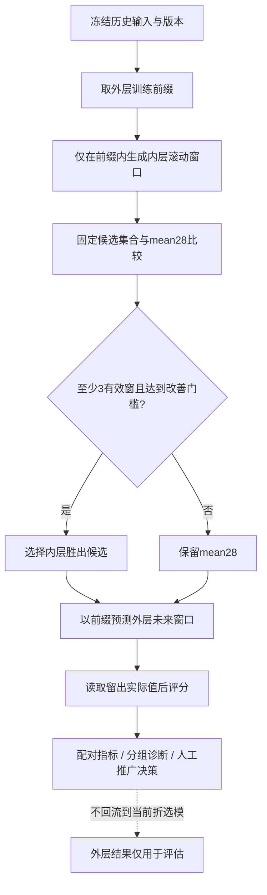

# v0.9.0 销量预测优化、均值基线比较与泄漏审查

日期：2026-11-16。新增候选版本 `rolling-champion-v3`、配对滚动回测与评估页面。**生产策略默认仍为 `seasonal-tsb-v2`，v3须显式启用；不会根据本轮合成样例自动替换真实租户模型。**

## 结论与交付边界

v3在仓库合成样例的7天、14天预测上优于28天均值与v2对照；30天相对均值轻微退化，没有通过零回归门禁。独立构造的9类固定合成场景整体较好，但不能抵消仓库样例的30天失败，更不能代表真实商家效果。

本轮实现了训练前缀处理、内层选模、同一批外层留出窗评分，并通过未来值/其他序列/外部市场信号扰动测试。**验证范围是冻结序列内的时间边界，不是供应商历史版本的完整 point-in-time 回放。** 当前事实表没有保存足够的“当时首次可得值与全部修订历史”，因此不能证明某个历史日期的快照与当时线上可用数据完全一致。

## 发现与修复

| 问题 | 本轮实现 |
| --- | --- |
| 固定分流不一定胜过均值 | 增加固定候选集合，在外层训练集内部做滚动验证；证据不足、均值误差为0或改善不明确时保留mean28 |
| 缺失占位值可能污染需求 | v3忽略missing日的数值，仅用之前的有效观察填补；缺货销量作为下界；填补值不加入有效观察缓冲 |
| TSB将未知日当真实事件 | v3的TSB仅在有效观察日更新发生概率和正销量规模；缺失/缺货日不当作无需求事件来衰减 |
| 回测只展示主模型与整体基线 | 11种对照使用完全相同的有效外层折；增加WAPE、MAE、偏差、胜平负、相对误差改善、分位覆盖率和pinball损失 |
| 类别先验缺少共享可得时间证明 | v3只用本序列观察，不读取其他SKU/仓库完整历史作为先验；低样本用自身有效观察均值，无观察为0 |
| ABC跨序列日历对齐未证明 | 默认不计算ABC，标记unavailable；仅显式声明共享对齐日历且长度一致时，用初始训练窗分档；分档不参与预测 |
| 升级后旧计划可能静默换模型 | 新冻结输入写入model_version；缺少该键的旧输入明确走v2；v2数值实现单独保留，未知版本拒绝复算 |
| 回测周期与计划可能不一致 | 评估默认使用所选计划周期，页面可切换7/14/30天；每次均实际重新回测 |

## 模型与验证设计

v3候选集合固定为：7/28/56天均值、上周同日、近8周同日均值、alpha=0.2指数平滑、近28天阻尼趋势、TSB、固定季节混合。v2保留为独立对照，不参与v3的内层搜索。

- **内层**：每次预测只在给定训练前缀内评分。至少28天起训，留出长度与预测周期一致，窗口不重叠，最多最近4个有效窗；至少需要3个有效窗。
- **均值保护**：候选的平均绝对误差必须比28天均值降低至少2%，且在过半内层窗胜过均值，才可替换；否则回退mean28。该保护只约束内层证据，不保证任何未来窗口都优于均值。
- **外层**：默认至少28天起训，按预测周期步进。含缺失/缺货删失的测试窗整折排除；训练中有效观察少于7天也排除。真实零销量测试窗保留。
- **评分**：点预测使用 `daily_rate × horizon`，不混入补货装箱或整数取整误差；P50/P80/P95的整数输出另做分位诊断。所有候选共享相同fold集合和fold_set_digest。
- **历史版本**：冻结版本控制后续预测与复算；旧v2保留类别先验的原数值路径。有效外层训练折至少7个观察，因此v2冷启动先验不影响这些比较；低样本冷启动的业务效果不在本轮指标证明范围内。



方法依据为作者教材的[滚动预测起点与多步交叉验证](https://otexts.com/fpp3/toolbox.html#time-series-cross-validation)及[真实留出误差评估](https://otexts.com/fpp3/toolbox.html#evaluating-point-forecast-accuracy)。实现采用固定超参数与训练内验证，不进行随机打乱划分。

## 可复现对比结果

仓库样例：60条SKU×仓库序列，每条180天。合成压力集：54条序列，每条252天，覆盖稳定、周周期、上升/下降趋势、水平突变、间歇、停销、缺失、缺货9类场景。种子固定为101、103、107、109、113、127。没有使用真实商家数据，也没有按外层分数修改本轮候选参数。

以下WAPE是百分比；“相对均值改善”=`1 - 本模型绝对误差合计/mean28绝对误差合计`，不是百分点差异。不同周期之间有数据重叠，折数不能当成独立统计样本数量。

| 数据集 | 周期 | 有效外层折 | mean28 WAPE | v2 WAPE | v3 WAPE | 相对均值改善 |
| --- | --- | ---: | ---: | ---: | ---: | ---: |
| 仓库合成样例 | 7天 | 1260 | 6.791% | 6.482% | 5.511% | +18.85% |
| 仓库合成样例 | 14天 | 600 | 7.269% | 6.878% | 6.378% | +12.25% |
| 仓库合成样例 | 30天 | 300 | 7.935% | 7.680% | 8.008% | -0.93% |
| 固定合成压力集 | 7天 | 1647 | 11.413% | 12.797% | 9.174% | +19.62% |
| 固定合成压力集 | 14天 | 790 | 11.412% | 12.909% | 9.100% | +20.25% |
| 固定合成压力集 | 30天 | 324 | 13.878% | 15.153% | 11.982% | +13.67% |

默认交互页面取每序列最近8个起点；另行运行全部可用起点，避免只看最近窗口。两种口径均保留30天退化结果：

| 数据集 | 周期 | 有效外层折 | mean28 WAPE | v2 WAPE | v3 WAPE | 相对均值改善 |
| --- | --- | ---: | ---: | ---: | ---: | ---: |
| 仓库合成样例 | 7天 | 480 | 7.362% | 7.047% | 6.217% | +15.55% |
| 仓库合成样例 | 14天 | 480 | 7.410% | 7.030% | 6.320% | +14.71% |
| 仓库合成样例 | 30天 | 300 | 7.935% | 7.680% | 8.008% | -0.93% |
| 固定合成压力集 | 7天 | 415 | 8.750% | 10.063% | 6.820% | +22.06% |
| 固定合成压力集 | 14天 | 403 | 9.651% | 11.735% | 6.853% | +28.99% |
| 固定合成压力集 | 30天 | 324 | 13.878% | 15.153% | 11.982% | +13.67% |

完整11模型、分场景、逐序列胜平负/宏平均和分位诊断见：

- [最近8个起点对比](artifacts/forecast-comparison.json)
- [全部滚动起点对比](artifacts/forecast-comparison-all.json)

### 不能忽略的失败与局限

1. 仓库样例30天v3 WAPE约8.008%，mean28约7.935%，v2约7.680%。严格均值门禁会拒绝v3；不通过改指标口径或挑选模型来掩盖。
2. 分位未校准：仓库样例30天v3的P95留出覆盖率只有约51.3%，远低于名义95%。点误差改善不意味着不确定性已校准，不能把P95当履约SLA。下一步需独立校准集与可信真实销量验证。
3. 少量内层窗只能提供有限证据。对于短历史、较长预测周期或大量删失，v3经常保留均值；仍需观察真实试点中的分组稳定性。
4. 聚合WAPE按销量加权，可能掩盖低量SKU退化。报告额外提供SKU×仓库序列的胜平负和宏平均skill；完美基线的比例不可定义，单独计数，不伪造0%或100%改善。
5. 测试窗删失被排除，指标描述的是可观察需求窗口，不能反推缺货期间真实潜在需求。源历史修订可得时间也未重建；不使用“完全证明历史无泄漏”的表述。

## 无未来引用验证

`tests/production/test_forecast_comparison.py`覆盖：

- 将某折全部测试值与后续尾部替换为巨大数值，预测、候选选择和训练摘要保持不变，只有实际值与评分变化。
- 检查每个内层留出结束位置不超过当前外层训练截止，内外层各自窗口不重叠。
- 修改其他SKU完整历史和未来市场信号，不改变目标序列预测。
- 修改missing占位为巨大正数不改变v3结果；未来异常值不改变之前缺失/缺货处理值；真实零和缺货销量下界正确保留。
- TSB不把未知日当成真实零事件；零分母指标明确返回null，MAE与零销量折仍参与比较。
- 从逐折预测重新计算WAPE、覆盖率、pinball及配对结果；所有模型折数一致。
- v2金标保留原70天样例的日均10.904039、P50=153、P80=165、P95=177，置信分数0.8234。

数据库/API回归额外验证新策略版本冻结、v3复算、旧形状证据在插入时构造且从不修改、旧版本不调用v3选择器，以及评估周期验证。版本与证据不可变约束保持生效。

## 生产接口与推广方式

- `GET /api/v1/workspace/plans/{id}/evaluation?horizon=14` 返回当前计划版本的主指标、11模型同折对比、选择分布、排除原因及折集合摘要；省略周期时使用计划周期。
- 交互限额为100条序列或30000个日观察、每序列最多最近8个起点；大批量或全起点分析使用CLI。
- 现有策略默认v2。试点人员应先保存现有完整策略配置，复制并只修改 `forecast_model_version` 为 `rolling-champion-v3`，通过 `POST /api/v1/policies` 创建新版本。该API需要策略编辑权限与有效CSRF；省略其他字段会使用默认值，因此不能把“只含版本字段”的请求误作实际配置的局部更新。
- 策略切换只影响后续生成的计划。现有冻结计划不改版本；v3应先在影子模式用本租户数据通过均值回归门禁和校准验收，再决定执行推广。
- 本轮没有新增数据库迁移，迁移头仍为 `0005_governance`。Amazon/TikTok继续Mock，外部执行/回写的默认开关不变。

```bash
# 同折比较与严格均值门禁
PYTHONPATH=src python -m aegis.cli backtest --horizon 7 \
  --max-baseline-regression 0 --output /tmp/forecast-7.json

# 全滚动起点；仓库样例30天严格门禁预期失败
PYTHONPATH=src python -m aegis.cli backtest --horizon 30 --max-folds 0 \
  --max-baseline-regression 0 --output /tmp/forecast-30.json

# 固定场景矩阵，不修改候选参数
python scripts/benchmark_forecasting.py
python scripts/benchmark_forecasting.py --max-folds 0 \
  --output docs/artifacts/forecast-comparison-all.json
```

## 外部市场数据预留

现有 `market_signals` 契约支持通过通用REST或CSV/XLSX导入，字段包括广告投入、促销、季节、平台活动和价格指数，并按租户、商品、仓库和日期落库。**当前生产组装显式排除这些信号，v3也没有使用它们。** 没有默认接通外部数据供应商。

加入模型前需补齐provider/版本历史、`available_at`/首次发布时间等可得性信息。每一历史起点只允许读取当时已知的信号；预先公布的促销计划与事后实际流量/价格/销量必须分开。当前接入表和`updated_at`不能单独证明当时可得性，不能直接把整段市场序列乘入历史回测。

## 工程验证与证据

全仓库：**135项通过、0失败、0跳过**，一个现有Starlette TestClient/httpx弃用警告。真实浏览器通过本地签名Google替身登录，实际创建冻结影子计划并验证回测默认14天及7/30天切换；11个模型行在390/768/1440px检查，宽表在自身容器滚动，无页面级横向溢出。截图为合成销量场景。

Linux ARM64/AMD64重新构建与运行验收，包含非root/只读根目录、数据库迁移、健康检查、默认Google/Mock和回测；AMD64为本机仿真，没有做真实容量测试。证据以 `docs/artifacts/forecast-container-*.json`、`forecast-release-manifest.json`、`forecast-verification.json` 为准；前轮产物保持历史版本。
