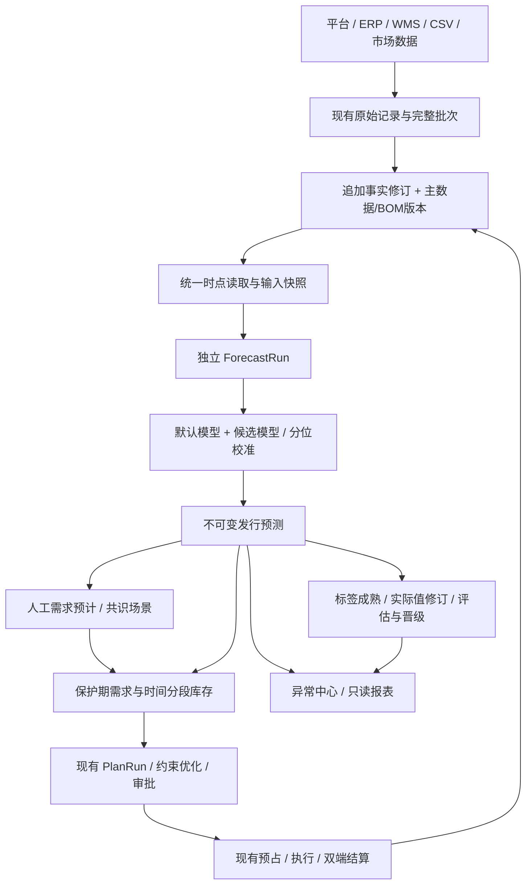

# Aegis-Predict 对标评估与生产开发落地方案

日期：2026-11-17。对象：Amazon、TikTok Shop 多租户销量预测与补货 SaaS。本文是开发方案与决策记录，新增能力尚未实施；不把第三方项目的功能声明或研究成绩当作本项目的验收结果。

## 1. 决策结论

**有必要增加相关能力，但应优先补齐“数据可回放—预测可持续评估—库存可解释—人工可协同”四条链路，而不是照搬两个项目、重写前端或一次性扩展成制造 ERP。**

建议顺序：

1. **P0：真实时点数据与独立 ForecastOps、预测周期和补货保护期一致性、分位校准与上线门禁。** 这些能力决定当前预测结果能否被可靠验证和用于真实采购。
2. **P1：带版本的套组 BOM、正反向追溯、时间分段的库存风险与异常处置、运营预测协同。** 复用现有主数据、审批、预占和执行闭环，形成计划员实际能用的功能。
3. **P1/P2：实际经营信号的滞后特征、新品分层与影子模型、异步 Excel/飞书报表。** 以真实数据覆盖、权限和客户需求为前提。
4. **有条件实施：领星专用连接器、跨仓调拨与替代品候选、长周期季节预测、制造物料需求。** 没有明确试点需求或数据契约时，不进入首批范围。
5. **暂不建设：名称相似即自动替换商品、直接自动下单、无头浏览器替代官方接口、跨租户混合训练、全量制造 MRP/APS/MES。** 当前证据和主数据不足以承担这些动作。

第一阶段应交付可生产部署的影子评估和风险工作台；**代码部署完成、标签成熟、真实账户验收、模型晋级，是四个不同里程碑**。

## 2. 证据范围与评估方法

### 2.1 固定本次阅读版本

| 对象 | 本次基线 | 阅读范围 |
| --- | --- | --- |
| Aegis-Predict | `9dee024f0d8adc372ae511a0b62e9eaa04a83b07`，业务实现为v0.10.0 | 生产规划、输入组装、回测、市场信号、映射、库存、模型表、配置、验证产物 |
| lx-forecast-pipeline | [`97b868d75cde24e4d408399cdeecc292395d1b4a`](https://github.com/Digital-sy/lx-forecast-pipeline/tree/97b868d75cde24e4d408399cdeecc292395d1b4a) | README、动态监控与研究决策、预测、采购入口、研究模型、时点库存回放、采购桥接与分配审计等关键文件 |
| OmniStock-Analytics-Hub | [`08d17ad2255866d41e07bff8da0b6de033fde901`](https://github.com/jolie-z/OmniStock-Analytics-Hub/tree/08d17ad2255866d41e07bff8da0b6de033fde901) | README和完整`app.py`；公开树包含这两份文本及3个演示GIF |

外部资料通过只读 GitHub 接口检查；未执行其脚本、连接其数据库或调用其线上演示的数据接口。没有两个项目的私有数据、商家权限、服务器配置或完整运行记录，因此不作外部系统生产成熟度认证，也不转述其效率/准确率宣传为已证实事实。

本文区分四种状态：**已实现**指代码可定位；**已验证**指有明确范围的测试/运行证据；**待验收**指代码存在但缺少真实环境证明；**建议新增**指本方案提出。未见某能力，只表示本次公开代码/本地路径没有相应证据，不推断私有部署一定不存在。

### 2.2 当前项目的真实起点

本项目已具备的底座不应重复建设：

- PostgreSQL租户RLS、复合租户外键、角色权限、Google OIDC流程、会话撤销与审计。
- Amazon/TikTok读取适配器与Mock，通用REST、CSV/XLSX；原始记录、完整批次、游标与分页、隔离、映射、来源权威及独立源对账。
- v2默认生产路径，v3训练内选模，v4计划市场信号；冻结输入、版本固定、旧计划复算、13模型同折比较。
- 补货点、装箱、共享库存池、运输和成本约束优化；审核、发布预占、执行观察、消耗/释放、两端库存结算。
- 市场信号追加式修订，发布/接收/可用时间过滤，撤回和冲突处理；首次历史回填不伪装成过去已知。
- 最新归档为159项测试通过、6组工作台布局检查，ARM64及本机仿真AMD64容器运行、市场回归实际拟合通过。此次仅编写方案，没有重新运行这些业务验证；结果范围以[市场验证记录](artifacts/market-verification.json)为准。

仍待真实验收：Google部署配置和账户、平台真实商家授权、具体ERP/WMS字段与权限、逐市场对账、真实需求与经营效果、容量与恢复演练。不能将Mock或Linux冒烟通过视为以上项目全部通过。

## 3. 两个参考项目分别贡献什么

### 3.1 lx：经营计划、预测监控及新品采购连接

这个项目同时存在多条路径，不能只根据README的“v4规则预测”概括全仓库：

| 观察 | 实际依据 | 对Aegis的启发 |
| --- | --- | --- |
| 业务链含系统预测、运营预计、库存扣减、颜色/面料及报表 | [README](https://github.com/Digital-sy/lx-forecast-pipeline/blob/97b868d75cde24e4d408399cdeecc292395d1b4a/README.md) | 补齐经营协同、层级汇总和采购解释，区分销量预计与下单意图 |
| 月度规则模型有同比、季节与新品回退路径 | [预测模块](https://github.com/Digital-sy/lx-forecast-pipeline/blob/97b868d75cde24e4d408399cdeecc292395d1b4a/jobs/feishu/forecast_sales_improved.py) | 长周期季节模型可作为候选，不能直接替换当前日级模型 |
| 动态监控强调issue-date留存、目标成熟及人工晋级 | [监控设计](https://github.com/Digital-sy/lx-forecast-pipeline/blob/97b868d75cde24e4d408399cdeecc292395d1b4a/docs/forecast_dynamic_monitoring.md) | 从一次性回测升级为持续预测运营 |
| 新品研究区分机会识别、条件销量及完整销量预测 | [Stage-1决策](https://github.com/Digital-sy/lx-forecast-pipeline/blob/97b868d75cde24e4d408399cdeecc292395d1b4a/docs/new_visible_v1_stage1_decision_20261007.md) | 排名分数、概率、需求数量分别建模与验收 |
| 研究折控制标签成熟并移除测试launch | [切分实现](https://github.com/Digital-sy/lx-forecast-pipeline/blob/97b868d75cde24e4d408399cdeecc292395d1b4a/scripts/train_new_visible_v1_stage2_volume.py#L160-L182) | 新品泛化测试应增加launch分组隔离，不能随机打散重复快照 |
| 有完整需求分位候选及分位交叉诊断 | [直接分位研究](https://github.com/Digital-sy/lx-forecast-pipeline/blob/97b868d75cde24e4d408399cdeecc292395d1b4a/scripts/train_new_visible_v1_stage2_direct_quantiles.py) | 独立验证采购数量分布与累计周期一致性 |
| 主流程已接新品H48/H60数量覆盖，桥接缺失/过期会失败 | [主脚本](https://github.com/Digital-sy/lx-forecast-pipeline/blob/97b868d75cde24e4d408399cdeecc292395d1b4a/scripts/run_procurement_pipeline.sh)、[桥接](https://github.com/Digital-sy/lx-forecast-pipeline/blob/97b868d75cde24e4d408399cdeecc292395d1b4a/jobs/feishu/new_visible_procurement_bridge.py) | 已晋级模型应有显式失效策略，不能不留痕地回退到别的业务模型 |
| 覆盖量按颜色精确分配并检查总量 | [覆盖与分配](https://github.com/Digital-sy/lx-forecast-pipeline/blob/97b868d75cde24e4d408399cdeecc292395d1b4a/jobs/feishu/new_visible_procurement_overlay.py) | 层级分配必须守恒，整数与装箱需联合约束 |
| 时点库存回放与跨周期审计分别存在 | [回放](https://github.com/Digital-sy/lx-forecast-pipeline/blob/97b868d75cde24e4d408399cdeecc292395d1b4a/scripts/replay_new_visible_procurement_asof_inventory.py)、[周期审计](https://github.com/Digital-sy/lx-forecast-pipeline/blob/97b868d75cde24e4d408399cdeecc292395d1b4a/scripts/audit_new_visible_live_horizon_monotonicity.py) | 预测准确、库存决策正确及周期单调性应分别验证 |

**重要辨析：**主脚本中`NEW_VISIBLE_PROCUREMENT_MODE`默认`primary`，并调用新品数量覆盖；研究分位脚本同时明确是research-only。部分采购覆盖代码仍阻断未验证的定制面料数量，且不创建PO。因此，应逐入口识别状态，不能声称“所有新品模型仍仅研究”，也不能声称“整套研究已自动下单”。这些是代码行为，不代表本次已验证该项目的线上配置与效果。

类目市场数据适配器包含显式字段覆盖、重复记录处理等可借鉴设计，但“选择最新快照”不自动等价于历史发布/接收/可用时间回放。Aegis应保留更明确的三时间过滤契约，不为接入更多源退回latest-only读取。[适配器依据](https://github.com/Digital-sy/lx-forecast-pipeline/blob/97b868d75cde24e4d408399cdeecc292395d1b4a/scripts/amazon_category_insights_adapter.py)

不照搬其服装特定编码、固定季节月份、销量门槛、48/60/90天周期、跨店模型或面料参数；这些取决于品类、市场和供应链，不能作为多租户默认值。

### 3.2 OmniStock：把复杂库存解释给计划员

[公开app.py](https://github.com/jolie-z/OmniStock-Analytics-Hub/blob/08d17ad2255866d41e07bff8da0b6de033fde901/app.py)体现了三个有价值的交互：套组穿透物理SKU、缺货行联动候选库存、组合与底层商品正反向查询。它主要使用7天均值、备货周期和阈值，不应因“智能预测”名称就认定其预测能力优于Aegis。

需要改造的边界也很明确：

- 文件缺失降为空表、数值异常填0的路径，不能直接用于Aegis的权威来源；未知必须与真实零分开。
- `TTL=可用+在途+换货在途`属于其业务口径，不能直接变成Aegis的当日可售库存；须确认文档关联、所有权、预计到货和来源重叠。
- 前缀`H`判断底层商品、清洗名称相同查替代品，适合特定演示，不足以作为跨品牌/规格/市场的可履约等价规则。
- 无销量时以`999.9`表示周转的展示不适合本项目；应返回明确的不可定义状态。
- “前10项”限制只出现在部分下拉；模糊查询另有路径。截断不是租户授权，也不能据此证明整套数据访问安全。
- 本次公开树没有数据文件、自动化测试或完整私有后端；无法复现其宣称的效率和准确度，也不据此判断其私有系统没有相应保障。

借鉴其阅读路径和可解释性，继续沿用现有工作台设计。无需增加一个平行Streamlit应用或重新接一套登录。

## 4. 功能取舍矩阵

优先级由真实试点风险与可交付价值决定，不以参考项目是否出现该功能决定。

| ID | 能力 | Aegis现状 | 必要性与决策 | 阶段 |
| --- | --- | --- | --- | --- |
| F01 | 原始事实与主数据时点回放 | 市场修订完整；需求/订单投影仍可覆盖，映射/BOM缺少完整历史选择 | 必补，后续模型与历史经营回放的前置条件 | P0 |
| F02 | 独立预测运行、成熟后自动评分 | 有PlanRun和回测；缺持续预测发行/成熟标签体系 | 必补，不占用业务计划的活动槽位 | P0 |
| F03 | 预测保护期一致、时间分段库存 | 以一个周期日均乘提前期/复盘期 | 必补，尤其市场信号使日均与周期相关时 | P0 |
| F04 | 分位校准与晋级治理 | 有分位诊断，分位未校准，版本显式启用 | 必补；不把置信启发式当概率 | P0→P1 |
| F05 | BOM版本与正反向追溯 | 有SkuComponent及订单单层展开；缺版本化主流程与专用页面 | 扩展已有能力，首批聚焦销售套组 | P1 |
| F06 | 库存风险与异常中心 | 有紧急度、来源门禁和对账差异处置 | 补风险解释、负责人、恢复与告警去重 | P1 |
| F07 | 人工预测、采购意图、共识与FVA | 可调整补货行；不是需求预测协同 | 必要但分对象保存；先影子比较再参与计划 | P1 |
| F08 | 实际流量等滞后信号与新品分层 | v4仅使用已知planned；observed归档，无新品专门生命周期 | 有价值，先契约与快照，后模型 | P1数据/P2模型 |
| F09 | SKU/变体/商品组/店铺层级 | 有SKU、分类、渠道来源，缺通用版本层级 | 视业务补齐，避免预设服装颜色体系 | P1基础/P2预测 |
| F10 | Excel、飞书/协作报表 | 有API与通用outbox；缺专用报表和租户通知产品 | 先可下载快照报表，再单向协作输出 | P1/P2 |
| F11 | 领星专用连接器 | 有REST/CSV通道，无领星专用适配 | 有领星试点才建设；不改变权威来源机制 | P2条件项 |
| F12 | 替代商品与跨仓候选 | 无业务等价主数据/候选引擎 | 先只读推荐和人工确认，暂不自动履约 | P2条件项 |
| F13 | 60/90天及年度季节候选 | API周期可到365、历史可配730；默认并非已验证长周期模型 | 周期参数上限不是有效性证明；补对应回测后启用 | P2 |
| F14 | 面料/制造MRP、产能与生产工单 | 有采购和运输约束，不是完整制造规划 | 通用SaaS首批不做；独立行业包立项 | P3/有条件 |
| F15 | RPA自动下载与自动采购 | 已有API/CSV和受控回写开关 | 不作为首选；保留人工导出作为可审计兜底 | 暂缓 |

## 5. 当前代码中应先解决的四个断点

### 5.1 有原始记录，不等于已具备完整历史回放

[canonical.py](../src/aegis/integration/canonical.py)保留原始接入后，会更新订单与日需求投影；[observations.py](../src/aegis/integration/observations.py)读取当前权威来源和最新完整批次；[assembler.py](../src/aegis/planning/assembler.py)负责冻结本次输入。它们支持复现“这次冻结了什么”，不等于能重建任意历史日期当时的订单状态、来源规则、映射和BOM。

新增历史能力必须利用已有RawRecord/BatchRecord证据，补足规范化版本与投影选择，不另建一套重复接入。库存已有历史快照也应保留，补齐当时获知时间、关联版本和完整性证据；不能概括为“库存完全没有历史”。

### 5.2 计划中的预测不能直接承担每天的影子运行

[PlanRun及冻结输入](../src/aegis/models/planning.py)和[活动唯一约束](../src/aegis/models/__init__.py)约束一个租户的业务计划生命周期。直接每天创建PlanRun，会与待审批/已发布计划竞争活动槽位，也把科研任务与库存执行绑在一起。

应独立建ForecastRun和预测结果，继续保留业务计划的唯一活动约束；需要补货时由PlanRun引用已验收的预测快照，并在发布前复核库存。

### 5.3 预测周期与实际保护期不一定一致

[engine.py](../src/aegis/planning/engine.py)先调用`forecast(series, horizon_days)`取得日均，再用该日均计算`lead_time_days`和`lead_time_days + review_period_days`需求。对于随周期变化的季节/促销/市场预测，不能默认一个30天日均就代表未来90天需求。

例如未来7天促销，其后恢复常态：把促销窗口的平均日销外推到90天会高估；反之，30天窗口外的旺季也可能被漏掉。增加候选模型前，应先定义每个物流方案所需的真实保护期，并直接预测该区间或使用一致的逐日轨迹。不能把参考项目的H48/H60机械变成全租户默认值。

### 5.4 订单套组展开不是完整BOM治理

[SkuComponent](../src/aegis/models/catalog.py)及订单需求SQL使用单层`LEFT JOIN sku_component`。当前映射确认解决的是外部编码对应谁，不解决BOM按哪个生效版本展开、嵌套环路、共享组件可售和历史用量解释。

同时，订单流与已聚合日需求流的计量对象可能不同。新增BOM前必须声明输入是“销售套组件数”还是“物理组件件数”，不能对已拆解的ERP汇总再次相乘。

## 6. 目标架构：扩展现有生产路径

保留PostgreSQL、SQLAlchemy/Alembic、现有Worker租约与fencing、FastAPI、Google会话及当前工作台。新增模块先采用同仓库模块化服务；训练任务与API进程分开。没有规模数据证明前，不引入第二数据库、平行登录、Kubernetes、复杂调度平台或独立特征平台。



**职责边界：**ForecastRun不创建采购单和库存预占；运营场景不改写基础预测；报表读取已完成快照；异常关闭不等于对账通过；模型晋级不等于允许外部回写。库存账、订单事实和分析读模型分开。

### 6.1 统一时点契约

所有新输入至少区分以下概念：

| 时间/版本 | 含义 | 不能替代它的字段 |
| --- | --- | --- |
| `event_at`或本地业务日期 | 销售、发运、库存发生时间 | 不能作为本系统已知时间 |
| `source_published_at` | 来源发布该修订时间；无法确认时允许未知 | 不能用updated_at猜测真实首次发布 |
| `received_at` | 原始记录首次接收时间，系统产生 | 不能由导入文件指定过去值 |
| `available_at` | 规范化成功、业务可使用的系统时间 | 不能早于接收或已知发布时间 |
| `valid_from/valid_to` | BOM、层级等业务生效区间，半开区间 | 不等于系统获知时间 |
| `revision_id/content_hash` | 修订及不可变内容标识 | 不以最新可变行ID代替 |

查询以`available_at <= knowledge_cutoff`为硬条件；有可信发布时间时还要求不晚于cutoff。业务日期不得超过对应特征允许的范围，主数据同时满足生效区间与当时可得性。未知发布时间的数据可用于系统启用后已接收的事实计算，但不得冒充供应商历史可得性已认证。

写入追加记录时保留raw、batch、mapper、映射、状态投影和BOM版本引用。业务物化表仍可为查询性能更新，但不能作为唯一历史证据。服务端记录系统时间，禁止客户端回写`received_at/available_at`。需要精确到数据库提交可见性的场景，应另验证commit与激活边界；本期验收定义日级预测发行切点和完整批次屏障，不能仅凭一列时间戳宣称任意亚秒级回放完全一致。

回填分两类：

- **真实历史观测归档**：保留供应商原时间及本次接收时间；过去origin看不到今天才接收的记录。
- **模拟可得性数据**：只进入明确标识的研究数据集，禁止进入真实租户事实表和上线成绩。

标签可以使用目标结束后的真实结果，但训练/校准必须满足标签在当时已经成熟且可得。实际值后续修订产生新标签版本和新评估版本，不覆盖已发布的历史评分。

### 6.2 逻辑数据模型

以下为建议新实体，不代表已经存在的表或确定迁移编号。实际迁移从`0006_market_revisions`之后递增，并先验证旧版本复算。

| 实体 | 核心字段 | 约束与用途 |
| --- | --- | --- |
| `source_observation_revision` | tenant、来源、实体类型/外部键、事件时间、发布/接收/可用时间、修订、raw/batch、hash、撤回 | 统一订单/需求/库存修订入口或分表同契约；复用现有RawRecord，不重复采集 |
| `demand_projection_revision` | SKU/仓/渠道/日期、units、状态、输入修订集合、BOM/mapper版本、available_at | 可追溯组件需求；明确销售件数/组件件数口径 |
| `planning_input_snapshot` | cutoff、calendar、source manifests、data/mapping/BOM/policy/model版本、hash、储存引用 | 通用不可变输入，供ForecastRun和新PlanRun引用；旧PlanInputBlob仍支持 |
| `forecast_run` | issue_at、截止时间、目标集合、输入快照、模型集合、状态、租约/fence、预算、幂等键 | 独立预测任务，不占业务计划活动唯一槽位 |
| `forecast_prediction` | run、series、目标起止、周期、模型/特征/校准版本、expected_units、分位、诊断、hash | 同发行点每系列/目标/模型唯一；结果不覆盖 |
| `forecast_actual_revision` | series、目标区间、actual_units、可观察比例、maturity_at、label_available_at、依据修订、truth_policy | 不把缺货期间销量直接等同潜在需求；未成熟标签不评分 |
| `forecast_evaluation` | 配对预测集合、标签版本、cohort、指标、排除理由、artifact hash | 结果可重算、可追溯，不让新实际值静默改变旧报告 |
| `model_release`及事件 | model/artifact/code/feature/schema hash、训练/校准cutoff、状态、gate evidence、批准/撤回记录 | 控制面状态可变且审计；模型产物及批准证据不可变 |
| `bom_revision` / `bom_edge` | parent、component、数量/UOM、生效区间、available_at、版本、批准人 | 套组定义版本化、无环、跨租户引用拒绝 |
| `product_group_membership_revision` | group/variant/sku、市场/店铺、有效区间、可得时间、属性 | 支持SPU类汇总，不要求所有客户都有颜色/尺码 |
| `forecast_override_revision` | 需求或采购意图类型、作用范围、目标、数量、依据、期限、状态、基础预测引用 | 不修改系统预测；已批准版本参与指定场景 |
| `planning_scenario` / 版本 | base snapshot、override集合、假设、结果hash、非执行标记 | 只读what-if；发布前须创建/复核正式计划 |
| `inventory_risk_case` / 事件 | 风险键、规则版本、证据快照、严重度、负责人、状态、恢复证据 | 告警去重与业务处置，不能替代库存结算 |
| `commerce_performance_revision` | 店铺/SKU/日期、指标名/口径、数值/单位、覆盖状态、三时间 | 为observed滞后特征准备；缺流量不填0 |
| `report_job` / `notification_delivery` | tenant、快照、目的地、权限摘要、幂等键、状态、重试/过期 | 报表、外发与业务提交解耦；使用现有outbox触发 |

通用修订表与分领域修订表二选一：先用订单/需求/库存三个有明确类型的修订适配器统一契约，避免首版泛化成任意JSON查询平台。高频查询应有tenant、source、业务键、available_at和目标日期组合索引；SQL选择先过滤可得性，再在业务键内排序版本。

共同底线：tenant不可由普通请求覆盖；复合租户外键；事件/结果表SELECT+INSERT及不可变触发器；相同版本异内容隔离；JSON字段大小和图遍历深度有限额。保留策略必须区分临时缓存与审计证据，不能套用outbox短期清理规则删除发行预测或已执行计划依据。

## 7. P0具体实现

### 7.1 F01：原始事实时点化与输入快照

1. 在现有normalize事务中生成修订与投影依据，写入前检查来源业务键、重复版本和状态合法性；批次未完成不得发行可执行快照。
2. 版本化来源批准、SKU映射、商品层级及BOM；先实现读取接口和新输入引用，不回写旧计划blob。
3. 建`AsOfReader`服务，统一需求、库存、在途、市场信号及主数据时点选择；HTTP与离线评估使用同一实现。
4. 独立记录`history_capability`：`forward_only`、`certified_history`或`simulated`；历史不足时减少可评估窗口，不能用今天库存/映射补过去。
5. 新快照覆盖每一条物理库存、每个渠道的需求覆盖状态、模型所需信号及版本水位；同一快照不能混入两个不相容的日期或来源口径。
6. 旧v2/v3/v4路径维持旧schema复算，新schema有显式版本；未知版本拒绝加载，迁移后做已冻结金标对比。

验收：晚到订单取消不会改变取消获知前的输入；晚到库存/BOM不会出现在更早origin；同内容重放不产生新可用时间；模拟历史不能通过真实上线门禁。

### 7.2 F02：持续ForecastOps与成熟标签

运行链路：`queued → running → succeeded/failed/cancelled`。预测成功后发出幂等事件；评分任务仅在目标窗完整结束、来源覆盖完成且等待期满足后生成标签。评分状态单独为`waiting_maturity / waiting_source / scored / excluded`，不把未评分显示为零误差。

建议幂等键包含租户、schedule、issue槽位、input_digest、模型集合和目标集合；补跑同发行槽位但新输入创建新revision并明确替代关系。每日调度受租户时区、来源完成屏障、并发与资源配额控制。研究任务不持有采购或库存写权限。

每次发行至少并行保存：当前生产版本、mean28、v3，以及显式启用的v4/新候选。展示比较使用相同origin、目标区间、实际值版本与可观察集合；不可只删候选失败窗而保留基线窗。保留失败数量、回退率、数据覆盖及未成熟数量。

真实观测从启用日开始积累；日销量有过去记录，也不意味着库存、流量、映射都有同等历史。30天标签至少要等对应未来窗口结束并满足到数条件，90天同理；工程迭代完成不缩短这一等待。

### 7.3 F03：保护期与库存时间轴

对每个供应/运输方案定义提前期`L`、复盘期`R`、目标周期以及截单/收货日历。直接请求`D(0,L]`与`D(0,L+R]`，或由一致的逐日预测轨迹积分；**不以`forecast(H)/H × 另一周期`作为季节/促销模型的默认换算**。

先分两层交付：

- 第一层直接预测各必要区间的累计需求，补齐目标/提前期解释；保留原算法版本以复算旧计划。
- 第二层输出时间分段需求和到货，识别“总量够但到得晚”的缺货。每种运输方案在自己的到货时点参与约束优化，而非全用默认lane提前期。

库存位置继续复用现有在途/PO关联和预占逻辑；当日可售只计已确认、可履约库存。时间轴示意为：

`期初可售 + 截至t已确认可到货/调入 - 截至t需求消耗 - 其他有效承诺 = projected_available(t)`。

明确每个项的所有权和包含关系：快照allocated若已含某些承诺，不得再次扣；PO与在途共用同一单据只计一次；尚未到货的全量在途不计当日可售。系统预占与渠道发布可售上限不同，后者没有确认语义时只做风险暴露，不直接当已售出。

同一发行点，累计期望需求必须非递减；分位按q单调；同分位跨累计周期也应满足一致性。若分别训练不同周期出现冲突，记录原始结果、修正方法和修正后评分，不能无痕修平。不把各天P95相加当累计P95。超过已验证周期或365天接口上限时显式阻断/标记不可用，不截断后装作完整覆盖。

### 7.4 F04：分位校准、模型注册与推广

目前v3在仓库样例30天相对mean28仍有轻微退化，历史记录的P95覆盖率也明显低于名义值；v4合成矩阵整体改善但噪声组退化。因此，首个目标应是补齐可信分布与评估链路，而不是宣布新模型必胜。[v3证据](19-forecast-model-evaluation.md)、[v4证据](20-market-signal-integration.md)

校准必须使用三个按时间分离的区段：训练、已成熟的校准、最终测试。每个origin的校准标签也须在当时可得；归一化、缺失处理、类别编码和阈值选择只在相应训练/校准段完成。校准可先采用分周期的残差经验分位候选，再比较直接分位模型；对于时间相关与分布漂移，不宣称分布无关的永久覆盖保证。

指标至少包含：mean28/当前Champion配对WAPE、MAE、Bias、零销量窗、宏平均系列表现、分位pinball、覆盖率、区间宽度、数据与回退覆盖率，以及分类别/生命周期/市场/渠道的退化。ABC只从发行前可得且日历对齐的训练数据计算；财务价值分类还需当时可得成本/价格，不能只用事后销量分档。

模型控制面分`registered → shadow → candidate → approved → active → retired/revoked`。模型产物、代码/镜像、输入schema、特征、训练/校准截止与门禁证据固定；激活是租户/适用范围配置事件，不修改旧预测和计划。

必须区分两类失败：

- v4内置、已版本化的信号不足回退到v3：允许，保存原因和次数。
- 已批准模型产物缺失、hash错误、schema不符：不得静默改成另一模型；预测任务失败，可执行计划阻断，影子页显示不可用。业务另行批准新release才切换。

晋级条件由试点在看最终留出结果前冻结。建议初始候选门槛：整体相对Champion误差改善至少2%，高价值/主要市场组相对退化不超过2%，相对mean28不退化，Bias和库存风险在约定范围，校准与业务回放均通过。以上是待业务确认的工程门槛，非已验证的通用行业标准。样本不足或分组置信区间过宽，只能延长影子期；重叠滚动窗不能作为独立样本夸大显著性。

## 8. P1业务能力的可落地设计

### 8.1 F05：套组BOM、共享组件与双向追溯

首版只覆盖销售套组，不宣称已完成制造MRP。步骤如下：

1. 增加明确的商品类型与版本BOM，替代“编码以某字母开头即底层商品”。quantity为正，UOM受控；套组组件采用整数计量，制造材料小数用量留给后续独立契约。
2. 批量导入先做草稿校验：未知SKU、跨租户边、重复组件、零/负用量、环路、生效冲突、已停用商品，统一返回错误行，不部分发布。
3. 审核后发布新BOM版本。初版仅允许单层，遇嵌套明确阻断；嵌套需求确认后再开放有界DAG展开，设置最大深度、节点数与整数溢出保护，不在未知图上无限递归。
4. 每条订单/需求投影保存BOM版本、需求计量基础与展开结果。历史订单按相应事件时有效且当时已知的版本解释，后续BOM修改不重算旧冻结计划。
5. 正向页面：套组→组件数量→对应库存来源/预占/在途→最短板组件→可组套上限；反向页面：组件→所有相关套组/渠道→历史消耗/已确认承诺/缺口。每个数量能追到事实或计划行。
6. 区分实物预包装套装与现场虚拟组套。实物成品若已入库，不再同时把其内部组件作为自由库存；虚拟套组承诺只在组件层保留一份消耗。

单套组的理论上限可用`min(floor(组件自由库存/单套用量))`解释，但多个套组共享组件时必须联合约束：`Σ(各套组分配量×组件用量) <= 该组件自由库存`。不能分别算完上限再相加发布。

例：组件A可用10件；X套组每套用2件、Y每套用1件。各自上限5和10不能同时售出，必须满足`2X+Y<=10`。该约束需在最终审批/执行时用最新库存再校验，并与现有物理SKU预占保持唯一消费口径。

日需求输入新增明确的`quantity_basis`或来源契约：`sellable_units`、`component_units`。同一天同一业务事实不能同时以父件销量和组件消耗重复计入预测。已有订单单层拆解应迁移为版本化投影，不能再额外叠加一轮展开。

### 8.2 F06：风险中心与动态预警

复用仓网总览、补货队列和对账差异，不建设另一套“总控大屏”。新增风险类型：

| 类型 | 业务判断 | 数据不足时 |
| --- | --- | --- |
| 即时可履约缺口 | 已确认硬承诺超出当前物理可售 | 显示承诺口径/来源待确认，不直接称超卖 |
| 到货前缺货 | `projected_available(t)`在最近可行到货前为负 | 标记到货或需求证据不足 |
| 保护期不足 | 库存/在途无法覆盖所选方案保护期 | 使用已验证周期，否则阻断执行 |
| 积压/慢动销 | 完整需求覆盖下低消耗且持续持货 | 无销量历史和真实零分别解释 |
| 数据风险 | 来源失效、批次不完整、映射缺失、修订冲突、数据过期 | 不显示“库存健康”绿色结论 |
| 模型风险 | 漂移、偏差、覆盖率不足、异常回退或候选失败过多 | 显示未成熟/样本不足，不填0分 |

“库存覆盖天数/Days of Supply”是面向需求的运营指标，不称为财务DIO；财务DIO需要成本和销售成本口径。完整7天日均可作为透明描述性指标与baseline，不替代已有模型。缺失天的覆盖比例必须展示；分母为零或未知时返回null和reason，不用999.9伪造健康程度。

规则是版本化策略：全局默认→商品组/仓库→SKU特例，限定作用范围、生效期和批准人；阈值变化留痕。个性阈值不能绕过来源完整性和库存守恒。

风险事件与处置单分开。处置状态为`open / acknowledged / investigating / resolved / suppressed`，保留负责人、说明、期限与恢复证据；持续缺货只更新同一风险实例，不每天重建告警。建议连续2个有效观测确认、恢复后重置事件、同事件每日最多一条常规提醒；数据失效或真实硬承诺缺口可即时触发。参数先在影子期验证，不把“连续两次”作为所有风险统一标准。

### 8.3 F07：运营预计、采购意图和共识场景

先拆语义，再设计表单：

- `demand_forecast`：预计某目标窗能卖多少，是需求判断。
- `purchase_intent`：运营/采购希望下多少单，是供应动作意图，包含MOQ、资金或战略囤货影响。
- `replenishment_adjustment`：针对既有计划行的人工补货调整，继续使用现有审批机制。

它们可以比较，不应相互覆盖或混称“人工预测”。需求覆盖使用数量、作用范围、目标日历、原因、期限和已知时间；采购意图另存独立对象。基础模型预测永久保留，创建共识场景后才形成单独计划输入。

汇总维度可为商品组×店铺×月份，底层必须能分解到SKU/仓/日。分配权重仅取发行前可得的销售结构或明确人工计划；零权重、缺商品关系时不任意均分。先定义可行总量，再按整数/装箱做约束分配；当总目标与装箱不相容，返回不可行或经批准的取整差额，不能既要求原总量守恒又悄悄向上取整。

FVA（Forecast Value Added）以同发行点、同目标、同实际值版本比较系统基线与人工/共识预测。保留负FVA，区分预测改进与库存动作收益；批准时间晚于issue的调整只能用于新issue，不能补进过去成绩。没有实际成熟标签时仅显示差异，不显示“提升”。

首版外部协作只读：导出报表、下载后填报并通过API导入草稿、站内审核。飞书消息中的操作链接回到Google登录与现有权限校验，不能凭一条聊天消息直接审批采购。

### 8.4 F08/F13：实际经营信号、新品与长周期模型

补数据而不是仅增加模型名称：

| 数据 | 最低契约 | 预测使用方式 |
| --- | --- | --- |
| Sessions/流量 | 指标定义、SKU/店铺/市场粒度、目标区间、三时间、真实覆盖 | 截至issue可得的滞后统计，不填入未来日期 |
| CVR | 订单/单位数分子定义、同范围Sessions分母、时区 | 同口径计算，分母0/缺失为null；不同平台不盲目横比 |
| 价格/广告实际值 | 币种、税费/退款口径、指标归属和可得时间 | 历史滞后特征；未来值须单独是已批准计划或已验证的外生预测 |
| 首销/上新 | 真实事件、生效计划、known_at、渠道及商品代际 | 按当时可见记录分层，不能用未来确认的首销日期回填过去年龄 |
| 品类/市场因子 | 粒度、覆盖、发布滞后、来源许可及版本 | 按发行前有效映射关联；不复制今天最新类目值到历史 |

新增指标应有独立明细契约，不能把sessions硬塞入现有广告指数列。由`commerce_performance_revision`派生origin级特征；字段/供应商变化生成契约版本。每次特征实验先检查跨时期非空率、正值率、定义变化和上线日期，防止模型把“数据源上线年代”学成销量变化。

新品阶段先做规则观察池，输出等级和原因，不输出未经校准的“爆发概率”。待数据足够，再比较：同龄/品类基线、正则线性模型、单租户范围的树模型、直接需求分位；候选优先少而透明。

需要两套不同评估任务：

1. **存量商品预测**：允许用同SKU在issue之前的历史，采用前向切分和标签成熟约束。
2. **新品泛化**：除时间切分外，test的launch/entity group不得出现在训练；多仓/多渠道重复快照统一归组，避免同一次上新两边出现。

不能把新品的group holdout强加到所有存量预测，也不能用存量成绩证明冷启动有效。模型默认不混用不同租户训练数据；同企业多店合并仍须明确范围、特征契约和适用市场。

如果研究机会事件，`P(事件)×E(销量|事件)`仅为事件机会量，不是总需求。完整期望还包括`P(非事件)×E(销量|非事件)`；未经校准的ranking score更不能直接当P。首版优先直接需求模型与独立机会排序，不为叙事复杂化采购公式。

长周期按真实供应链需求选择30/60/90天，不继承H48/H60常量。年度季节候选要有跨年覆盖与足够成熟评估期；历史配置允许730天仅提供数据上限，不构成两年数据一定可用或模型一定有效的证明。月份预测明确区分已完成月、当前月nowcast及未来月，不把不完整当月当完整标签。

### 8.5 F10/F11：报表、协作与ERP

首个交付为异步快照报表：库存口径、模型预测/基线/人工值、补货建议、信号覆盖、异常和输入版本同页解释。CSV/XLSX防公式注入；下载按租户、地点范围和请求时权限重新校验，链接短期有效，缓存键包含租户及快照。不能通过一个全局缓存暴露其他租户报表。

飞书/其他协作通道分为：目的地配置、通知路由、投递记录。沿用outbox触发，但当前配置只有全局webhook，需增加租户目的地和权限边界；凭据加密、允许的外发字段和重试限额单独管理。先单向通知/报表，不接受聊天回调直接更改库存。

领星专用连接器的建设门槛：至少一个确认使用领星的试点、实际权限、站点/店铺样例、可验证的订单/库存/采购映射、限流与授权生命周期契约。此前继续使用REST/CSV。连接器接入同一SPI和规范化链，不共享全局token，不另写到MySQL，不绕过来源权威与在途去重；官方接口、签名、额度和市场权限在具体实施时按所选应用核实。

同步报表采用版本快照、幂等键和完成标记；不清空外部表后裸写全量。必须重建时，先写新版本、完整校验，再切换可见版本，失败保留上一版；外部平台不支持原子切换时显示同步中并保留最后完整版本链接。

### 8.6 F12/F14：延后能力的清晰边界

**替代/调拨：**名称检索仅产生候选。通过主数据约束筛选规格、包装、质量/批次/效期、市场合规、仓库履约范围、所有权、可售与未预占数量；无法确认跨渠道履约资格时，不推荐为可执行方案。同SKU跨仓调拨和不同SKU商业替换是不同动作。最终动作需人工确认、重新计价/时效校验、原子预占和原订单/建议关联；首批只读，不自动替消费者换货或创建单据。

**制造材料：**采购下单、生产投料和最终销售不是一个消耗时点。材料需求应基于明确的生产/采购计划、有效制造BOM、UOM换算、良率/损耗约定和工艺提前期；版本必须冻结。`1+损耗率`与`1/良率`不是同一个定义，不能混用。缺单耗/良率/UOM时阻断，不默认1米或跳过缺项后继续汇总。

若客户确有制造需求，再独立立项生产工单、工序/产能、物料发退料、成品收货和损耗对账；当前整件整数库存和物流优化不足以承载这一账务链。首个SaaS试点不引入这些对象，也不声称达到大型制造企业完整MRP/APS水平。

## 9. 接口、前端与代码改动边界

### 9.1 建议API

以下均为待开发契约，表中路径省略统一的`/api/v1`前缀。普通请求的tenant来自会话；后台任务携带已认证的租户上下文。异步创建返回202与任务ID，幂等重复返回已有任务；状态冲突返回409，字段/数据门禁失败返回明确的422类错误。

| API方向 | 作用 | 权限与防护 |
| --- | --- | --- |
| `POST /forecast-runs`、`GET /forecast-runs/{id}` | 独立预测与重算 | 新增forecast运行/查看权限、CSRF、幂等、预算 |
| `GET /forecast-runs/{id}/predictions` | 分页预测和证据 | tenant+地点范围、版本化结果、无全表扫描 |
| `POST /forecast-runs/{id}/evaluations` | 触发成熟评分 | 输入摘要与标签政策冻结，未成熟返回waiting状态 |
| `GET /model-releases`、审批/激活子资源 | 候选、门禁和激活 | 模型发布权限；高风险与计划执行权限分离 |
| `POST /bom-revisions`、`POST /bom-revisions/{id}/publish` | BOM草稿与审核发布 | 映射/主数据权限、批量完整校验、修订不可变 |
| `GET /skus/{id}/components`、`/where-used` | 正反向追溯 | `as_of`/业务生效时间明确，支持分页和范围校验 |
| `GET /inventory-risks`、处置子资源 | 风险、负责人、恢复 | 区分查看、接单、修改规则；处置不改源事实 |
| `POST /forecast-overrides`、审批子资源 | 人工需求预计/采购意图 | 明确类型、数量单位、基础版本、期限和依据 |
| `POST /planning-scenarios` | 非执行what-if | 独立版本，不占用活动PlanRun，不创建预占 |
| `POST /report-jobs`、下载子资源 | 快照报表 | 异步、下载时复权、脱敏、防公式注入 |
| 通知目的地配置与投递只读接口 | 租户通知 | 密钥不回传、目的地授权、跨租户引用拒绝 |

首版沿用现有全局范围要求；若开放地点范围用户，所有列表、聚合、导出和异步结果均在后端执行范围过滤。未实现范围语义的操作返回403，不靠前端隐藏按钮保护。

### 9.2 工作台阅读路径

保持当前导航和设计风格，围绕用户任务逐步加入：

1. **仓网总览**先显示数据是否可信、何时缺货、先处理哪几项；点击风险进入来源/需求/在途证据，而不是堆更多指标卡。
2. **销量预测**明确发行点、目标区间、生产模型、候选与人工预计；默认只展示主要版本，展开再看细节和信号时间线。
3. **效果评估**分开回测与真实发行后成熟评分；显示未成熟、排除和回退数量。改周期必须换实际目标与评分，不只换标签。
4. **补货队列/分仓**展示保护期、到货前缺口、共享组件约束及人工场景来源；发布继续走现有审批与复核。
5. **主数据映射**增加商品关系/BOM页签；编码映射、套组组成、商业替代关系分开管理。
6. **数据源/对账**展示修订可用性和历史覆盖起点；异常恢复引用完成批次和复核证据。

表格采用摘要→行内展开/详情页，手机宽表在自身容器滚动；数字必须带件/套/材料UOM/天及时间口径。不可定义值显示原因；颜色不作为唯一状态编码。默认不新增聊天机器人入口。

### 9.3 推荐代码组织

| 位置 | 变更方向 |
| --- | --- |
| `models/`与Alembic | 修订、快照、ForecastRun/Prediction/Actual/Evaluation、BOM、规则与协同实体 |
| `integration/normalize.py`、领域writer | 在现有事务中追加修订与投影依据，保持隔离/重放 |
| 新`planning/asof.py`、`snapshots.py` | 统一时点读取、快照schema与内容寻址 |
| 新`forecasting/`模块 | 独立预测Worker、发行、成熟评分、校准、模型release；复用现有forecast实现 |
| `planning/engine.py` | 保护期需求接口与时间分段供应；变更规划算法版本 |
| `inventory/` | BOM消费口径、风险读模型、共享组件约束，不重复库存账 |
| `api/`及当前静态工作台 | 新读模型、异步任务、RBAC与页面增量扩展 |
| `integration/outbox.py`及新delivery服务 | 复用事件，租户级路由、投递幂等、死信处置 |
| `scripts/`、`tests/production/` | 可复现研究/影子入口、业务金标、故障注入与迁移验收 |

改变补货目标计算必须升级`planning_algorithm_version`；输入schema、forecast model、校准和BOM版本分别记录，不用一个“v5”代指所有变化。旧算法通过归档实现或固定镜像digest复算；不得只保留版本字符串却执行新公式。

## 10. 工作分解与迭代顺序

### 10.1 资源假设与估算边界

以下为计划估算，不是已验证工期：2名后端/数据工程、1名预测工程、0.5～1名测试，以及每周固定参加验收的计划员/采购负责人。第一轮核心工程约55～75人日；P1完整业务增量另需45～65人日。不同任务有前置依赖，不能简单相加后除以人数承诺上线日。若只有1名开发，应顺序交付，压缩范围而非省略隔离、回放和执行验收。

未计入第三方应用审核、真实数据商采购、历史数据修复及标签自然成熟时间。第一批样例和接口到位前，可以完成Mock/CSV工程验收，但不能关闭真实账户与数据验收项。

### 10.2 可进入开发排期的工作包

| 工作包 | 产出 | 依赖 | 估算人日 | 退出条件 |
| --- | --- | --- | ---: | --- |
| E00 试点契约 | 目标市场/渠道/仓、数量口径、日历、保护期、权限、可得历史矩阵、样例集 | 业务负责人 | 3～5 | 没有把未知来源写成默认假设 |
| E01 时点基础 | F01修订、版本引用、AsOfReader、快照v2及迁移 | E00 | 14～18 | 晚到/撤回/映射变化/零与缺失金标通过 |
| E02 ForecastOps | 独立任务、发行预测、成熟标签、配对评分与导出 | E01基础 | 12～16 | 不影响活动业务计划，重试/接管幂等 |
| E03 保护期 | 累计目标接口、L/L+R评估、到货时间轴、算法版本 | E01/E02 | 10～14 | 促销跨周期和迟到到货用例正确，旧算法仍可复算 |
| E04 模型治理 | 分位校准、release、门禁、漂移与晋级记录 | E02成熟样本 | 10～14 | 测试集隔离，未校准不宣称服务水平，产物丢失不降级冒充 |
| E05 回归/运行验收 | 租户权限、迁移、故障、Linux、性能、备份恢复 | E01～E04 | 6～8 | P0全部阻断项关闭，真实项仍明确列出 |
| E06 套组追溯 | F05单层版本BOM、输入口径、正反查和守恒 | E01；真实套组需求 | 12～18 | 改版不改旧订单解释，多套组共享组件不超分 |
| E07 风险工作台 | F06规则、证据、负责人、去重、恢复 | E02/E03 | 10～14 | 未知不绿、重复不轰炸、解决不越过库存结算 |
| E08 人工协同 | F07需求预计/采购意图分离、场景、审批与FVA | E02；商品组基础 | 12～18 | 覆盖不改基线、无效分配阻断、负FVA可见 |
| E09 报表与通知 | F10下载快照、租户目的地、投递/死信 | E02/E07 | 8～12 | 租户隔离、下载复权、外部发送默认关闭 |
| E10 经营数据与新品 | 指标契约、历史覆盖、规则观察池、分组OOS | E01；实际数据许可 | 12～20起 | 先通过数据和规则监控，模型晋级另验收 |

E06～E10不是同一周全部开始。没有套组业务，先做E07；没有人工需求预计流程，E08先保留数据对象与只读差异，不强行建设审批产品。领星/制造材料等条件项单独估算，不隐藏在以上工期中。

### 10.3 建议节奏

| 时间窗 | 主交付 | 可以宣布什么 | 不能宣布什么 |
| --- | --- | --- | --- |
| 第1周 | E00、固定金标、回归基线、历史覆盖审计 | 范围和验收口径冻结 | 已有完整历史或真实平台已验收 |
| 第2～3周 | E01，E02任务骨架 | 可前向积累、可冻结发行 | 新模型有效、过去库存已重建 |
| 第4～5周 | E02/E03、初版E04/E05 | 可独立预测、按保护期做影子比较 | 所有长周期评分已成熟 |
| 第6周 | P0退出评审、风险只读试用 | 可部署的影子评估MVP | 全面自动采购、制造生产系统 |
| 第6～9周 | 选择E06/E07/E08优先路径，补E09 | 真实计划员可用的受控工作台 | 所有候选已经优于当前生产模型 |
| 第10～14周 | 条件允许时E10、专用ERP或长周期候选 | 数据许可与标签充分时进入受控候选 | 依靠研发工期缩短30/90天标签等待 |
| 持续 | 按成熟目标窗复盘、分组FVA、运行SLO | 有证据的租户级晋级/回退 | 一次合成实验证明普遍经营收益 |

**首个MVP范围固定：**F01～F04、一个试点租户/有限SKU、已有Google/Mock/CSV通道、只读风险解释。第6周退出指影子工程满足G0/G1/G4；新模型G2/G3和真实环境G5按实际数据另行验收，未通过项目不能被标记为已完成推广。不能为了“像大型平台”加入复杂材料排产、替代品自动履约或RPA。

## 11. 验证设计与上线门禁

### 11.1 测试矩阵

| 编号 | 用例 | 必须观察到的结果 |
| --- | --- | --- |
| T01 | 修改origin之后的销量、流量、价格及尾部数据 | 该origin的训练摘要、预测与选择不变，仅后续实际值/评分改变 |
| T02 | 旧业务日期的新订单取消在origin后接收 | origin前仍是当时旧状态；获知后新issue变化，旧预测不变 |
| T03 | 库存修订晚到，今天库存很高 | 历史回放不能看到今天库存，也不能因此消除历史缺货 |
| T04 | BOM/映射改版或回溯生效 | as-known历史不使用未来版本；旧计划展开结果及复算保持一致 |
| T05 | source authority在origin后变更 | 历史快照保留当时的来源批准；新计划重新按当前权限校验 |
| T06 | 标签窗未结束/来源未到齐/实际值仍修订 | 等待或生成新的label revision，不把部分销量当完整标签 |
| T07 | train/calibration标签与test开始重叠 | 训练/校准选择拒绝，标签成熟及可得时间均受检查 |
| T08 | 同新品多仓/多店/多快照 | 新品泛化轨道按声明的launch group隔离；存量轨道不误删合法过去历史 |
| T09 | 缺失、真实零、缺货删失并存 | 保留不同状态与覆盖比例，零分母WAPE/skill为null且MAE仍可用 |
| T10 | 7天促销、60天保护期、两种运输提前期 | 使用各自区间需求与到货时点，不将短周期日均机械外推 |
| T11 | PO与在途重叠、快照allocated已包含承诺 | 按单据和语义只计/只扣一次；口径未知阻断执行 |
| T12 | 总库存充足但到货晚于缺货日 | 风险仍出现，不能因TTL够大显示健康 |
| T13 | 共享组件A=10、套组X用2/Y用1 | 所有可执行分配满足2X+Y<=10，重复请求不再次预占 |
| T14 | ERP日需求已按组件提供 | 不再次按父件BOM展开；单位、数量及依据一致 |
| T15 | 嵌套、环、跨租户BOM、无效UOM | 首版不支持时明确拒绝；支持后有界展开并保留路径 |
| T16 | 商品组目标无法满足装箱/整数 | 返回不可行或显式批准的取整差额，不破坏总量守恒 |
| T17 | 名称相似但规格、效期、市场或可用量不同 | 不成为可执行替代，不产生原订单变更或库存扣减 |
| T18 | 同一issue重复调度、Worker中途失联、租约过期 | 仅fence持有者提交；唯一结果与事件，失败不会留下半份有效快照 |
| T19 | 多个业务计划存在时执行每日ForecastRun | 不占活动PlanRun槽位，不产生库存预占/写回 |
| T20 | 当前模型产物缺失/hash不匹配 | 可执行任务失败并告警，不改模型名称后继续使用兜底 |
| T21 | 多次规则告警、抖动、确认后恢复 | 一个风险实例、有限通知、明确恢复；数据未知不计恢复 |
| T22 | 重试报表、外部目标失败、重复回调 | 不重复业务动作；保留版本、死信和最后完整报告 |
| T23 | 越权查询、范围用户导出、跨租户ID、缓存同key | 列表/聚合/附件/任务结果都无法跨边界泄露 |
| T24 | 未登录或权限已撤销后访问历史下载链接 | 拒绝或链接失效，不能依靠曾经生成过报告放行 |
| T25 | Excel中商品名为公式文本 | 作为安全文本写入；可信数字仍为数字，不损坏业务数量 |
| T26 | 旧计划在新迁移/算法发布后复算 | 使用原schema/算法/模型/BOM，结果或明确的原镜像入口可验证 |
| T27 | 峰值任务、数据库重启、对象缺失 | 按预算排队/重试、无双执行；不可变证据可恢复且hash一致 |

每个测试都要能对应生产不变量，避免只验证某个函数返回固定字符串。迁移测试在独立数据库做升级/回滚/元数据漂移，生产降级不得以删除审计档案代替业务回退。

### 11.2 从离线到经营的四层证据

1. **确定性与边界**：上述时点、守恒、权限、版本及失败行为；固定输入、种子和配置可复算。
2. **预测与校准**：相同有效窗比较mean28、当前Champion、候选和人工场景；显示数量、排除与失败率，按时间块/实体组评估不确定性。
3. **库存决策回放**：使用origin时已知初始库存、PO/到货、执行证据和政策；不能拿今天库存回放过去。模拟到货/缺货损失标为假设；对删失需求做敏感性分析，不把未观察到的潜在需求当真实标签。
4. **真实试点**：在可比SKU/仓库范围记录人工处理时间、实际发运/到货、缺货、库存与资金；分批启用并记录促销、供应中断等混杂因素。影子预测优于基线不自动证明利润或履约改善。

生命周期不等于概率模型，库存覆盖率不等于真实fill rate，采购单创建不等于实物完成，规则关闭不等于来源数据正确。经营指标应给出分子、分母和不可观测部分，避免仅换名称制造“提升”。

### 11.3 Go / No-Go

| Gate | 通过条件 | 未通过时 |
| --- | --- | --- |
| G0 数据契约 | 每个输入的对象/单位/时区/来源/可得历史/权威关系明确 | 只做样例接入与契约修复，不训练/执行 |
| G1 历史正确 | 时点与修订测试通过，旧证据保留，不能认证的历史明确排除 | 继续前向积累，不补造历史 |
| G2 预测可用 | 截止期与目标一致，基线/候选同折、标签成熟，失败和回退可见 | 维持现有生产版本/人工决策 |
| G3 数量与风险 | 分位和保护期验收通过，时间轴/组件/PO守恒，关键组无不可接受退化 | 候选只读、不能进入正式补货 |
| G4 运行安全 | 权限/租户/并发、幂等、备份恢复、容量与可观测性通过 | 不开放对应功能给真实客户 |
| G5 业务验证 | 试点负责人确认可解释性、实际字段、真实授权和执行契约 | 保留Mock/shadow，列清待验收项 |

v4现有固定回退继续有效。新增模型或新规划算法的激活须先通过其适用范围的Gate；不得通过修改默认值绕开尚未成熟的长期目标评分。

### 11.4 初始门禁配置草案

以下仅为实施时待业务冻结的示例，不是当前支持的配置或既有实测标准。训练、校准和最终留出严格按时间隔离；行数门槛不能代替代表性与分组诊断。

```yaml
promotion_policy_version: pilot-draft-1
comparison:
  min_relative_gain_vs_champion: 0.02
  max_relative_regression_vs_mean28: 0.00
  max_relative_regression_in_key_groups: 0.02
  max_abs_aggregate_bias: 0.10
  min_mature_issue_groups: 8
  min_unique_series: 30
  max_prediction_failure_rate: 0.001
calibration:
  min_mature_rows: 500
  p95_nominal: 0.95
  p95_target_coverage_band: [0.92, 0.98]
  report_interval_width: true
  report_blocked_time_and_entity_uncertainty: true
execution:
  require_approved_model_release: true
  require_validated_protection_horizon: true
  require_current_inventory_and_reconciliation: true
  auto_promote: false
```

短历史/小租户不足这些初始门槛时，保留人工受控试点与当前版本，不为了凑数量跨租户混合或重复计算重叠窗口。每个关键组的覆盖、误差和统计不确定性单独审阅；总体通过不能掩盖主要市场退化。修改门槛生成新版本，并使用新的最终留出，不能看完失败结果后原地放宽判定。

实际值全零时，WAPE和相对比例不可定义，使用MAE/绝对误差差及零销量窗计数；mean28完美时单独记录，不制造100%改善。覆盖率达标也要同时检查区间宽度和采购成本，防止无限放宽分位来“过关”。

## 12. 运行、性能与恢复方案

### 12.1 性能目标先作为压测假设

试点容量假设：单租户1000条SKU×仓系列、每日3个周期×3个模型，约9000条发行结果/日，全年约329万条；这不是现有实测能力。逐日轨迹和全量重复输入会放大存储，故输入按租户内容寻址/分块去重，结果元数据留PostgreSQL，大对象按保留策略转加密对象存储。

初始压测预算建议：4vCPU/16GB环境下，1000系列预测任务在10分钟量级完成；20并发下分页查询p95小于2秒、任务创建p95小于1秒；API不执行大型同步回测。需用固定负载真实测量后修订预算，无法达到就降低套餐规模或分批计算，不取消输入限额。

继续保留现有交互100系列/30000日观察的保护，扩大批量走离线Worker。任务每租户设并发和CPU/内存限额，重训另设队列与预算；某租户大任务不能阻塞其他租户登录、查库存或审批。

日常更新是快照/推理/监控，不默认每天重训。重训需要成熟标签、漂移证据和冻结实验；外层测试反复调参后必须换新的最终留出期，不能无限复用一份成绩。

### 12.2 可观测性与运维

- 数据：来源延迟、完整批次、隔离比例、修订冲突、事实历史覆盖起点、主数据版本缺口。
- 模型：队列等待/运行时间、预算、失败/回退、漂移、成熟标签比例、分组误差、校准覆盖与区间宽度。
- 业务：风险事件数/重复率、到达确认时间、处置时长、人工覆盖和负FVA；真正的实物完成由执行证据计算。
- 投递：报表版本、目的地、最后成功、重试、死信；不配置订阅者时的本地日志发布不能算外部通知送达。
- 全链路使用tenant、run、snapshot、model_release、trace_id关联，日志不写token、凭据和不必要的个人信息。

备份数据库和不可变对象，定期在隔离环境恢复并核对manifest/hash与引用完整性。RPO/RTO由客户合同确定后验收；容器可启动不代表恢复目标已达成。模型只加载受信注册产物，固定hash和依赖，禁止加载客户上传的任意pickle/代码。

### 12.3 迁移、灰度与回退

1. 追加新表/索引/权限，先暗发布，旧API/计划继续工作。迁移后重新执行应用角色grant/revoke并验证RLS。
2. 指定试点开启事实修订采集，与现有规范化同事务提交；规范化成功但历史写入丢失的路径不允许。如果关闭采集以恢复旧业务，必须记录历史覆盖缺口。
3. 影子生成输入快照与独立ForecastRun，对比旧路径；不替换旧PlanInputBlob，不回填伪造availability。
4. 成熟评分和保护期用例通过后，开放只读风险/报表，再逐步开放协同草稿与审批。
5. 新规划算法单独版本激活；发布前仍复核最新权威库存、来源、预占及现有对账门禁。
6. 外部通知、平台写回、模型自动晋级分别受控；初始均关闭。当前Amazon/TikTok Mock及v2默认不因本方案自动改变。
7. 回退先停新任务/激活旧release或旧算法，保留所有新修订和发行结果；旧代码不识别新schema时使用其原固定镜像。不要通过降级DDL删除已执行动作的依据。

建议的租户功能开关：`fact_history.capture`、`forecast_ops.enabled`、`planner.horizon_aware`、`bom.versioned`、`risk_cases.enabled`、`forecast_override.enabled`、`notifications.external`。这些是拟新增配置，不是当前已支持环境变量。`cross_tenant_training`和`model.auto_promotion`保持关闭，未来另行立项审批。

## 13. 反向论证、风险与停止条件

| 反方观点/风险 | 何时有道理 | 本方案的处理 |
| --- | --- | --- |
| 现有159项通过，不需要再补历史 | 只能证明测试覆盖路径可靠，不能证明任意历史时点的数据都存在 | 扩展真实可得证据，不推翻既有测试价值 |
| 直接接入lx模型比基础设施见效快 | 若数据粒度、业务定义和成熟历史完全匹配，可快速做离线候选 | 不先进入采购；固定业务基线、按本租户时点数据重评 |
| Aegis已有BOM，无需新功能 | 单层、当前态、少量套组可能已经足够 | 按需求补版本/追溯；无嵌套客户不先开发任意层图引擎 |
| Omni界面更直接，重写成Streamlit更快 | 单机演示或独立内控工具可能更省事 | 当前SaaS已有统一登录/权限/API，优先复用，避免双体系 |
| 库存全部加起来更直观 | 对已确认同所有权、同可售时点、互不重叠分项可以汇总 | 本期先区分物理可售、承诺、在途与来源，不复制TTL公式 |
| 名称相同就可自动平替 | 在已人工认证的完全等价组内，可辅助检索 | 候选与执行分开；缺规格/合规/批次信息则不执行 |
| 新品事件模型越复杂越先进 | 足够真实标签、独立验证和明确采购价值时可能有用 | 首版排序观察池；直接销量与完整期望优先，概率另校准 |
| 增加所有广告/价格字段会提升效果 | 数据稳定、当时可得且真实关系能迁移时可能成立 | 先覆盖审计和消融；保留噪声退化，不以字段多作为价值 |
| RPA能快速绕过API困难 | 经客户明确授权、平台允许且有运维兜底时可做辅助 | 不默认绕过权限；先API/CSV，不能承诺静默零维护 |
| 制造业客户需要面料，所以应立即做MRP | 已有确定制造订单、BOM/UOM和发退料流程的行业客户才成立 | 作为行业包，先验证客户与数据；不拖慢通用SaaS试点 |
| 自动晋级能减少人工 | 大规模成熟证据、稳定风险政策与可靠回退后可研究 | 当前市场噪声和长周期退化已有反例，保留人工激活 |

必须暂停对应功能推广的情况：没有可信目标实际值；库存/在途重叠无法解释；BOM或销售对象不明；真实权限不足；跨租户或并发不变量失败；模型/校准最终留出不通过；关键分组样本不足。暂停某模型或行业功能，不阻止继续使用已通过验收的原有模块。

## 14. 最终建议与开工定义

批准第一批E00～E05，优先级依次是：**真实时点证据、独立预测评估、保护期需求、校准与治理**。下一批根据试点实际套组和人工协同需求选择E06～E09。E10新品/实际信号先收数据，模型效果与执行推广另评。

开工即可拆成以下首批任务：

1. 固定一组现有冻结计划金标，并盘点订单、需求、库存、映射、BOM各自的历史证据与缺口。
2. 实现追加修订和AsOfReader的第一条订单/日需求链路，建立晚到取消与BOM变化的时间点用例。
3. 建独立ForecastRun/InputSnapshot，不改业务计划活动唯一约束；支持mean28和当前模型同发行保存。
4. 增加标签成熟状态与一个7天实际评分闭环，随后等待14/30天自然成熟。
5. 为同一发行输入直接预测L与L+R，加入“短促销+长保护期”和“迟到在途”的决策金标。
6. 建最小模型release和分位诊断报告；在成熟数据不足期间保持当前模型和执行开关不变。

交付物应是能审核、复算、回退、解释和接真实数据的系统增量，而不是参考项目功能名称的合集。第一轮验收不以功能数量、GIF效果、模型数量或新增代码量作为完成标准。

## 附录A：本次重点证据索引

### A1. Aegis现有实现

- [输入组装](../src/aegis/planning/assembler.py)、[需求来源与覆盖](../src/aegis/integration/observations.py)、[规范化与组件SQL](../src/aegis/integration/canonical.py)。
- [预测模型](../src/aegis/planning/forecast.py)、[市场模型与as-of](../src/aegis/planning/market_forecast.py)、[配对回测](../src/aegis/planning/backtest.py)。
- [规划引擎](../src/aegis/planning/engine.py)、[政策](../src/aegis/planning/policy.py)、[生命周期](../src/aegis/planning/lifecycle.py)。
- [库存预占及在途关联](../src/aegis/inventory/service.py)、[计划模型](../src/aegis/models/planning.py)、[主数据模型](../src/aegis/models/catalog.py)、[基础事实模型](../src/aegis/models/foundation.py)。
- [主数据映射](../src/aegis/integration/mapping.py)、[事件投递](../src/aegis/integration/outbox.py)、[运行配置](../src/aegis/core/config.py)。
- [企业落地方案历史](13-enterprise-readiness-and-delivery-plan.md)、[生产闭环](16-production-closure-and-auth.md)、[工作台](17-production-workspace-integration.md)、[管理页](18-governance-workspace.md)。
- [v3评估](19-forecast-model-evaluation.md)、[v4市场接入](20-market-signal-integration.md)、[最新验证产物](artifacts/market-verification.json)。

### A2. 外部阅读与局限

lx仓库本次树约211个文件，本次选择关键运行入口、模型/数据契约和业务桥接阅读，不声称完成全仓库安全审计。OmniStock公开树5个文件；CSV和私有后端不在公开树，本次未执行应用。公开自动化测试证据分别为lx的3个测试文件、OmniStock未见测试目录；数量不代表实际私有测试能力，更不作为两者商业可用性的单独判定标准。

本次两个快照均未见LICENSE文件，GitHub元数据也未标注license。方案借鉴业务思想并给出来源，不复制外部实现；若后续需要纳入代码或依赖，先核实复用授权与版本，不把公开可读当作已获特定复用许可。

上述外部链接均固定到commit；新提交可能改变路径和结论，实施前如换版本应重做差异审查。全部工期、SLO、晋级阈值和建议API均为本方案提出，不能混入“当前已实现/已通过”清单。


## 实施进展（2026-11-17）

本轮已落地 F01–F07 的 P0 与指定三项 P1，包含版本化销售套组、风险处置、运营协同的 API/页面，以及独立预测调度、成熟评估、保护期规划和分位晋级门禁。详细实现、测试、试点操作与首版边界见[实施记录](22-point-in-time-forecastops-and-decision-workspace.md)。真实观测从启用日积累；尚无真实商家模型晋级/收益结论。多级制造 MRP、通用层级、专用协作报表和实际经营信号模型仍保留原后续优先级，不随本轮完成标记。


## 2026-11-20 E10 交付进展

已完成独立经营指标契约、真实接收时点/修订历史、滞后特征、v5可选候选及消融验证、新品观察池/同龄群组先验、双轨离线回测和免费公开上下文接口。详见[实现、对比与边界](23-commerce-coldstart-and-public-signals.md)。Amazon/TikTok真实分析报表权限与逐市场验收、新品独立前向实绩及真实执行验收仍未完成；受控历史实验不替代 E10 商业验收。
