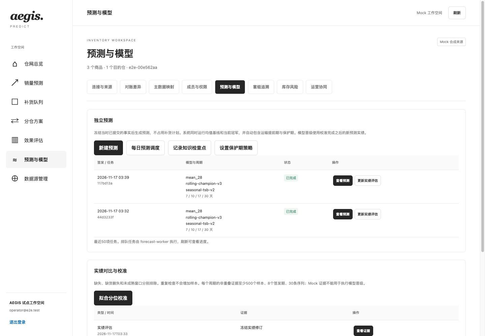
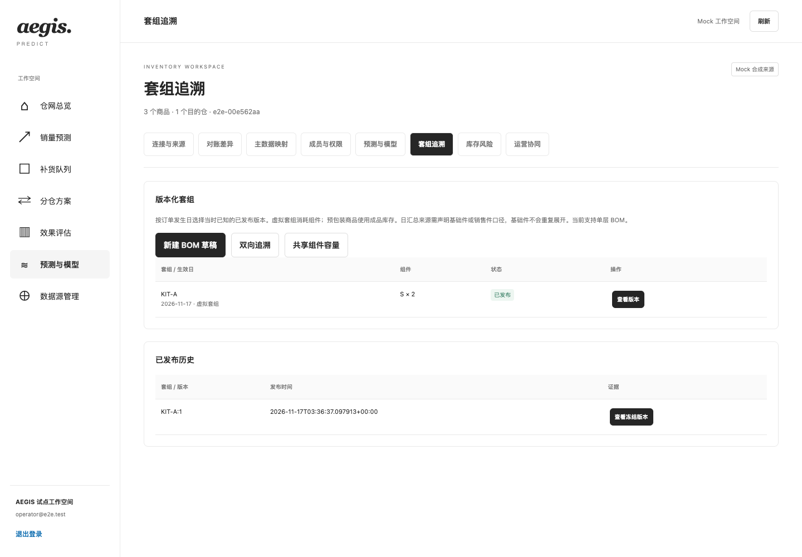
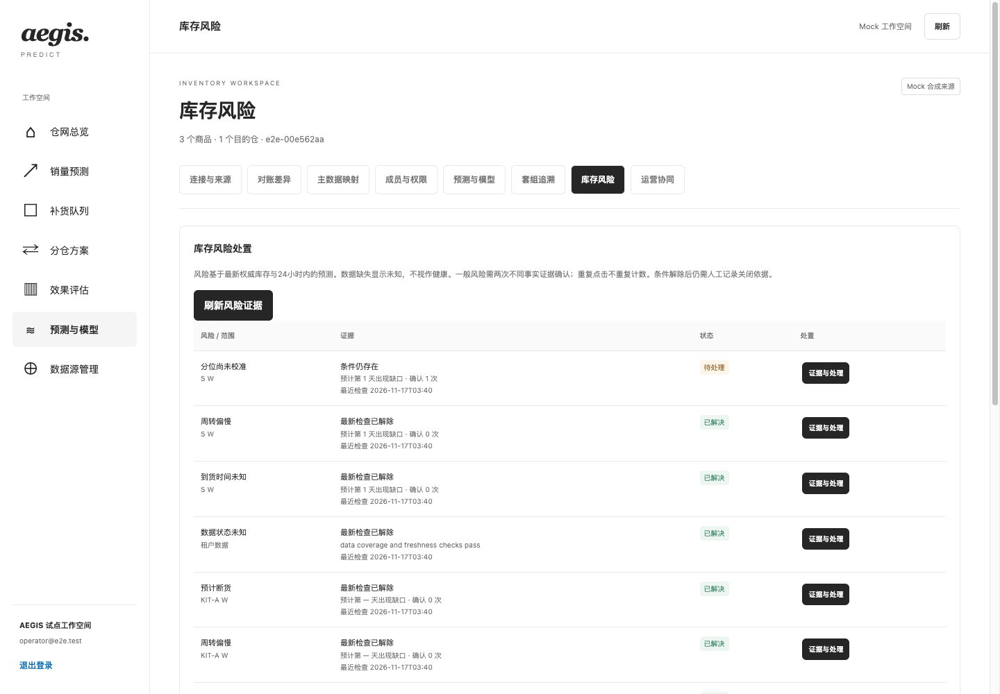
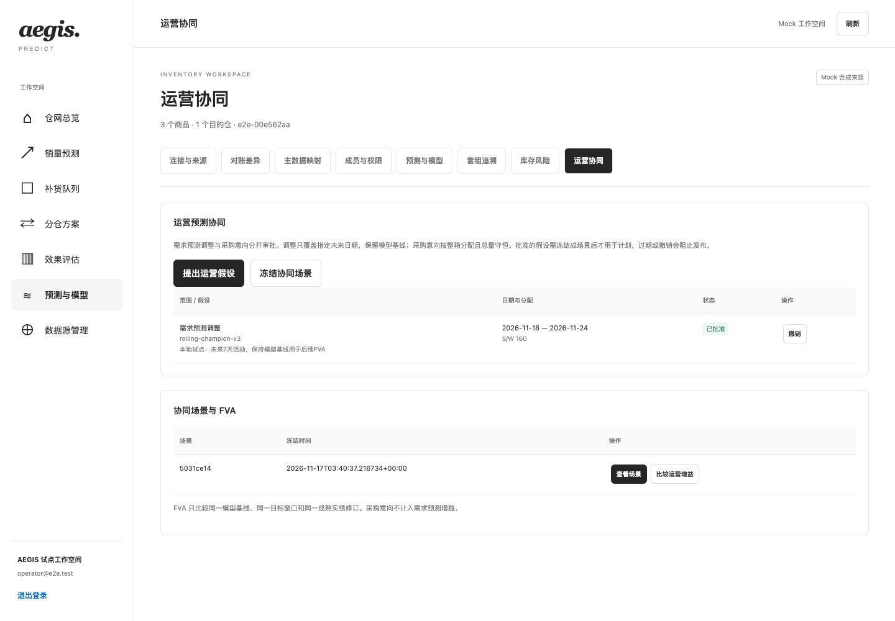

# v0.11：真实时点 ForecastOps、保护期规划与决策工作台

日期：2026-11-17。对应[开发方案](21-reference-project-assessment-and-delivery-plan.md)的 F01–F07，即本轮指定的 P0 与三项 P1。

本版本交付可以部署、通过 API 与页面操作、按证据复核的工程闭环。**真实商家模型效果尚未得到证明，新模型默认处于影子验证阶段。** 不把历史销量导入、合成测试或 Mock 授权误写成已积累历史知识、已完成真实模型晋级。

## 1. 交付范围与入口

| 工作包 | 实现 | 入口与证据 |
| --- | --- | --- |
| F01 真实时点 | 事实追加历史、服务器知识检查点、事务提交可见性、删除标记、历史来源与主数据回放、摘要校验 | `decision/history.py`；`0007_decision_operations`；输入证据 API |
| F02 独立预测评估 | 独立幂等队列、租约与栅栏、取消/过期重排、每日发行调度、成熟后自动评分、冻结实绩修订、配对基线 | 工作台「预测与模型」；`forecast-worker`、`scheduler` |
| F03 保护期一致性 | 一次选模后的每日轨迹，各运输方式独立的 `L`/`L+R`，到货时间轴、跨 SKU 共享运输选择与库存约束 | 新算法 `aegis-protection-v3`，原补货队列/分仓/销量预测页 |
| F04 校准与晋级 | 按累计周期拟合 P50/P80/P95 残差分位、保留原始分位的单调修正、校准后独立前向测试、运行可靠性、异人激活/回滚 | 「预测与模型」；不可变 calibration / promotion evidence |
| F05 套组与追溯 | BOM 草稿、异人发布、版本/生效日、销售件与基础件口径、事件日展开、正向/反向追溯、共享组件容量校验 | 「套组追溯」 |
| F06 库存风险 | 每日预计库存路径、到货未知/数据未知/未校准风险、证据去重、双证据确认、认领/调查/限时静默/有证据关闭 | 「库存风险」 |
| F07 运营协同 | 需求调整与采购意向分离、守恒分配、整箱可行性、异人审批、失效与撤销、不可变场景、同基线同实绩 FVA | 「运营协同」 |

所有页面复用现有 Google 登录、Cookie 会话、CSRF、租户 RLS、权限和审计。Amazon、TikTok 保留 Mock。地点受限成员继续被后端阻止访问租户级计划/聚合，避免只在前端隐藏数据。

## 2. 真实时点的定义

### 2.1 服务器可见性，而非业务时间倒填

`fact_revision` 由数据库触发器在规范化/业务修改的同一事务内追加，保存规范表、实体键、数据库事务 ID、服务器 `available_at`、操作和行版本。覆盖订单、需求观测、库存、PO、库存归属/关联/预占、SKU、地点、传统组件关系、映射、来源批准、连接状态、批次及其记录、市场修订、同步水位、固定建议和已发布 BOM。

检查点由数据库生成 `captured_at` 与 `pg_current_snapshot()`，客户端不能指定过去时间。历史选择先过滤可得性和提交可见性，再按实体取最新版本：

```sql
available_at <= checkpoint.captured_at
AND pg_visible_in_snapshot(transaction_id::xid8, checkpoint.pg_snapshot::pg_snapshot)
```

因此，在检查点之前开始但之后才提交的事务，不会因为较早的业务时间、事务开始时间或序列号混入过去。删除作为 tombstone 参与同样的选择。

迁移时的存量只建立**迁移当时才可知**的基线。系统定时保留服务器检查点，也可以在页面记录或由预测发行自动创建；没有检查点的部署前时间不能伪造回测起点。导入历史销量不自动获得历史库存、历史取消状态或历史映射。

### 2.2 与既有校验复用

回放在当前连接创建事务内临时类型投影，仅填充本租户、该检查点可见的历史事实，再调用既有来源权威、完整批次、渠道覆盖、缺失/缺货、PO 防重和预占校验。回放前后隔离 ORM 身份缓存，防止 Session 中已读取的今天对象覆盖过去投影；有未提交的规范数据修改时拒绝回放。临时表退出即删除，不修改生产投影。

输入产物冻结 network、策略、实体 ID、来源、水位、时区日历、事实修订引用、BOM 引用和到货日程，带 schema 与 SHA-256 摘要。证据表只追加，应用角色不能修改/删除；`fact_revision` 还禁止应用直接插入。连接历史采用字段白名单，不保存配置密钥、密文、令牌；raw 历史不复制原始 payload。

「数据准备情况」使用相同的历史读取器生成**不落库的当前可见性预览**，不在 GET 请求发行预测或修改知识检查点。

## 3. 独立发行与成熟评分

### 3.1 生命周期与运行隔离

```text
知识检查点 → 冻结输入 → queued → running → succeeded
                                   ├→ failed
                                   └→ cancelled
预测结果 → 等待目标窗结束/完整到数 → 冻结 actual revision → paired evaluation
```

`ForecastJob` 不创建 `PlanRun`，不占用业务计划的单活动槽位，不创建库存预占或外部采购/调拨单。队列以租户锁与幂等键避免并发重复：同键同请求返回原任务，同键不同请求返回 409。输入在排队前冻结。Worker 的 10 分钟租约、所有者与到期时间在写结果前再次核对；已取消或失去租约的 Worker 不能提交迟到结果。过期任务最多尝试三次。

每次任务强制包含 `mean_28`、策略版本和实际冠军；页面候选可选 v3/v4/v2。v4 仍要求明确 provider/platform，只读三时间过滤后的计划信号。缺少市场证据仍走已有 v3 回退。

新轨迹版本 `fixed-selection-daily-v1` 在最大请求周期选定模型一次，然后生成非负逐日预测并积分；市场回归保存其未来每日向量，季节模型保留星期变化。不是从 `forecast(30)/30` 外推任意周期。

### 3.2 每日调度与边界

策略支持：

```json
{
  "forecast_schedule_enabled": true,
  "forecast_schedule_hour_local": 8,
  "forecast_schedule_horizons": [7, 30],
  "forecast_schedule_models": ["rolling-champion-v3"]
}
```

默认关闭；页面「每日预测调度」保存新的策略版本。scheduler 按租户时区、策略 ID 和当地日期发行一次，只发行当前时点，不把补跑包装成过去签发。来源未就绪则本轮拒绝发行，下一轮扫描重试。策略版本变化是新的调度身份；同日人为连续创建策略版本应视为不同发行，统计支持仍按不重叠目标窗去重。

scheduler 每轮以 keyset 扫描最多 20 个活动租户策略，避免固定只扫描首批租户；实际延迟取决于租户数量和 worker 周期。每租户最多 4 个排队/运行任务。scheduler 还为活跃接入租户大约每 15 分钟保留一次检查点。

forecast-worker 无待计算任务时处理到期评分：目标窗结束后评分，并每日复核至最后目标窗结束后 30 天；更晚修订可在页面手动重新评估。队列繁忙时需扩容 forecast-worker，监控评分延迟。自动发行不跳过来源质量、Mock/真实隔离或执行审批。

### 3.3 标签和效果口径

- 训练只含检查点之前已完成的本地自然日；签发当天作为第一个预测日，可能包含已过去的当日部分。当前整日近似偏保守；尚未实现小时级截单预测。
- 标签窗口在目的仓本地日历完整结束后才成熟。所有批准渠道都要有完整覆盖；缺失与缺货删失单独排除，不能当零销量。
- 完整的零销量窗口参与评估；真实总量为零时 WAPE、bias 或基线改善比例返回不适用。
- 实绩从另一个检查点冻结。迟到取消、修订或删失产生新的 actual/evaluation；旧证据保留。最新不可用标签也会替代旧的可用标签，不能继续挑选过去的好成绩。
- v2 冠军保留当时冻结类目同伴的冷启动先验；v3/v4不接受无依据的同伴先验。候选、均值、冠军必须是同一预测发行、SKU/仓、周期、目标日期和实际值，才能进入晋级配对。
- MAE/WAPE/bias/分位覆盖与 pinball 由服务端计算；API 不接收用户自报实际值、残差、误差或晋级指标。

已有旧计划的离线回测继续是「冻结历史的回溯比较」，不会被改称真实历史知识回放。新保护期计划的效果页展示对应独立预测的成熟实绩证据；没有标签时明确等待。

## 4. 校准与模型晋级

校准采用租户范围、同模型与代码、相同目标口径的**累计需求有符号残差经验分位**，按每个 H 单独拟合。它是 pooled split-conformal 实现，不声称跨商品异方差、结构变化和运营干预下无条件满足理论覆盖保证。

校准与模型范围包括代码摘要、轨迹版本、预测周期集合、历史长度、市场 provider/platform、序列/时区集合、需求来源口径及已知 BOM 版本。新增 SKU、变化的 BOM 或来源口径需要新范围验证；不能悄悄继续使用旧校准。

每个周期先保证 `P50 ≤ P80 ≤ P95`；跨累计周期使用保守的累计最大包络。产物保留 `raw_quantiles`、是否修正及方法，评估使用实际提供给规划的修正后值，不把每日 P95 相加。

| 门槛 | 默认要求 |
| --- | --- |
| 校准支持 | 每个 H 至少 500 个不重叠样本、8 个签发日期、30 条 SKU/仓序列 |
| 独立测试支持 | 校准提交之后的新发行，目标日期晚于全部校准标签；每个 H 同样满足支持量 |
| 点预测改善 | MAE 比当前冠军至少改善 2%，相对 mean28 不退化 |
| 分组退化 | 目的仓 MAE 相对 mean28 不超过 2% 退化 |
| 聚合偏差 | 绝对 bias ≤ 10%，分母为零时不能假定达标 |
| P95 覆盖 | 独立测试覆盖在 92%–98% |
| 运行可靠性 | 同范围/代码/模型至少 8 个已完成任务，观察到的失败率 ≤ 0.1%；取消单独排除 |
| 来源与审批 | 测试输入不可过期、不可含 Mock；创建人与激活人为不同成员，激活时重新计算门槛与当前冠军 |

支持不足也可以保存校准，但状态为 `shadow_only_insufficient_support`，不能激活执行。门槛由服务端常量冻结在证据中，本次不开放随请求调低。重复评分、重复发行、重叠窗口不会增加独立样本量。

激活发布不会悄悄改写全租户策略。需要在保护期策略明确选择匹配的发布、模型、校准预测；回滚会使对应执行发布校验失败，操作员选择另一已验证版本或回到影子模式。没有凭合成数据激活任何新生产模型。

## 5. 保护期与时间分段优化

新算法通过策略显式选择，默认 v2 及旧 blob/数值路径保留：

```json
{
  "algorithm_version": "aegis-protection-v3",
  "forecast_model_version": "rolling-champion-v3",
  "forecast_result_id": "已完成预测的证据UUID",
  "forecast_scenario_id": null,
  "model_release_id": null,
  "protection_quantile": 0.95,
  "review_period_days": 7
}
```

没有匹配模型发布时可生成影子计划。该策略不会使未验证模型获得执行资格。

- 自动预测包含每条运输方案的 `L`、`L+R`，不够或超过 365 天直接拒绝，不截断后冒充完整覆盖。
- 优化器在每个目的仓选择一种本轮运输方式，各 SKU 共享该选择；这是首版调度假设，尚不支持同仓同轮多模式组合。每种方式有自己的目标库存、时间约束与缺货松弛，快线不会继承海运的最长保护期。
- 每日预计可用量：当前在库减 allocated/backorder，加截至当日**可证实**的到货，减逐日预测。期初不计尚未到货的全量在途。
- PO 与关联在途只计一次。无 ETA、过期 ETA、归属不明的在途保留 `unknown_inbound_units`，阻止新算法真实执行。
- 只有日期的 PO 按该日期结束后才可用；运输 `L` 日之后可用于第 `L+1` 日，避免在日历精度不足时提前消费库存。尚无节假日/截单/码头收货日历。
- 对「总量足够但到得晚」保留早期缺口；必要时允许保护期内到货前的桥接补货。缺口松弛有显式成本，不伪造现有库存或强行把不可满足计划宣布可行。
- 装箱、共享库存池、供应商配额/MOQ/预算、仓容、运输总配额和人工固定数量继续作为约束。没有校验通过的时序可行解时失败，不采用忽略硬约束的回退。
- 需求分位之外的 lane 提前期标准差作为单独披露的保守缓冲，不冒称联合履约概率已校准。规划成本是模型目标，不是实测利润。

发布执行时再检查模型发布是否有效、预测当地日期/时效、运营假设批准状态、BOM 是否变化、最新权威来源/对账、到货日程、仓容、供应商及运输能力，最后复用现有并发预占和实物执行/双端结算闭环。

## 6. P1 业务规则

### 6.1 套组 BOM 与双向追溯

BOM 草稿明确父商品、组件基础件数量、虚拟/预包装形态、生效日和依据。不同成员发布不可变版本；同父商品同生效日不允许覆盖。初版仅单层，嵌套、环及非法数量明确阻断。

订单事实在**发生地点本地日期**选择当时已知且已生效版本；后知 BOM 不写回更早知识检查点。每日汇总由来源批准声明 `base_units` / `sellable_units`：基础件不展开，销售件按事件日版本展开；订单流固定为销售件。虚拟父商品不得同时暴露物理父 SKU 库存，预包装商品使用独立成品库存。

正向查询返回组件和版本，反向查询返回被哪些套组使用。冻结库存容量查询显示单个套组理论上界，并对联合分配验证 `Σ 套组数量 × 组件数量 ≤ 可用组件`；独立理论上界不能相加。该查询不创建渠道库存发布或套组预占；最终补货仍在基础件/实物 SKU 上执行。多级制造 MRP、工单、损耗和生产能力不在本次销售套组范围内。

### 6.2 风险处置

规则 `inventory-risk-v1` 包括预计缺货、慢动销/过量、在途 ETA 未知、数据未知和未校准模型。数据/模型范围不一致时显示未知，不把新 SKU 或缺失预测跳过后视为健康。

普通风险要两次**不同事实证据**确认；重复点击同一预测/库存水位不增加确认次数。硬库存缺口、数据未知与不确定性等立即记录。每条风险保留证据键、确认数、条件、最近检查、负责人、状态和审计。

状态支持观察、待处理、认领、调查、解决、限时静默。条件仍存在不能关闭；清除证据超过两小时需重查；静默必须有理由且不超过 7 天。默认只在工作台和审计中记录，本次不向邮件/飞书/外部 webhook 发送新风险消息。

### 6.3 运营共识场景与 FVA

需求调整与采购意向分别保存，不直接改模型输出或库存。输入为未来日期、目标总量、明确的 SKU/仓及权重、失效时间和理由；不接受回溯创建场景来美化历史 FVA。

需求分配使用整数最大余数，保持总量；采购意向使用整箱 MILP 精确守恒，不可行直接拒绝。零权重组要求显式分配依据，不擅自均摊。

批准人与发起人必须不同，同类型重叠假设被阻止。场景冻结基线、批准版本和调整后的逐日轨迹，调整仅在指定日期内生效，绝不把 7 天运营量外推至 90 天。人工平移后的分位明确标为未校准；基线证据单独保留。

采购意向按各期限累计数量约束参与规划，发布时也不能通过驳回/调低计划行绕过，不能绕过优化器和补货审批自动变成采购单。撤销/过期会阻止再次冻结及执行发布。

FVA 只对同一基线预测和同一成熟实际修订比较误差，正值代表运营调整降低 MAE。采购意向不进入需求预测 FVA；没有成熟标签时显示等待，不能给出虚构增益。

## 7. 部署、操作与 API

### 7.1 升级与进程

先备份并在副本演练。`0007_decision_operations` 为规范表安装追加历史触发器并为存量建立当前基线；首次扫描和新增写放大会产生 WAL/磁盘成本，需要迁移窗口与容量评估。不要在生产随意 downgrade：会删除本版本的历史、证据和工作流。

```bash
aegis db upgrade
aegis db grant
# 分别作为常驻进程，配置与现有租户/数据库部署一致
aegis worker sync
aegis worker plan
aegis worker forecast
aegis worker scheduler
```

Compose 已加入 `forecast-worker`，CI 容器验证也检查其入口，并在两种架构实际执行新决策内核。复核命令：

```bash
python scripts/verify_container.py --image 你的镜像 --platform linux/arm64 --output /tmp/aegis-container.json
# 已有同镜像完整记录时，只补验决策内核（会核对镜像ID）
python scripts/verify_decision_container.py --image 你的镜像 --platform linux/arm64 --evidence /tmp/aegis-container.json
```

应用角色必须重新 grant，使 fact 历史直接插入与证据更新/删除被收回。部署默认 Google 登录、Amazon/TikTok Mock、执行与外部回写关闭，密钥仍从环境注入。

### 7.2 建议试点路径

1. 完成来源批准、数量口径、完整批次和独立源对账，至少建立两个不同成员（计划员/审批员）。
2. 在「套组追溯」发布需要的 BOM；没有套组的 SKU 不需要制造 BOM。
3. 在「预测与模型」发行独立预测，或启用每日调度；检查原始输入和事实水位。
4. 有需要时提出运营假设，另一成员审批后冻结场景；先用影子计划比较。
5. 选择保护期策略、预测证据及场景，回补货队列生成影子计划；核对目标、选定运输方式、早期缺口与库存限制。
6. 风险刷新后认领/处置；源问题先在来源修正并同步，再用新证据关闭。
7. 等未来标签实际成熟，形成校准集，再等待校准之后的独立前向测试。通过门槛后由另一成员激活并显式选择执行策略。
8. 真实账户接入、对账/UAT、恢复/容量验证完成后，再评估开启执行。工程测试不能替代这些证据。

### 7.3 主要新增端点

统一前缀 `/api/v1/decision`，沿用现有会话与 CSRF；请求不接收 tenant_id。

| 接口 | 用途 |
| --- | --- |
| `GET /summary`、`GET /artifacts/{id}` | 有界任务/工作流/证据清单、摘要校验后的完整证据 |
| `POST /checkpoints` | 服务器生成知识检查点 |
| `POST /forecasts`、`GET /forecasts/{id}`、`POST /forecasts/{id}/cancel` | 独立任务、幂等、取消 |
| `POST /results/{id}/evaluate` | 当前或指定已记录真值检查点的成熟评分 |
| `POST /calibrations`、`POST /releases` | 服务端校准、晋级检查 |
| `POST /releases/{id}/activate`、`/rollback` | 异人激活与回滚 |
| `POST /boms`、`POST /boms/{id}/publish` | 套组草稿与发布 |
| `GET /boms/trace`、`POST /boms/capacity` | 双向追溯、共享组件验证 |
| `POST /overrides`、`POST /overrides/{id}/{approve,reject,revoke}` | 运营假设与批准版本 |
| `POST /scenarios`、`POST /scenarios/{id}/fva` | 冻结场景与同窗口增益 |
| `POST /risks/refresh`、`POST /risks/{id}/{acknowledge,investigate,resolve,suppress}` | 风险观察与处置 |

工作流修改要求 `expected_revision` 和理由，旧版本返回 409。创建/审批/风险/模型分别拥有动作权限；VIEWER 只有读取，PLANNER 不能代替 APPROVER 批准，TENANT_ADMIN 也不能批准自己发起的发布。

## 8. 验证记录与已知边界

交付验证：完整回归 **180项通过、0失败、0跳过**（原159项，新增21项；1项既有 Starlette/httpx 弃用警告），耗时45.59秒。其后追加的存量订单来源升级案例复核通过。测试使用一次性 PostgreSQL 与合成数据，绝不计入真实模型上线证据。

| 验证 | 证据 |
| --- | --- |
| 完整 Python/数据库回归 | [180项测试记录](verification/p0p1-tests.json)；新模块 F/I 静态检查、JS语法与compileall通过 |
| 迁移 | 从空库升级、元数据无漂移、全部租户表 RLS、降至 0002/base 再升级 |
| 真实时点 | 并发未提交事务排除、ORM 今天缓存排除、晚到需求/取消不改变旧检查点、服务器不可倒填、追加表权限 |
| 算法 | 市场未来修订扰动不改变既有轨迹、7 天促销不外推、运输方式分别计算保护期、到货前缺口、整数/整箱守恒、非重叠支持、分位修正留痕 |
| 标签与晋级 | 零销量不删除、缺货删失排除、修订标签替代、支持不足/Mock/失败率阻止激活、正向门槛控制样例；正向样例是单元测试，不是实际发布 |
| API/工作流 | 租户越权、CSRF、幂等冲突、取消栅栏、异人审批、BOM 展开/容量、场景限定日期、风险确认/关闭/CAS |
| 浏览器 | [端到端记录](verification/p0p1-browser.json)；Google Mock 完整登录、两人 BOM/运营假设审批、场景冻结、风险刷新、新保护期影子计划、原预测/效果页；1440 桌面与390手机截图 |
| Linux | [ARM64运行记录](verification/p0p1-linux-arm64.json)、[AMD64运行记录](verification/p0p1-linux-amd64.json)：迁移、健康、UID10001、只读根、wheel摘要、市场拟合/回测、新保护期MILP和整箱/分位检查均通过；两架构source_tree_digest一致 |

首版工程限制：

- 单任务至多 200 条 SKU/仓序列、最多 24 个自动合并周期、365 天上限，总预测点预算 300,000；临时历史投影总行数最多 250,000；校准/晋级先在数据库选择每次发行最新实绩，流式读取后限制为最多1,000,000条标签。大范围校准应预留至少4GiB内存并先做容量验证。超限明确拒绝，不能称作已完成大卖家容量验收。
- 当前归档为行级 JSONB 证据与原始引用，未完成按时间分区、冷存储/保留策略和百万级事实重放压测。生产迁移先测磁盘、WAL、恢复与批量导入成本。
- 连接工作进程沿用现有 owner 领取/应用角色执行业务的部署结构；更细的独立数据库 Worker 角色和企业密钥治理仍需按部署安全要求实施。
- 一次日历日预测、日期级 ETA；复杂收货日历、小时级补货、多模式同仓混装、多级 BOM/MRP、通用版本层级及批次/效期仍在后续范围。
- 反向追溯首版默认以检查点 UTC 日期展示关系；订单展开以地点本地日为准。跨时区临界时刻审计请同时核对版本有效日与事件地点。
- 存量认证历史的批量认证导入、退款/退货独立事实、源端订单行集合删除语义、长期经营 FVA 尚需源契约与后续数据。
- 默认观测失败率和经验覆盖是所收集数据的统计量，不是未来 SLA 或服务概率承诺。真实账户授权、源清单可信度、长稳、灾备、租户配额/公平性及真实收益均需试点验收。

## 9. 页面截图

以下均为本地 Google Mock 与合成数据，未伪造成熟销量或晋级成功。








