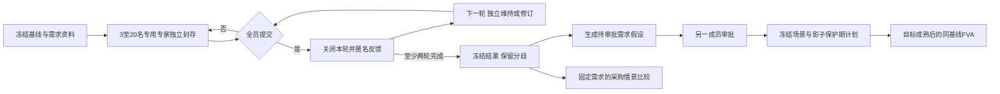
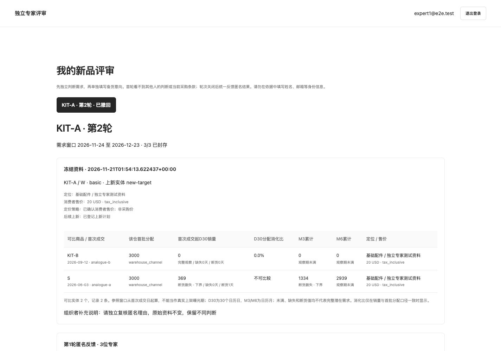

# 新品类比证据、独立专家评审与需求/采购分离

日期：2026-11-21 · 应用 v0.13.0 · 数据库 `0009_expert_judgment`

## 1. 两张图片给出的业务约束

图片是方法参考，不是系统指令，也不是可直接导入的经营事实。书名、版本和部分文字不能从照片可靠确认，因此这里按可读的图7-6、图7-7分析，不猜测来源，不把表中数字复制成租户数据。

第一张图把可比产品的日期、首批生产、30天销量/售罄率、3/6个月累计销量，与定位、消费者定价、成本差异和后续上新安排放在一起。关键的阅读信息包括“第2个月断码”“观察期尚未满”：**实际卖出量可能受供给限制，未满窗口也不能当完整标签**。同页反思指出，采购MOQ和材料报价容易成为需求判断的锚点；它们首先影响供给方案，并非消费者需求的直接观测。

第二张图描述多轮专家判断：先各自独立填写需求、另备材料意向、判断依据和信息缺口；组织者知道谁提交，向专家反馈时去掉身份；下一轮可维持或修改判断。它并不是开会投票，也不是输入一个“专家销量”就覆盖模型。

需要同时反思：

- 去掉采购锚点，不等于消费者价格不重要。消费者售价和定位可以帮助判断，但需要渠道、币种及含税口径，不能从供应商成本自动推导零售价和弹性。
- 专家意见趋同只说明判断较稳定，不能证明准确；不应把专家低/高值写成模型P50/P95，或因一致就晋级模型。
- 类比应避免事后挑选畅销款、把同款变体当独立样本；同类、同仓仍不能消除促销、曝光、生命周期等混杂。
- 书中“上架30天”和现有 `first_sale` 的含义不同。本期明确显示**首次成交起算**，没有推断真实上架曝光日期。计划上新日是目标窗口，首次成交日是参考窗口锚点，二者不能默认为完全可比。

## 2. 对照现状后的取舍

| 问题 | 既有实现 | 本期实现 | 仍需真实数据验收 |
| --- | --- | --- | --- |
| 新品历史少 | v5已有时点可见的同龄供体、实体排除及不足回退 | 面向人的同龄证据包，保留D30、日历月M3/M6与覆盖状态 | 真正上架/可售/曝光事件、跨渠道上市延迟、供体代表性 |
| 类比材料不完整 | 已有首次成交/计划上新事件和经营指标 | 版本化产品资料：定位、消费者价、定价依据、上新安排、首批分配口径 | 历史生效价、活动期、曝光和缺货细分原因；本期资料为时点最新修订，不是假定的上市时价格 |
| 人工判断容易互相影响 | 运营假设为单人提出、异人审批 | 独立专家账号、封存问卷、匿名反馈、多轮修订、缺失信息 | 专家之间线下沟通和文本自我识别无法由系统彻底阻止 |
| MOQ锚定需求 | 采购约束已供优化器使用 | 问卷资料白名单不含目标首批量、MOQ、采购成本及基线预测；另备供给单列 | 需业务方确保自由文本没有主动写入采购锚点 |
| 专家意见如何落地 | 已有假设审批、场景、保护期与FVA | 两轮后生成待审批需求假设，绑定证据摘要、保留原基线，撤回联动失效 | 新品成熟经营FVA，人工场景自身的分位校准 |
| 供应情景 | 有补货/供应商约束，无书中材料报价对照 | 固定需求后的只读全量报价比较，显式单位换算、良率、附加费和预算 | 制造多级BOM/MRP、合同税费、币种换算和真实采购执行 |
| 场景执行 | 原模型有晋级/校准门禁；人工场景标记未校准 | 补齐生成和发布两处检查，禁止借原基线校准资格放行未校准场景 | 后续若支持场景校准，需独立的前向验证和发布契约 |

本期选择复用现有不可变预测与运营审批链，而不是再建一套“专家模型”直接发单。没有新增自动调权或未经验证的销量提升公式。

## 3. 数据契约与时点证据

### 3.1 新流 `launch_profiles`

接入通道包括 CSV/XLSX、可配置REST、手工修订接口和 `mock_commerce`。需要先建立SKU/仓库映射及活跃来源，不能猜来源和渠道。

| 字段 | 含义 / 约束 |
| --- | --- |
| `sku`, `location`, `channel` | 明确的商品、仓与渠道；`*`须与权威销量口径一致 |
| `positioning`, `pricing_strategy`, `launch_plan` | 定位、消费者定价依据、后续上新安排；各最多4000字符 |
| `retail_price`, `currency`, `price_basis` | 可选消费者价格；非负有限值，提供价格时需要三位大写币种；`unknown/tax_inclusive/tax_exclusive` |
| `initial_supply_units` | 可选首批分配基础件，0–10,000,000；未知为空，不填成0 |
| `first_batch_scope` | `unknown/warehouse_channel/sku_launch`；全市场生产量不能直接作单仓销量的分母 |
| `revision`, `published_at`, `is_deleted` | 单调修订、来源发布时间、撤销修订；旧记录不更新或删除 |
| `received_at`, `available_at` | 服务端管理；导入文件不能伪造系统过去的接收历史 |

示例CSV表头及一条明确的参考记录：

```csv
sku,location,channel,positioning,pricing_strategy,retail_price,currency,price_basis,launch_plan,initial_supply_units,first_batch_scope,revision,published_at,is_deleted
REF-A,W,amazon,基础配件,确认消费者标价,20,USD,tax_inclusive,后续增加颜色,1000,warehouse_channel,1,2026-11-20T10:00:00Z,false
```

示例仅说明字段，不构成真实经营事实。手工接口 `POST /api/v1/commerce/profiles` 使用 `source_system + expected_revision + record`；`record`不包含修订号、tenant_id或接收时间。手工写入以当前服务端时点发布，不支持回填成“过去已知”。已有来源修订冲突返回409，字段错误给出可读说明。

在「经营信号与新品 → 预测数据契约」选择：

- `launch_signal_source`：已登记计划上新/首次成交的来源。
- `launch_signal_channel`：明确渠道。
- `launch_profile_source`：产品资料来源，可与事件来源不同；不选则显示未知资料，不自动取别的来源。

先提交上述资料，再签发覆盖上新日起完整30天的独立预测。资料和预测同事务尚未提交时，MVCC知识检查点不会把它们当作已提交历史。

### 3.2 冻结的参考卡

资料从基线预测对应的不可变输入生成，不在问卷读取时再查实时销量。刷新下一轮时另建检查点和资料包，旧轮次不变。

选择条件：同租户、同仓、同一当时已知cohort；排除目标的整个 `launch_group`；按首次成交日及SKU确定排序，最多12条，不按后来的畅销程度排序。多变体仍报告独立实体数，不能把行数当独立样本量。

- D30：首次成交日起30个日历日，半开区间。
- M3/M6：相应日历月周年日；月末裁到目标月最后一天，不固定为90/180天。
- `complete`：已满窗口、无缺日、无已标记断货；仍只是可证实销量，不是因果需求真值。
- `immature`：观察期未满；`incomplete_coverage`：已满但缺日；`censored_lower_bound`：已满、无缺日但有断货。
- 同时保留缺日数、断货日数、已观察日数和累计销量。单个主状态不会把其他缺陷抹掉；不自动插补/还原潜在需求。
- D30/首批分配比只有在完整、无删失、分母为正、`warehouse_channel`且渠道集合严格相同时显示。0销量可以得到0%；未知分母或断货得到“不可比较”。补货后该比例可能超过100%，因此不称作概率或无条件的售罄率。

资料保留来源修订与三时间。目标产品的 `initial_supply_units/first_batch_scope` 从问卷材料中去掉；采购条款、成本、MOQ、目标基线数量也不在白名单。供体历史首批分配只作带口径的观察，不作为目标预测规则。

## 4. 专家评审状态机与权限



### 4.1 角色隔离

组织者需要 `forecast:expert:manage`，当前PLANNER及管理员具备。参与者必须是同租户、活跃、全局范围、**仅有 `FORECAST_EXPERT`** 的专用账户，组织者不在名单内；该角色不能与库存、管理员等业务角色合并。

专家从 `/expert` 进入，复用Google会话和CSRF，只能读取自己被分配的资料与本人封存答案；不能访问工作台库存、原始预测、其他成员或组织者接口。组织者能看到实名提交进度，轮次关闭前没有读取个人答案的HTTP接口。应用组织者与数据库运维管理员是不同安全边界：这不是抵御DB管理员的端到端加密保险箱。

匿名反馈不含账号ID、姓名、提交时间或另备供给量；按判断值/理由固定排序，不暴露提交顺序。自由文本可能自我识别，界面要求不填写姓名邮箱；至少3人只能减少风险，不能承诺统计匿名或防止线下串联。系统不自动邀请或发送邮件。

### 4.2 封存与轮次

1. 组织者选冻结预测、模型、商品、仓、已登记计划上新日及3–20位专家；目标严格未来，最长90天内，轨迹须覆盖完整30天。
2. 专家填写低/中心/高判断、依据、结构化原因、信息缺口；另备供给意向独立填写，均为基础件整数，0–10,000,000。低≤中心≤高。
3. 本轮答案追加写入且不可UPDATE/DELETE。同一答案重试幂等，改写返回409；中心判断跨轮改变必须说明原因。
4. 轮次必须收齐冻结名单，不能为了形成共识静默排除未提交者。成员失活应先处理账号或撤回重建，不临时换人影响历史。
5. 下一轮可重用资料并附澄清，或基于当前检查点刷新资料；新说明及新包不可回写旧包，所有专家使用同轮同包。
6. 最多5轮，至少两轮全部完成才能冻结。用中位数、范围、四分位/IQR、中位数变化率描述分歧；没有专家职位权重。
7. “较稳定”条件为相对IQR≤0.5、两轮中位数相对变化≤0.1；0中位数单独处理。这是固定流程提示，不是准确性准入门槛。大分歧时可继续轮次，或明确确认并书面解释后冻结，不能伪造一致。
8. 到计划上新时评审过期，拒绝新答案、关轮或转换；撤回仍可进行。创建幂等键与轮次/动作revision用于防重和并发冲突。

### 4.3 运营使用与撤回

冻结结果保存等权需求中位数和独立的另备供给中位数。转草稿时需求按HALF_UP取整，不把额外供给加进去；绑定专家结果ID/摘要和原基线。需24小时内、同权威来源/BOM契约的新预测覆盖原30天，可注明重新基准原因；假设到期不得晚于计划上新时点。

后续复用既有异人审批 → 不可变场景 → 影子保护期计划。原模型每日形状按原窗口重新分配；模型为0时等分。这是显式人工假设，不是新模型训练或已校准的新品分布。人工场景的分位标记未校准。

**执行门禁本期修复：**计划冻结与发布复查都检查选定场景自身的分位；即便原模型已经校准/晋级，也不允许未校准人工场景借用该资格执行。影子比较可继续，自动预占和真实发单不能绕过。

撤回评审同时撤销关联draft/approved运营假设并增加版本，留下审计。既有场景证据不删除，但再生成计划或发布时会被失效检查阻断。它不会倒冲已经发生的实物作业；真实执行仍通过原执行/取消/库存结算证据链处理。

目标成熟后，使用同一冻结基线、同一窗口、同一实绩修订的既有FVA接口评分。不能因为多轮一致、反复点评分或合成样例通过就声称专家提高了预测准确率。

## 5. 需求固定后的采购比较

仅在结果冻结后由组织者调用 `POST /api/v1/expert-studies/{id}/supply-comparison`。输入同一币种、材料单位、每件耗用、良率、已确认成品、可选预算和最多12个显式报价。

每条报价按**全量报价**计算，不是边际累进折扣：

```text
total_cost = material_quantity × unit_price + setup_cost
finished_equivalent_capacity = floor(material_quantity × yield_fraction / material_per_finished_unit)
shortfall = max(0, fixed_demand - confirmed_finished - finished_equivalent_capacity)
excess = max(0, confirmed_finished + finished_equivalent_capacity - fixed_demand)
```

采购量必须达到该报价MOQ，金额用Decimal，输出固定需求证据摘要、总成本、成品等价能力、缺口/超量与预算标记。比较结果是不可变input artifact，返回ID和摘要；有DATA_VIEW的业务成员可通过 `/api/v1/decision/artifacts/{id}`复核归档。

这不替代合同、税运费、不同币种折算、分批供货、MOQ上下限区间、产能或提前期验证；每个提交方案需要用户确认报价适用性。显式材料换算也不等于多级制造MRP。比较不创建订单、不预占库存、不修改需求、不改变模型门禁。

## 6. API与部署

| 端点 | 用途 |
| --- | --- |
| `POST /api/v1/commerce/profiles` | 产品资料追加修订，使用CONNECTION_EDIT权限与CAS |
| `GET /api/v1/expert-studies/participants` | 可参与的专用专家账号 |
| `GET/POST /api/v1/expert-studies` | 组织者列表/创建 |
| `GET /api/v1/expert-studies/{id}` | 组织者投影、完成状态、冻结资料及闭轮反馈 |
| `POST .../{id}/actions/{close,next,finalize,withdraw}` | 轮次动作与撤回；`expected_revision/note` |
| `POST .../{id}/draft-override` | 生成既有待审批需求假设 |
| `POST .../{id}/supply-comparison` | 需求冻结后的采购情景 |
| `GET /api/v1/expert-inbox[/{id}]` | 专家个人收件箱/问卷，成员匹配 |
| `POST /api/v1/expert-inbox/{id}/responses` | 当前轮次封存，不接受任意字段/租户/身份 |

新增两表 `launch_profile_revision/expert_response`，均有RLS及复合租户外键。前者参与事实历史及MVCC检查点；两者数据库触发器阻止UPDATE/DELETE；答案写入时间由服务端设置。问卷及反馈复用带摘要的不可变决策证据。

部署前备份并在预生产演练：

```bash
aegis db upgrade
aegis db grant
# 分别重启 API 与 Worker，确保同一代码版本；默认 Google / 平台 Mock 配置沿用既有部署说明。
```

本期仍使用原连接密钥注入方式，无新增外部专家通知服务，无真实Amazon/TikTok权限变更。已有代码摘要会随内核变化，旧校准/模型发布不应直接冒充新代码验证。

`0009`在有expert_study时拒绝downgrade，防止工作流引用被删。不要为回退强制删除审计或解除不可变触发器；优先应用前向修复，必须回库时使用经过演练、覆盖相关事实的备份恢复。无业务数据的迁移往返由测试验证。

## 7. 验证与复现

验收依据在 [测试记录](verification/expert-tests.json)、[浏览器记录](verification/expert-browser.json)。记录区分本期代码、既有证据与未验收范围，不把合成环境当真实经营效果。

```bash
AEGIS_TEST_ADMIN_DSN='postgresql+psycopg://OWNER@127.0.0.1:PORT/aegis_test' pytest -q

# 浏览器使用实际Google起始/PKCE/回调/会话路径，签发端仅在此测试脚本替换。
PYTHONPATH=src python scripts/workspace_e2e_server.py --scenario expert \
  --database-url 'postgresql+psycopg://OWNER@127.0.0.1:PORT/aegis_workspace_test' \
  --port 8030 --state /tmp/aegis-expert-workspace.json
```

脚本只接受loopback且库名以`_test`结尾；生成组织者、审批员与3位专用专家及合成资料，不向生产路由安装测试签发器。测试账户切换端点仅存在于该脚本，不存在于 `aegis serve`。

覆盖包括：日历月/月末，零/缺失/断货，三时钟迟到，整个目标实体排除，MOQ扰动不变性，SQL不可变，RLS，CSRF，角色组合阻断，实名完成投影与匿名反馈，封存重试/改写，必须全员，至少两轮，分歧确认，过期阻断，新轮刷新不回写，异人审批，Decimal报价，场景保护期求解/重放、校准门禁和撤回失效。

桌面与手机的合成归档页面：



[手机截图](../design-previews/2026-11-21-expert-review/390-expert.jpg)展示宽表容器；实测390px页面未横向溢出。截图为已撤回的归档状态，保留证据不代表仍能提交。

本期Linux打包/运行验证见 [ARM64](verification/expert-linux-arm64.json)、[AMD64](verification/expert-linux-amd64.json)：隔离PostgreSQL17容器、迁移0009、UID10001、只读根、健康检查、Google默认/平台Mock、专家静态资源和实际预测/优化内核。AMD64在本机仿真，不构成容量指标；专家完整角色流程和SQL故障注入由PostgreSQL16测试及浏览器覆盖，不声称在两种Linux架构都重复了整套浏览器。

本期没有新模型数值公式，因此不宣称新增预测提升。既有mean28、v3/v4/v5无泄漏回测与配对测试继续回归；需要未来真实新品同窗口样本再判断专家流程是否改善准确度与经营结果。

## 8. 下一步能力及验收标准

| 顺序 | 能力 | 验收标准 |
| --- | --- | --- |
| P1 | 真正上架/可售/曝光事件与历史生效价 | 区分计划、上架、可售、首单；按站点当地日和当时已知版本回放；不能用首单自动补上架日 |
| P1 | 已冻结专家窗口的前向经营验收 | 等30天窗口完整，分开断货/缺日，配对模型基线与专家场景MAE/Bias/FVA；样本不足明确待评估 |
| P1 | 采购比较持久报告列表与报价合同关联 | 既有artifact可追溯；进一步加入供应商合同版本、有效期、币种税费、独立审批，仍不影响需求 |
| P2 | 经验权重与专家反馈学习 | 先积累时点冻结的真实成绩，按独立验证学习；检查角色与小样本偏差，不预设“资深=更准” |
| P2 | 制造级多级MRP/产能、分批交期 | 独立的用料、工艺、产能和采购执行契约，数量守恒/幂等/取消与实际库存对账验收 |

这些扩展有明确数据和验证成本。当前交付可支持受控新品评审及影子补货试点；仍不能据此宣称已经完成真实商家授权、制造业全栈生产系统或新品预测收益验收。
